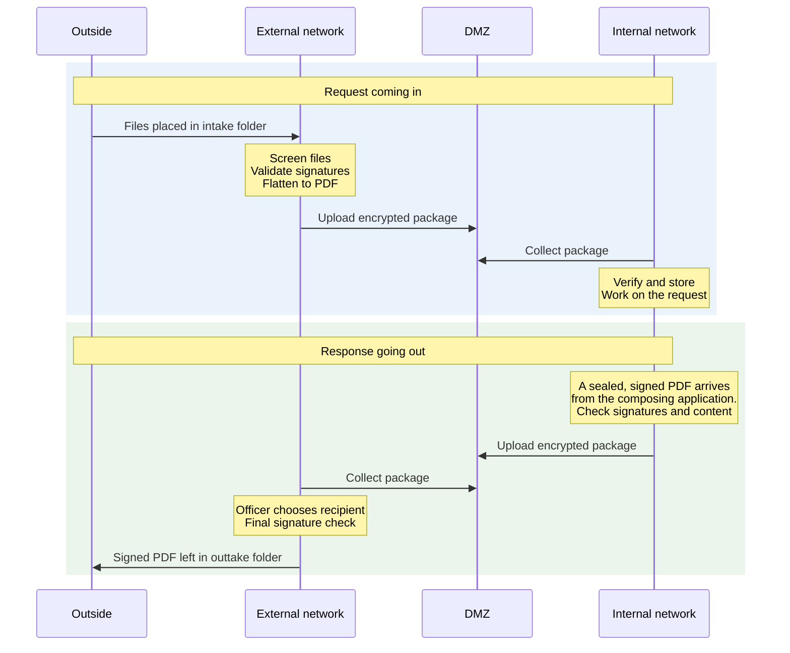
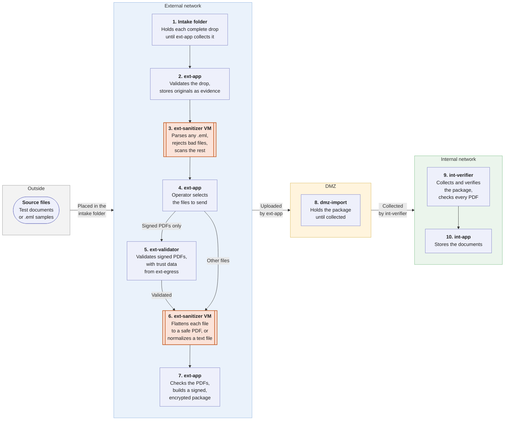
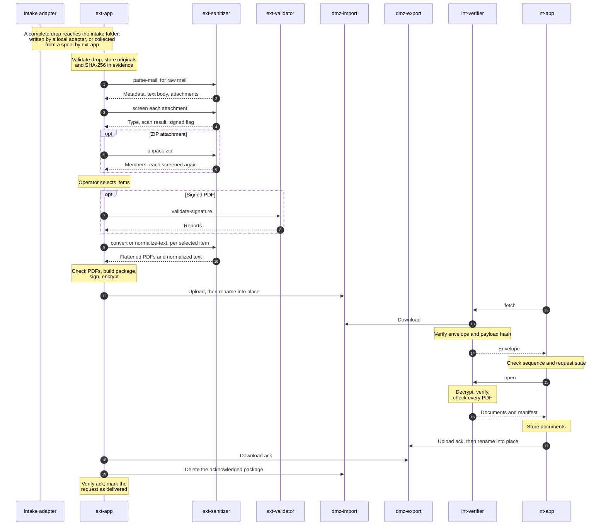
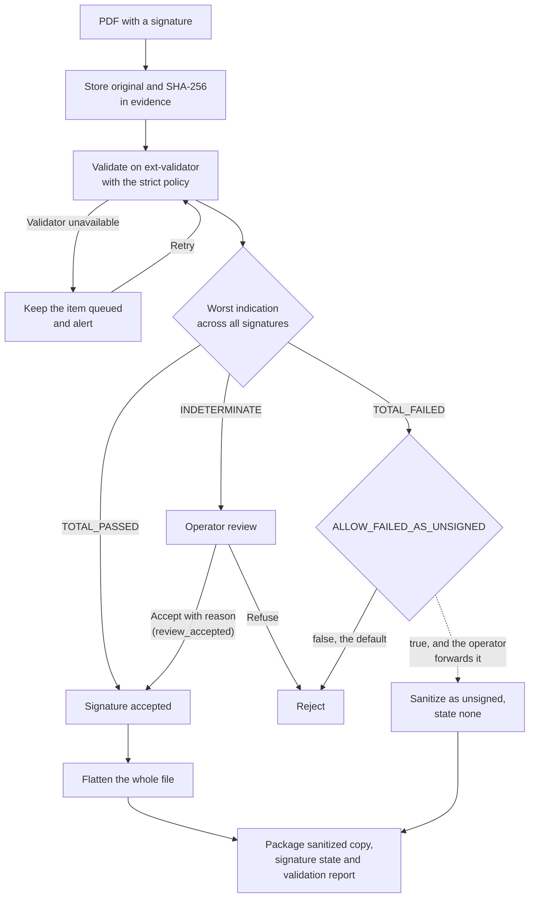
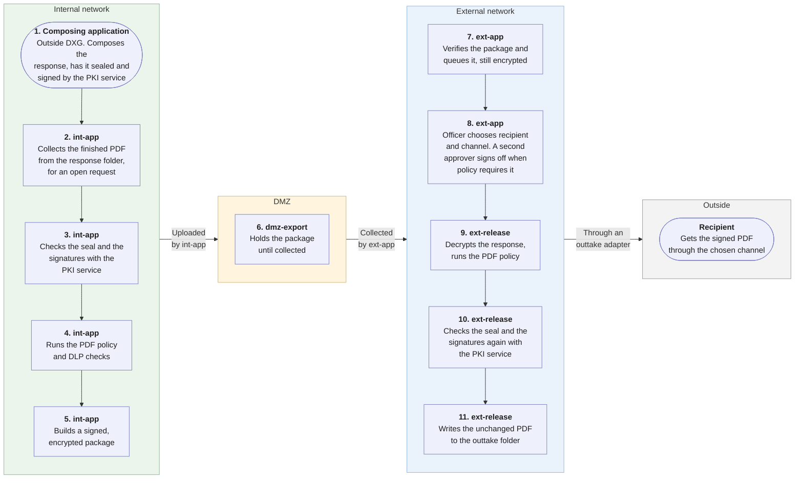
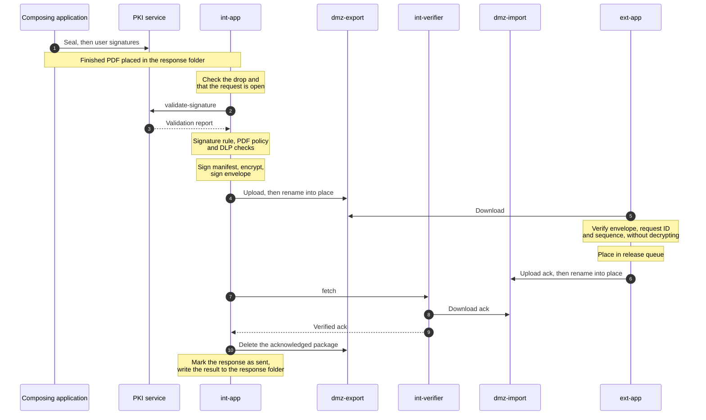
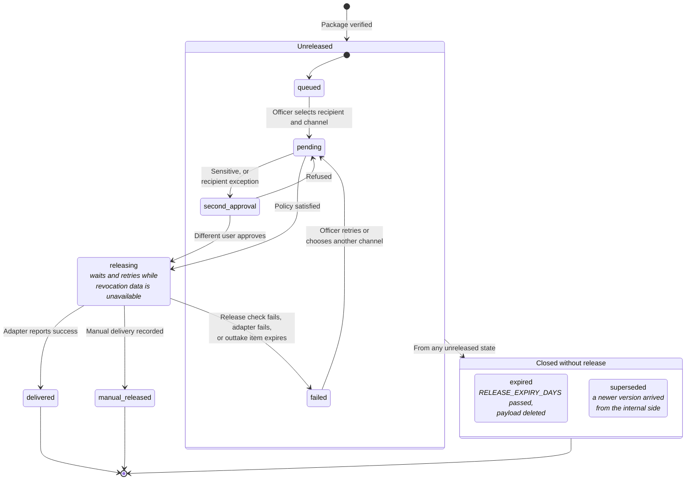
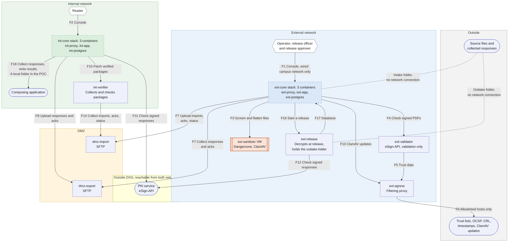

# Document Exchange Between the External and Internal Networks

**POC/MVP technical documentation for the self-hosted pipeline**

|  |  |
| --- | --- |
| Status | Draft for POC implementation |
| Date | 2026-11-04 |
| Working name | DXG (Document Exchange Gateway) |
| Audience | Developers, infrastructure engineers, security reviewers |

Sections 1 to 4 explain what DXG must do, how it works and what each part is. Sections 5 to 12 hold the detailed design. The appendices hold settings, interfaces and deployment details, and link to the code and configuration files kept next to this document in `checks/`, `scripts/`, `sql/`, `schemas/`, `examples/`, `poc/` and `deploy/`.

Two other documents belong with this one:

- The [proposal](document-exchange-proposal.md) is a short overview for decision makers.
- The [passthrough design](document-exchange-signed-pdf-passthrough.md) describes one optional feature that is disabled by default.

## 1. Overview

### 1.1 Purpose

DXG moves documents from mail requests received on the internet-connected external network to the internal network (intranet). It then returns a response created on the internal network to the external network, where an authorized user decides how and where to send it.

The design has six rules. The [proposal](document-exchange-proposal.md) lists the same six, with the same numbers.

1. **Nothing from the internet reaches the internal network unchanged.** Documents are flattened to PDF. Only signed manifests, reports and normalized text accompany them.
2. **Nothing connects into the internal network.** The internal network never connects to the internet or directly to the external network. The one accepted exception is the shared PKI service (section 3.4). The two networks exchange signed, encrypted packages through a DMZ, and the internal network opens all connections on its side.
3. **Untrusted files are opened only in disposable isolation.** A VM with no keys and no outbound network opens them. It is restored from a clean snapshot daily.
4. **Packages cannot be read or forged in transit.** The sender signs each package and encrypts it for the receiver. Each direction has its own DMZ host, account and keys.
5. **People decide, the system enforces.** An operator selects what enters. The internal side decides the content of a response, and its users approve it by signing. A user on the external side chooses the recipient and channel.
6. **Every step is traceable.** Both sides record every decision against the request ID in a hash-chained audit log.

Section 2.2 turns these rules into security requirements. Section 3.6 defines one optional exception to rule 1 for incoming signed PDFs. It is disabled by default and needs a written risk acceptance.

### 1.2 Scope

| In scope | Out of scope for the MVP |
| --- | --- |
| A general adapter interface at the intake and outtake folders (section 5.2), with three adapters: folder drop, manual collection and mail | Other adapters, such as an upload portal, an SFTP drop or an HTTP API. The interface allows them, and the MVP does not build them |
| File allowlist, type detection, ClamAV screening | Commercial CDR |
| Sanitization to flattened PDF with Dangerzone | Editable Office output on the internal network |
| TXT normalization and safe ZIP unpacking | RAR, 7z and other archive formats |
| PAdES validation of incoming PDFs with the organisation's eSign-API, which builds on EU DSS | Validation of `.p7m`, `.p7s` and ASiC files |
| Evidence store for originals on the external network | Long-term archival preservation |
| Signed and encrypted packages in both directions | Hardware diode (kept as an upgrade path, section 11.2) |
| Carrying finished, signed PDF responses out, with signature, content and DLP checks | Composing, approving and signing a response. That happens in the composing application, through the PKI service. Also out of scope: passthrough of incoming signed PDFs, designed but disabled (section 3.6) |
| Release console on the external network, with delivery through the outtake folder | Recipient encryption and secure download portal |
| Audit trail linked to a request ID | High availability |

### 1.3 Assumptions

- The internal network is not classified or formally accredited. If it is, the accrediting authority decides the architecture before implementation starts.
- PDF output is acceptable for documents that arrive as Word or Excel files.
- Volume is low to medium. This must be measured during the POC (section 10.6).
- The organization can run an internal CA, or issue the certificates in section 4.4.
- Responses are composed in another internal application and signed through the organisation's PKI service: the server seal first, then one or more user signatures. The seal, the signatures and the timestamp are all qualified.
- One instance of the PKI service is reachable from both networks. The organisation accepts this as an exception to rule 2 (section 6.2).
- The POC uses test data only, on one Docker host.
- For the MVP, network teams can enforce the flow matrix in section 5.1 at a firewall that neither network administers.

### 1.4 Terms

**Networks and hosts**

| Term | Meaning |
| --- | --- |
| External network, external side | The internet-connected network that holds the mailbox, and the DXG components on it |
| Internal network, internal side | The network with no internet access, and the DXG components on it |
| DMZ | A separate network zone between the two networks. It holds only packages |
| `ext-app`, `int-app` | The web application on each side. This document names the application when it describes work, such as building a package |
| `ext-core`, `int-core` | The stack, and in the MVP the VM, that runs the application with its database. This document names the stack when it describes a host, such as in the flow matrix |
| Container | A long-running Docker container, started from a pinned image |
| Stack | A group of containers that work together, such as `ext-core` |
| Sandbox | A short-lived container created for one document. Dangerzone starts these inside its VM |
| VM | A separate virtual machine, used for the sanitizer in the POC and for everything in the MVP. The MVP may use a physical server instead |
| POC, MVP | Proof of concept on test data, and the minimum viable product for real use |

**Documents and their path**

| Term | Meaning |
| --- | --- |
| Request | One submission received through an intake adapter, such as an email with its attachments, and everything derived from it |
| Item | One submitted file, such as an attachment, or one file unpacked from a ZIP |
| Adapter | A small service that moves files between an outside source or target and a folder. Mail is one adapter, and the interface is the same for all (section 5.2) |
| Channel | One way out for a released response, served by one outtake adapter, such as `email` or `manual` |
| Spool | An SFTP-only folder on the host of an adapter or of the composing application. A DXG component collects from it and delivers to it, so that host never connects to DXG |
| Intake folder | Where every request enters the pipeline |
| Drop | One request as an adapter leaves it in the intake folder: a `request.json` file and the files it lists |
| Evidence store | Protected storage on the external network holding unchanged originals |
| Flatten | Render a document to pixels and rebuild it as a PDF, with an OCR text layer. Only the look of each page survives |
| Normalize | Clean a text file or email body: check the encoding and remove control characters (section 7.3) |
| Sanitize | Make an item safe for the internal network: flatten a document, or normalize a text file |
| Sanitized copy | The flattened PDF produced from an item |
| Package | The file that crosses the DMZ, in either direction |
| Envelope, manifest | The signed public metadata of a package, and the signed list of files inside its encrypted payload (section 8) |
| Ack | A package with no payload that confirms or rejects another package |
| Composing application | The internal application, outside DXG, in which a response is written and signed |
| PKI service | The organisation's eSign-API, outside DXG. It seals, signs and validates PDFs, and one instance is reachable from both networks |
| Response folder | Where the composing application hands a finished response to DXG (section 5.3) |
| Release | The act of sending an approved response from the external network |
| Outtake folder | Where every released response leaves the pipeline |
| Passthrough | The optional transfer of an incoming signed PDF without flattening (section 3.6) |

Appendix E.6 lists the roles, such as operator, release officer and reader.

**Abbreviations**

| Term | Meaning |
| --- | --- |
| CDR | Content disarm and reconstruction |
| DLP | Data loss prevention |
| DSS | The European Commission's Digital Signature Service. The eSign-API builds on it, and DXG uses its validation policy format and result names (section 4.3) |
| PAdES | PDF Advanced Electronic Signatures |
| QES, `QESIG` | Qualified electronic signature, the highest level of electronic signature under eIDAS. It names a person |
| Qualified seal, `QESEAL` | Qualified electronic seal, the organisation's counterpart of a qualified signature. It names a legal person and proves origin and integrity |
| OCSP, CRL | Online certificate status checks and certificate revocation lists |
| TSA | Timestamp authority |
| OCR | Optical character recognition, which adds a text layer to a flattened PDF |
| SFTP | File transfer over SSH |

## 2. Requirements

Each requirement has an ID that stays the same when this document changes. The security requirements enforce the six rules in section 1.1.

### 2.1 Functional requirements

| ID | Requirement |
| --- | --- |
| FR-01 | Accept requests only through the intake folder, and store each original unchanged |
| FR-02 | Reject executable, script and other disallowed content without operator action |
| FR-03 | Let an operator choose which allowed items go to the internal network, using metadata and the normalized message text only |
| FR-04 | Flatten selected documents to PDF, and normalize text files |
| FR-05 | Unpack ZIP files within limits, and treat each file as a separate item |
| FR-06 | Validate digitally signed PDFs before sanitization, and keep the original as evidence |
| FR-07 | Give the internal side a sanitized copy, a signature status and the validation report |
| FR-08 | Accept a finished, signed response from the composing application, linked to an open request |
| FR-09 | Require the server seal and at least one qualified user signature on each response. The signature is the approval |
| FR-10 | Deliver approved responses to a release queue on the external network without sending them automatically |
| FR-11 | Let an authorized user on the external network choose the recipient and channel for each response |
| FR-12 | Require a second approver on the external network for sensitive responses and for recipient exceptions that policy marks |
| FR-13 | Support a corrected response only as a new signed version created on the internal network |
| FR-14 | Record every decision against the request ID |
| FR-15 | Deliver released responses only through the outtake folder |
| FR-16 | Support new adapters without changing the pipeline |
| FR-17 | Provide passthrough of incoming signed PDFs, and their return, as optional features disabled by default |
| FR-18 | Deliver every response as a PDF signed with a qualified certificate and a trusted timestamp, byte for byte, with its signatures intact |

### 2.2 Security requirements

| ID | Requirement |
| --- | --- |
| SR-01 | No direct network path exists between the external and internal networks, and nothing in the DMZ or on the external network can open a connection into the internal network |
| SR-02 | Untrusted files are parsed only in isolated hosts with no general network access |
| SR-03 | Every package is signed by the sending side and verified by the receiving side |
| SR-04 | Document payloads are encrypted while in the DMZ |
| SR-05 | The internal side cannot set a recipient, subject, or mail header |
| SR-06 | The external side cannot alter a response without detection |
| SR-07 | Replayed or out-of-sequence packages are rejected and raise an alert |
| SR-08 | Import and export use different DMZ hosts, accounts, keys and storage |
| SR-09 | A valid signature never exempts a file from sanitization, unless the passthrough (section 3.6) has been activated |
| SR-10 | Administrative access is separate from data flows and is logged |
| SR-11 | Adapters reach only their own folders, and have no access to keys, the database or evidence. An adapter host cannot open a connection to `ext-core` or `ext-release` |
| SR-12 | A decrypted response reaches the outtake folder only after an authorized release |
| SR-13 | A response leaves only if nothing in it changed after the server seal, other than added signatures |
| SR-14 | Decrypted responses never reach the validator that parses files from the internet |
| SR-15 | On the internal side, packages from the DMZ are collected, parsed and decrypted only by a component that has no console, no database and no package signing key (`int-package-sign`) |
| SR-16 | The key that decrypts responses stays off the host that runs the external web application. So does every decrypted response, except a manual-channel file while an officer downloads it through the console |
| SR-17 | The external console is reachable only from workstations on the wired campus network |
| SR-18 | DXG sends the shared PKI service only finished responses, and never a file that came from the internet, unless the passthrough (section 3.6) has been activated |

## 3. How it works

### 3.1 At a glance

DXG has two flows: a request comes in, and a response goes out.



The columns are network zones, not machines. Each arrow points from the side that opens the connection. Both networks connect out to the DMZ, and nothing connects in to the internal network. The DMZ holds only packages with encrypted document content, and it uses a separate host for each direction.

### 3.2 Request coming in

An adapter drops each request into the intake folder. Untrusted files are opened only on `ext-sanitizer`. An operator chooses what to send, each chosen file is flattened to PDF, and the internal side collects the package.

Follow the numbers. Each box names the container or VM that does the work, and orange boxes with double side borders are VMs. Arrows show the order of work, not network connections: `ext-app`, `int-app` and `int-verifier` make every call, and the DMZ never connects to either network.



In the POC, files enter only through the intake folder, and raw `.eml` samples test mail parsing without a mailbox. The MVP adds a mail adapter at step 1.

The same flow as calls between components, where each arrow points from the side that opens the connection:



Steps in detail, with the step numbers from the first diagram:

- **Steps 1 and 2, intake.** A complete drop reaches the intake folder, written by a local adapter or collected from a spool by `ext-app` (section 5.2). The intake worker in `ext-app` validates it, stores the originals and their hashes in the evidence store, and removes the drop.
- **Step 3, parse and screen.** For raw mail, `ext-sanitizer` parses the MIME structure. `ext-app` receives JSON metadata and raw parts and does no MIME parsing of its own. Each attachment then passes the checks in section 7. Rejected items keep their evidence record and reason.
- **Step 4, select.** The operator sees sender, subject, normalized body, file name, detected type, size and scan result. The console does not render attachments.
- **Step 5, validate.** Signed PDFs follow section 3.3.
- **Step 6, flatten.** `ext-sanitizer` flattens each selected document and normalizes each selected text file.
- **Step 7, check and package.** The PDF policy (appendix F) checks each flattened PDF in a restricted container on `ext-core`. `ext-app` then builds the package from section 8. If the package would exceed `MAX_PACKAGE_BYTES`, `ext-app` builds nothing. The request returns to selection, the console says that the selection is too large, and the operator sends fewer items.
- **Step 8, transfer.** `ext-app` uploads the package to `dmz-import`.
- **Step 9, receive.** `int-verifier` collects the package and verifies it in the order in section 8.4. `int-app` asks for each step and checks the sequence number and request state in between (appendix D.5).
- **Step 10, store.** `int-app` stores the documents and sends an `ack`.

If the internal side reports a rejection, or no `ack` arrives within `ACK_TIMEOUT_MINUTES`, the request is flagged for an operator to resend.

### 3.3 Signed PDFs

This is the default behavior. The signature is validated and reported, but the file reaching the internal network is flattened and cannot be signed further. Section 3.6 describes the optional alternative.



Rules:

- Sanitizing breaks a signature, so validation always happens first.
- The signature scope does not decide the outcome. A signature that carries its validation data, at level LT or LTA, always reports a partial scope, because that data is added after it. The strict policy is what fails a file that was changed after signing. The console shows the scope as information.
- The original stays in the evidence store on the external network. By default, it does not reach the internal network.
- `INDETERMINATE` often means an unknown trust anchor, missing revocation data, or a temporary outage. An operator decides, and the package records `review_accepted` rather than `passed`.
- `TOTAL_FAILED` is a rejection. `ALLOW_FAILED_AS_UNSIGNED` can allow an operator to forward the document as unsigned, and defaults to `false`.
- A PDF that hides its signature from screening is treated as unsigned and is still sanitized. This is a loss of evidence, not a security failure.

The whole file is flattened, so the flattened copy shows every visible signature stamp. The consoles on both networks also show the signer details from the report.

**Decision table for validation results**

| Indication | Action | State sent to the internal side |
| --- | --- | --- |
| `TOTAL_PASSED` | Continue | `passed` |
| `INDETERMINATE` | Operator review | `review_accepted` if accepted |
| `TOTAL_FAILED` | Reject | None |
| Multiple signatures | Use the worst result | As above |
| `ext-validator` unavailable | Keep item queued and alert | None |

### 3.4 Response going out

DXG does not write, approve or sign a response. Another internal application, the composing application, does that through the organisation's PKI service. DXG receives the finished PDF, checks it, and carries it out unchanged.

A response is made in four steps, outside DXG:

1. A user composes the response in the composing application.
2. The PKI service flattens the form fields and annotations of the PDF, and applies the server seal with a qualified timestamp.
3. One or more users sign the sealed PDF through the PKI service. Each signature is qualified. In the organisation's process, a signature is the approval of the response.
4. The composing application places the finished PDF in the response folder (section 5.3).

The flow diagram reads like the incoming one: arrows show the order of work, not network connections.



The same flow as calls between components:



Rules:

- A response may only be linked to a request that is open on the internal network.
- The composing application can mark a response `sensitive`. Nothing on the internal side can supply a recipient, subject, body or header.
- A response is at most `MAX_RESPONSE_PAGES` pages and `MAX_RESPONSE_BYTES` in size.
- DXG never changes the file. A correction is a new version from the composing application, and it supersedes any unreleased version.
- `ext-app` can verify the envelope without decrypting the payload, so the response stays encrypted until release.

Checks by `int-app` before it builds a package:

1. The drop is valid, and its request is open (section 5.3).
2. The PKI service validates the file with the strict policy, and the signature rule below holds.
3. `pdf_policy.py signed` confirms that the file has no active content and no attachments. Exit `2` is accepted, because the last signer may lock the document.
4. The DLP rules pass on the text of the PDF, which `int-app` extracts in a restricted subprocess.

A failed check rejects the response. `int-app` writes the reason to the response folder, and the composing application submits a corrected version.

**Response signature rule.** A response can leave only when the PKI service reports all of the following. `int-app` checks the rule before packaging, and `ext-release` checks it again at release (appendix D.4).

| Requirement | Value in the validation report |
| --- | --- |
| Everything valid | The seal and every signature are `TOTAL_PASSED` |
| Server seal | The first signature in `signatureList` has the level `QESEAL` |
| Approval | At least one later signature has the level `QESIG` |
| Accepted levels only | Every level is in `RESPONSE_SIGNATURE_LEVELS`, which defaults to `QESIG` and `QESEAL` |
| Timestamped | Each `signatureFormat` is `PAdES_BASELINE_T`, `_LT` or `_LTA` |
| Trusted timestamp | Each timestamp has the indication `PASSED`, and its certificate chain ends in an EU trusted list. The report does not yet say whether a timestamp is qualified, so `REQUIRE_QUALIFIED_TIMESTAMP` cannot be checked directly (section 12.2, issue 21) |
| Nothing changed after sealing | Under the strict policy, the seal and every signature stay `TOTAL_PASSED`, and `validSignaturesCount` equals `signaturesCount`. The signature scope is not used, because it is always partial at level LT |

There is no manual override. If revocation data or the PKI service is temporarily unavailable, the check waits and retries. If the rule fails, the composing application creates a new version. Any other level fails the rule, including an advanced signature or seal that only has a qualified certificate.

**What the PKI service flattens.** Before sealing, the PKI service turns form fields and annotations into page content, and removes actions, outlines, forms and JavaScript. This is not the flattening that DXG applies to incoming files: text, fonts and images stay as they are. DXG can therefore read real text for DLP, but it cannot remove content that is hidden inside a page (section 6.2).

**The PKI service.** It is the organisation's eSign-API, and it is outside DXG. One instance is reachable from both networks, which is an accepted exception to rule 2 in section 1.1 (section 6.2). DXG sends it only finished responses, and never a file that came from the internet (SR-18). Incoming signed PDFs are validated by a separate instance, `ext-validator` (section 3.3).

### 3.5 Release



When an officer starts a release, `ext-release` decrypts the response and runs the checks in appendix D.4. The response must meet the signature rule in section 3.4 again, and a failed check blocks the release.

Release rules:

- The officer chooses a channel from the channel registry (section 5.2) and a recipient in that channel's format. The console suggests the reply hint of the request (section 5.2), which for mail is the original sender.
- A recipient different from the suggestion needs a written reason. Each channel also has its own second-approval rule. For email, domains listed in `SECOND_APPROVAL_DOMAINS`, or any domain when the list is `*`, need a second approver.
- Sensitive responses always need a second approver.
- Sensitive responses use only channels that the registry allows for them. In the MVP that is the manual channel, until recipient encryption exists (section 11.2). `SENSITIVE_ALLOW_EMAIL` defaults to `false`.
- The file is delivered byte for byte. The officer cannot edit it on the external network. A correction is a new version from the internal side, and it supersedes any unreleased version.
- A release closes the request on the external side, and the `released` status closes it on the internal side. A correction after release needs a new request.
- The release service writes the file and `delivery.json` to the outtake folder for the chosen channel.
- In the MVP, the mail adapter uses a fixed template, and `In-Reply-To` comes from the stored original message, through `channel_data`.
- The adapter compares the file hash with `delivery.json` immediately before delivery.

Delivery status stays on the external network. Only an enumerated status (`released` or `expired`) goes to the internal side, as a `status` package with no free text.

### 3.6 Signed PDF passthrough (reserved)

An optional feature can pass an eligible incoming signed PDF to the internal network unchanged, so that it can receive more signatures and leave again. It is disabled by default, and the POC and MVP do not depend on it. Its design, risks, tests and activation steps are in the [passthrough design](document-exchange-signed-pdf-passthrough.md).

The MVP does not build this feature, but it does include:

- The settings `SIGNED_PDF_PASSTHROUGH_ENABLED` and `SIGNED_PDF_RETURN_ENABLED`, read as `false`
- Rejection of `originals/` and `countersigned` responses, with `ack_reason` set to `feature_disabled`
- The database columns in appendix B for `passthrough`, `signable`, `original_path`, `original_sha256` and `kind`

Tests T-45 and T-46 prove that the disabled state holds.

## 4. Components

### 4.1 Architecture

This diagram shows every component and allowed connection in the POC.

- **Each solid rectangle is one Docker container.**
- **Each dashed rectangle is a stack of related containers.**
- **Each orange box with double side borders is a VM.** `ext-sanitizer` runs Dangerzone in a VM.
- **Rounded boxes are outside DXG**, such as services that DXG uses but does not manage.
- **Hexagons are people** using a console.
- **Each arrow** points from the side that opens the connection. Its label starts with the flow ID from section 5.1 and says what the connection is for.
- **The dotted lines** are the hand-offs through the intake and outtake folders, which have no network connection.



Section 4.2 describes each host, and section 5.1 gives the ports.

### 4.2 What each component does

The POC runs the sanitizer in a VM and everything else in Docker containers on one host (appendix E.8). The MVP keeps the same components and connections, but gives each component or stack its own VM, with clean snapshots and a firewall on each host. Internal and DMZ workloads run on hardware that does not also host external workloads, because a shared hypervisor is a path between the networks.

**External network**

**`ext-app`** (in `ext-core`). External web app: operator and release console, intake worker, workflow and packaging. These share one container because they share code and trust level. The console is reachable only from workstations on the wired campus network (SR-17).
- Software: Laravel, Vue, OpenSSL. Holds: `ext-package-sign`, the API key for `ext-validator`, SFTP, spool and agent keys, the `release-ext` key that starts a release, database credentials, the evidence store. Connections: F1 in; F3, F4, F7, F10, F16 and A1 out.

**`ext-release`**. The release service: decrypts an approved response at release, runs the final checks (appendix D.4) and writes the file to the outtake folder. In the MVP it runs on its own VM, apart from `ext-core`, and the outtake folder is on that VM (SR-16). Root on `ext-core` can then read neither the release key nor a decrypted response. The one exception is a manual-channel file, which passes through `ext-app` while an officer downloads it.
- Holds: `ext-release-enc`, the release decryption key, as its only holder, its own API key for the PKI service, spool keys and database credentials, and the outtake folder. Connections: F16 in; F12, F17 and A2 out.
- It accepts the approvals that `ext-app` recorded in the database, and cannot check them itself (section 6.2).

**`ext-proxy`, `int-proxy`** (in `ext-core` and `int-core`). A small reverse proxy in front of each console. It terminates TLS, holds the console certificate, and forwards only to its web application. It is the only container in its stack with a published port.

**`ext-postgres`, `int-postgres`**. Database and job queue for each side, with the hash-chained audit log (appendix B). The job queue is Laravel's database queue, so DXG needs no separate queue server. Reachable only inside its stack, except that `ext-release` reaches `ext-postgres` (F17).

**`ext-sanitizer`** (VM). The only place where untrusted files are opened and rebuilt: parses mail, detects type (Magika), scans (ClamAV), checks macros (oletools), unpacks ZIP files and flattens documents to PDF (Dangerzone). The one other component that parses an untrusted file is `ext-validator`, which reads signed PDFs to validate them.
- Software: a Python agent behind an SSH forced command (appendix D.1); Dangerzone starts one sandbox per document. Holds: no keys or credentials. Connections: F3 in, nothing out. Restored from a clean snapshot daily, because it is the host most likely to be compromised.

**`ext-validator`**. An instance of the eSign-API that DXG runs on the external network, for incoming signed PDFs only. It validates signatures against the EU trusted lists. Signing is not configured on it.
- Connections: F4 in; F5 out, to `ext-egress` only. It parses hostile PDFs and needs the internet, so the proxy allowlist stops URLs in a hostile certificate from probing internal systems.

**`ext-egress`**. Squid proxy that allows only trust lists, OCSP, CRL, timestamp hosts and ClamAV updates (appendix E.4). The only outbound path for `ext-validator` and for antivirus updates. Holds no keys. Connections: F5, F10 in; F6 out.

**`ext-mail-adapter`** (MVP). Fetches mail over IMAP (M1) and sends released responses over SMTP (M2). It runs on its own host with a spool (section 5.2): `ext-app` collects its drops and `ext-release` delivers to it (A1, A2). No keys, no database, and no connection to `ext-core` or `ext-release`.

**DMZ**

**`dmz-import`, `dmz-export`**. One SFTP-only server per direction (SR-08), built from OpenSSH and nftables (appendix E.5). They accept F7, F8 and F14 and open no connections. They hold only signed, encrypted packages, so a compromised DMZ host can delete or delay packages but cannot read or forge them.

**Internal network**

**`int-app`** (in `int-core`). Internal web app: stores verified documents for readers, collects finished responses from the response folder, checks them and builds response packages.
- Software: Laravel, Vue, OpenSSL. Holds: `int-package-sign`, its API key for the PKI service, SFTP, spool and verifier keys, database credentials. Connections: F2 in; F8, F11, F15, F18 out. No route to the external network or the internet, apart from the PKI service.

**`int-verifier`**. The only internal component that connects to `dmz-import` and parses what arrives from it. It collects packages, verifies and decrypts them, and checks every PDF (SR-15). `int-app` drives it through a forced-command interface (appendix D.5).
- Software: a small agent, OpenSSL, the PDF checks (appendix F). Holds: `int-import-enc` and the SFTP key for `dmz-import`. It has no console, no database and no package signing key (`int-package-sign`). Connections: F15 in; F14 out. Kept apart from `int-app` so that a flaw in the SFTP client, the tar reader, CMS parsing or PDF parsing does not land in the component that holds the internal documents and the package signing key (`int-package-sign`).

**PKI service** (outside DXG). The organisation's eSign-API. The composing application uses it to seal and sign responses. `int-app` and `ext-release` use it to validate them (F11, F12). One instance is reachable from both networks and reaches a cloud signature provider, so it is a path between the networks that DXG does not control (section 6.2). DXG never sends it a file from the internet (SR-18).

**Composing application** (outside DXG). The internal application in which users write a response and sign it through the PKI service. It leaves the finished PDF in the response folder on its own host, where `int-app` collects it (section 5.3).

### 4.3 Software used

Confirm licenses again when pinning versions.

| Software | What it does in DXG | Version reviewed | License |
| --- | --- | --- | --- |
| Dangerzone | From the Freedom of the Press Foundation. Renders a document to pixels inside a gVisor sandbox and rebuilds a clean PDF, with an optional OCR text layer | 0.11.1 | AGPL-3.0 |
| Magika | Google's machine-learning file-type detector. It reads the content, not the extension | 1.0.1 | Apache-2.0 |
| ClamAV | Open-source antivirus that catches known malware early | Current stable | GPL-2.0 |
| oletools (`olevba`) | Finds macros in Office files | Current stable | BSD-2-Clause |
| eSign-API | The organisation's signing and validation service, built on EU DSS. DXG runs one validation-only instance as `ext-validator`, and calls the shared PKI service for responses | 2.3.1 | Internal |
| Squid | Forward proxy, used here as an allowlist | Distribution version | GPL-2.0 |
| OpenSSH | SFTP-only server on the DMZ hosts, and the transport for agent commands | Distribution version | BSD-style |
| nftables | Host firewall on each MVP host | Distribution version | GPL-2.0 |
| OpenSSL | CMS signing and encryption of packages | 3.5 LTS or later | Apache-2.0 |
| pikepdf, qpdf | Inspect PDF structure for the PDF checks (appendix F) | 10.18.0, 12.4.2 | MPL-2.0, Apache-2.0 |
| Laravel, Vue | Web app and console UI on both sides | Current stable | MIT |
| PostgreSQL | Database and job queue | 16 or later | PostgreSQL License |
| Docker, KVM | POC hosting: containers, and a VM for the sanitizer | Not pinned | Apache-2.0 (Docker Engine), GPL-2.0 (KVM) |
| Lidi | ANSSI software for hardware data diodes, used only for the optional diode path (section 11.2) | Current stable | LGPL-3.0 |

### 4.4 Keys and certificates

| Key | Holder | Purpose |
| --- | --- | --- |
| `ext-package-sign` | `ext-app` | Sign imports, acks and status packages |
| `int-import-enc` | `int-verifier` | Decrypt import payloads |
| `int-package-sign` | `int-app` | Sign response packages and acks |
| `ext-release-enc` | `ext-release` | Decrypt responses at release |
| `ext-validator-key` | `ext-app` | API key for `ext-validator` |
| `ext-release-pki-key` | `ext-release` | API key for the PKI service |
| `int-pki-key` | `int-app` | API key for the PKI service |
| `ext-console-tls`, `int-console-tls` | `ext-proxy`, `int-proxy` | TLS server certificates for the two consoles |
| `sftp-ext-*`, `sftp-int-*` | `ext-app`, `int-app`, `int-verifier` | Separate SSH keys per host and direction. `int-verifier` holds the key for `dmz-import`, and `int-app` the key for `dmz-export` |
| `agent-ext` | `ext-app` | Run agent commands |
| `verifier-int` | `int-app` | Run verifier commands |
| `release-ext` | `ext-app` | Start a release on `ext-release` |
| `spool-ext-*` | `ext-app`, `ext-release` | One SSH key per adapter spool and direction. `ext-app` collects drops, and `ext-release` delivers items |
| `spool-int` | `int-app` | SSH key for the response folder on the composing application's host |

Rules:

- Use separate signing and encryption keys. Use P-256 or stronger, and a validity of one year or less.
- Pin the exact peer signing certificate on each side, in addition to chain validation. Roll certificates through a planned overlap period.
- Store private keys in files that one service user can read, in the POC and in the MVP. Hardware protection is in the backlog (section 11.2).
- A root CA for this system should be offline. It may be a dedicated private CA used only for DXG.

The qualified certificates that seal and sign response PDFs are outside DXG. The PKI service and its cloud signature provider hold them, and they are not package keys.

**Key compromise response:**

| Compromised key | Immediate action |
| --- | --- |
| `ext-package-sign` | Stop import processing on the internal side, remove the pin, investigate the external network, and review recent imports |
| `int-package-sign` | Block new responses on the external side, and hold unreleased items |
| `ext-release-enc` | Expire the queue, rotate the key, and ask the internal side to reissue required responses |
| `int-import-enc` | Treat all captured import payloads as exposed, and rotate the key |

## 5. Network

### 5.1 Flow matrix

The matrix names hosts, so it says `ext-core` for `ext-app` and `ext-postgres`. Everything not listed is denied. Supporting flows for logs, backups, time synchronisation, administration, name resolution and patches are not designed yet (section 12.2, issue 14). In the POC, Docker networks enforce these rules (appendix E.8). In the MVP, they are enforced at the zone firewall and again on each host.

| ID | Source | Destination | Port | Purpose |
| --- | --- | --- | --- | --- |
| F1 | Operator browser on the wired campus network | `ext-core` | 8080 | Console only, over TLS: select files, review results, release responses |
| F2 | Internal user browser | `int-core` | 8081 | Console only, over TLS: read documents, follow the status of responses |
| F3 | `ext-core` | `ext-sanitizer` | 22 | Run agent commands |
| F4 | `ext-core` | `ext-validator` | 8443 | Validation calls for incoming signed PDFs |
| F5 | `ext-validator` | `ext-egress` | 3128 | Trust lists, OCSP, CRL, TSA |
| F6 | `ext-egress` | Allowlisted hosts | 80, 443 | Same traffic, after filtering |
| F7 | `ext-core` | `dmz-import`, `dmz-export` | 22 | Push packages, pull packages, collect DMZ logs |
| F8 | `int-core` | `dmz-export` | 22 | Push packages |
| F10 | `ext-core` | `ext-egress` | 3128 | ClamAV definition updates |
| F11 | `int-core` | PKI service | 443 | Validation calls for responses |
| F12 | `ext-release` | PKI service | 443 | Validation calls at release |
| F14 | `int-verifier` | `dmz-import` | 22 | Pull packages |
| F15 | `int-core` | `int-verifier` | 22 | Run verifier commands |
| F16 | `ext-core` | `ext-release` | 22 | Start a release, hand over the encrypted package |
| F17 | `ext-release` | `ext-core` | 5432 | Read the release, record the result and the audit event |
| F18 | `int-core` | Composing application host | 22 | Collect finished responses from the spool, write results |

`ext-sanitizer` and both DMZ hosts have no outbound rules. `int-verifier` has one, F14. `int-core` has no route to the external network or the internet. F11 and F12 reach the same PKI service from both networks, which is the accepted exception to rule 2. Flow IDs F9 and F13 are no longer used.

In the POC, the two console ports are published only on the Docker host's loopback address. In the MVP, the zone firewall allows F1 only from the wired campus network, and not from the internet or any other network.

The MVP adds these flows. A1 and A2 apply to every adapter that runs on its own host, and the mail adapter is the first. M1 and M2 are the mail adapter's own flows to the outside:

| ID | Source | Destination | Port | Purpose |
| --- | --- | --- | --- | --- |
| A1 | `ext-core` | Adapter host | 22 | Collect drops from the spool |
| A2 | `ext-release` | Adapter host | 22 | Deliver items to the spool, collect results |
| M1 | `ext-mail-adapter` | Mail server | 993 | Fetch mail |
| M2 | `ext-mail-adapter` | Mail relay | 587 | Send released responses |

### 5.2 Intake and outtake adapters

The pipeline starts at a folder and ends at a folder. It does not know where a request came from or how a response leaves. An adapter is anything that puts a request into the intake folder or takes a released response out of the outtake folder. Mail is one adapter of each kind. A new adapter does not change the pipeline (FR-16).

Every adapter follows the same three small formats: a drop on the way in, and a delivery item and a result on the way out. Sanitization, the DMZ transfer and human release are the same for all of them.

**Folders.** The intake folder sits on `ext-core` and the outtake folder on `ext-release`. Neither is a network share.

```text
/srv/dxg/intake/
  .incoming/<request-id>/         Adapter is still writing
  ready/<request-id>/             Complete drop, waiting for the pipeline
  processing/<request-id>/        Claimed by the intake worker
  rejected/<request-id>/          Failed validation, kept for analysis

/srv/dxg/outtake/                 Mounted as tmpfs in the MVP
  .incoming/<release-id>/         Release service is still writing
  ready/<channel>/<release-id>/   Waiting for that channel's adapter

/srv/dxg/outtake-results/         On disk. A result holds no document content
  <release-id>.json               Delivery result written by the adapter
```

**How an adapter attaches.** There are two ways, and the formats are the same in both.

| Way | Where the adapter runs | Use it for |
| --- | --- | --- |
| Local | On the folder's host, under its own service account. It reads or writes the folder directly | Adapters that touch no other network: the `dxg-drop` script, manual collection |
| Spool | On its own host. The host has an SFTP-only spool, built like a DMZ host (appendix E.5) | Any adapter that connects to another network, such as mail, an upload portal or an HTTP API |

With a spool, `ext-app` and `ext-release` do all the collecting and delivering:

- `ext-app` collects complete drops from the spool and places them in the intake folder (flow A1).
- `ext-release` uploads each delivery item for that channel from the outtake folder to the spool, deletes its local copy, and collects the result (flow A2).
- The adapter host cannot open a connection to `ext-core` or `ext-release`. It holds no keys and has no database access.
- A file is uploaded under a temporary name and renamed when complete. `ext-app` deletes a drop from the spool after it has checked the size and hash.

```text
/srv/spool/
  in/<request-id>/                Complete drops, collected by ext-app
  out/<release-id>/               Delivery items, uploaded by ext-release. On tmpfs
  results/<release-id>.json       Delivery results, collected by ext-release. On disk
```

**Channels.** A channel is one way out. Each has one entry in the channel registry, which is configuration on the external side:

| Field | Meaning |
| --- | --- |
| Name | Used in `delivery.json` and in the outtake folder path |
| Attachment | Local, or the spool host |
| Recipient format | What a recipient must look like in this channel, such as an email address. The console checks it |
| Sensitive allowed | Whether the channel may carry a response marked `sensitive` |
| Second-approval rule | When a release through this channel needs a second approver, in addition to the rules in section 3.5 |
| Channel data | The extra fields this channel's adapter needs, such as a mail subject. No other field is accepted |

An intake adapter has a shorter entry: its name, and its account or spool.

Adapters and channels in the POC and MVP:

| Adapter | Direction | Attachment | Recipient format | Sensitive allowed | Second-approval rule | Channel data |
| --- | --- | --- | --- | --- | --- | --- |
| `dxg-drop` (POC) | In | Local | | | | |
| `manual` | Out | Local on `ext-release`. The officer downloads the file through the console | Name of the person who receives the file | Yes | None | None |
| `mail` (MVP) | In | Spool on `ext-mail-adapter` | | | | |
| `email` (MVP) | Out | Spool on `ext-mail-adapter` | Email address | `SENSITIVE_ALLOW_EMAIL`, default `false` | Domains in `SECOND_APPROVAL_DOMAINS`, or every domain when the list is `*` | `subject`, `reply_to_message_id` |

Adapters that fit the same interface later, and are not built in the MVP:

- **In:** manual upload by an operator, an rsync or SFTP drop, an HTTP API, a web upload portal, a watched network share, and a network scanner or printer.
- **Out:** an rsync or SFTP push, an HTTP API or webhook call, a web download portal, and a network share.

**Intake drop.** An adapter writes `request.json` and `files/` to `.incoming/<request-id>/`, then renames the directory into `ready/`. On a spool, it does the same under `in/`. In the POC, `dxg-drop` plays the adapter role.

```json
{
  "schema": "dxg-intake/1",
  "request_id": "0195f7a2-6f7e-7c1a-9a44-1b1f4c2e7d10",
  "source": { "adapter": "mail", "reference": "1718000000:4521" },
  "received_at": "2026-11-04T09:12:44Z",
  "files": [
    {
      "file": "files/000001.bin",
      "kind": "raw_mail",
      "display_name": "message.eml",
      "sha256": "3333333333333333333333333333333333333333333333333333333333333333",
      "bytes": 48213
    }
  ]
}
```

- `kind` is `file` or `raw_mail`. A raw mail message is a file kind that the pipeline unpacks on `ext-sanitizer`, in the same way as a ZIP. Any adapter may drop one, and the mail adapter drops the message unchanged, so hostile mail is still parsed only on `ext-sanitizer`.
- `source.reference` is the adapter's own ID for the submission, and must be unique for that adapter. For mail it holds `UIDVALIDITY:UID`, and the mail adapter moves a message to a processed folder only after its drop is complete.
- An adapter that does not supply a raw message may add `sender` and `subject`.
- An adapter may add `reply_hint`, with a `channel` and a `recipient`, to suggest where a response could go. For raw mail, the pipeline takes the suggestion from the parsed message instead.

The intake worker renames a drop into `processing/` and then checks it, in this order:

1. The directory name is a UUID that matches `request_id`.
2. The drop contains only regular files, with no links or extra entries.
3. `request.json` is within its size limit and matches the schema.
4. `source.adapter` is a registered intake adapter, and the drop arrived through that adapter's account or spool.
5. Listed files match the directory contents, sizes and SHA-256 hashes.
6. Total size is within `MAX_DROP_BYTES`.
7. `source.adapter` and `source.reference` have not been seen before.

A failed drop moves to `rejected/` and raises an alert. A valid drop is copied to the evidence store and removed from the intake folder. Values in `request.json` remain untrusted text, including `reply_hint`.

**Outtake item.** The release service writes the file and `delivery.json` after a release is authorized, then renames the directory into the channel's `ready/` folder.

```json
{
  "schema": "dxg-delivery/1",
  "release_id": "0195f7b4-1a22-7d10-8c11-4e2f7a9b6d33",
  "request_id": "0195f7a2-6f7e-7c1a-9a44-1b1f4c2e7d10",
  "channel": "email",
  "recipient": "person@example.org",
  "file": "signed.pdf",
  "sha256": "6666666666666666666666666666666666666666666666666666666666666666",
  "bytes": 214880,
  "expires_at": "2026-11-04T12:00:00Z",
  "channel_data": {
    "subject": "Response to your request",
    "reply_to_message_id": "<original@example.org>"
  }
}
```

The fields above `channel_data` are the same for every channel. `channel_data` holds only the fields that the channel's registry entry lists, and only that channel's adapter reads them.

The adapter checks `expires_at` and the file hash, delivers the file, writes a result, and deletes the item.

```json
{
  "schema": "dxg-delivery-result/1",
  "release_id": "0195f7b4-1a22-7d10-8c11-4e2f7a9b6d33",
  "result": "delivered",
  "reference": "250 2.0.0 queued",
  "completed_at": "2026-11-04T11:20:04Z"
}
```

`result` is `delivered` or `failed`. `reference` is the adapter's own proof of delivery, as text.

**Rules for all adapters**

- Adapters run as separate service accounts, and each outtake adapter reads only its own channel.
- Adapters have no access to package keys, the database or the evidence store.
- An adapter that connects to another network runs on its own host with a spool. It never runs on `ext-core` or `ext-release`.
- Only the release service writes to the outtake folder and to a spool's `out/` folder, and only after an authorized release. Adapters write their results to a separate folder, which is on disk.
- `delivery.json` never comes from the internal network.
- In the MVP, the outtake folder and every spool's `out/` folder are tmpfs mounts, because they hold decrypted responses. Items older than `OUTTAKE_MAX_MINUTES` are deleted and the release moves to `failed`.
- A watched network share is an adapter that copies files in. It is never the intake folder itself.

**Adding an adapter** takes four things and no change to the pipeline:

1. A registry entry.
2. A service account on the folder's host, or a spool host with flows A1 and A2 for it in the flow matrix.
3. Any flows of its own to the outside, like M1 and M2 for mail.
4. The adapter tests for it: T-12 to T-16 and T-18 for intake, T-43 and T-44 for outtake, and T-47 for a spool host.

### 5.3 Response folder

The response folder is where the composing application hands a finished response to DXG, and where DXG reports what became of it. It follows the pattern of the intake folder in section 5.2.

```text
/srv/spool/responses/
  .incoming/<response-id>/        Composing application is still writing
  ready/<response-id>/            Complete drop, waiting for int-app
  processing/<response-id>/       Claimed by int-app
  rejected/<response-id>/         Failed validation, kept for analysis
  results/<response-id>.json      Outcome, written by int-app
```

The composing application runs on its own host, so it attaches through a spool, like every adapter on its own host (section 5.2). The folder tree above is on that host. `int-app` collects complete drops from it and writes the results to it (flow F18). The composing application never connects to `int-core`. In the POC, the folder is a local folder mounted into `int-app`.

A drop holds `response.json` and the signed PDF:

```json
{
  "schema": "dxg-response-drop/1",
  "response_id": "0195f7c1-33aa-7e02-9d10-6b2f8c1a4e77",
  "request_id": "0195f7a2-6f7e-7c1a-9a44-1b1f4c2e7d10",
  "source": { "application": "compose", "reference": "R-2026-0042" },
  "sensitivity": "normal",
  "file": "signed.pdf",
  "sha256": "6666666666666666666666666666666666666666666666666666666666666666",
  "bytes": 214880
}
```

`int-app` renames a drop into `processing/` and then checks it, in this order:

1. The directory name is a UUID that matches `response_id`.
2. The drop contains only `response.json` and the listed file, both regular files.
3. `response.json` is within its size limit and matches the schema. The schema has no recipient, subject or free-text field.
4. `source.application` is registered, and `source.reference` has not been seen before for it.
5. The file matches its size and SHA-256 hash, and is within `MAX_RESPONSE_BYTES`.
6. `request_id` names a request that is open on the internal network.

A valid drop then goes through the checks in section 3.4. `int-app` gives the response the next version number for its request.

`int-app` writes the outcome to `results/`, and rewrites the file each time the status changes:

```json
{
  "schema": "dxg-response-result/1",
  "response_id": "0195f7c1-33aa-7e02-9d10-6b2f8c1a4e77",
  "version": 1,
  "status": "rejected",
  "reason": "signature",
  "updated_at": "2026-11-04T10:44:02Z"
}
```

`status` is `sent`, `rejected`, `released` or `expired`. `reason` is present only with `rejected`, and is one of `drop`, `schema`, `request_state`, `size`, `signature`, `pdf_policy`, `dlp` or `rejected_by_ext`. `drop` covers a wrong hash, an unknown application, a repeated reference and an extra file. Neither field is free text.

## 6. Threat model and limitations

Section 6.1 lists what can go wrong and what limits the damage. Section 6.2 lists what the design does not do at all.

### 6.1 Threat model

| Threat | Main control | Remaining risk |
| --- | --- | --- |
| Malicious attachment | Flattening in a sandbox, allowlist, PDF policy check on both sides | Exploit in the renderer that also escapes the sandbox and VM |
| Disguised file type | Content-based detection, and agreement with the file extension | Rare polyglot files, which are flattened anyway |
| ZIP bomb or path traversal | Unpacking limits, generated file names, disposable host | Resource exhaustion on the isolated host only |
| Compromised `ext-sanitizer` | No keys or credentials, output treated as untrusted, restricted PDF check on the external side, full verification on the internal side | A forged but well-formed PDF with false visible content |
| Compromised `ext-core` | The release key and decrypted responses are on `ext-release`, except a manual-channel file while an officer downloads it. The console is reachable only from the wired campus network. The internal side verifies every import and re-checks every PDF | Attacker can read every collected request, the evidence store and queued imports, and can sign packages until the key is revoked. Attacker can also record false approvals, and so release any queued response to a recipient of their choice. Attacker cannot change a response |
| Compromised DMZ host | Encryption, signatures, sequence numbers | Denial of service, and exposure of envelope metadata |
| Forged validation report | Package signature, signing key held only by `ext-app` | The internal side trusts the external validator result, so `ext-core` compromise affects it |
| Malware on the internal network leaking data | A response needs an open request, the server seal and a qualified user signature, DLP on its text, size limits, and has no recipient control. The PKI service removes forms, actions and JavaScript before sealing | Data hidden inside page content or images cannot be reliably detected, and DXG does not rebuild responses as images |
| Compromised internal system sets a recipient | Schema has no recipient field, and the external side chooses the recipient | None for address selection |
| Compromised external workstation | Server-side send, MFA, second approver | Workstation can mislead its own user, and manual downloads expose plaintext |
| Altered response after signing | Any change breaks the seal or a signature. The PKI service checks this for `int-app` and again for `ext-release` | A change made before the seal is not visible to DXG |
| Compromised or faulty adapter | Separate accounts or a separate host, strict drop validation, no access to keys or evidence, no connection to `ext-core` or `ext-release` | Adapter can submit unwanted requests, and can read its own outtake channel |
| Replay or reordering | Unique package IDs, per-direction sequence numbers | Delay is possible |
| SSH client attack from DMZ | The client that downloads from the DMZ runs on `int-verifier`, which has no console, database or package signing key (`int-package-sign`). `int-app` only uploads. Minimal SFTP client, patching | Residual risk until a hardware diode replaces the path |
| Compromised `int-verifier` | No console, database or package signing key (`int-package-sign`), one outbound flow, output read by `int-app` with a strict reader | Attacker can read import payloads, and can hand `int-app` a forged document that users then open |
| Signed PDF manipulation | Strict validation policy on `ext-validator`, and the whole file is flattened | Hidden content in a signed file is rendered as it appears |
| Compromised PKI service | DXG sends it only finished responses, never a file from the internet. `ext-validator` is a separate instance | It is reachable from both networks and from a cloud provider, so it is a path between the networks. A compromised service could also report a false validation result on both sides. Accepted by the organisation |

### 6.2 Known limitations

- **Docker POC.** All containers share one kernel, including those from both networks, so the POC must not handle real documents.
- **Software boundary.** A firewall and DMZ are not equivalent to a hardware diode. This design is not suitable for accredited or classified use without review.
- **Response content.** DXG does not flatten responses to images, as it does incoming files. The PKI service removes forms, annotations, actions and JavaScript before the seal, but text, fonts and images stay. Content hidden inside a page, and whatever metadata the PKI service keeps, leaves with the response.
- **Fidelity.** Output is rasterized, so files can grow and lose formulas, links and text selection quality. OCR quality depends on the source and language.
- **Spreadsheets.** Formulas and live data do not reach the internal network.
- **Trust in the external side.** The internal side cannot revalidate the original signature. It trusts a report signed by `ext-app`.
- **Release approvals.** `ext-release` accepts the approvals that `ext-app` recorded, so whoever controls `ext-app` can release a queued response without an officer. A separate confirmation on `ext-release` would close this. It was left out so that officers and approvers use one login.
- **Shared PKI service.** One instance of the PKI service is reachable from both networks and reaches a cloud signature provider. This is an exception to rule 2 that the security team has accepted. DXG limits its own part: it sends that service only finished responses, and validates files from the internet on a separate instance.
- **DLP.** Rule-based text scanning catches obvious leaks only. Malware could hide data inside a page image.
- **Availability.** Every component is a single instance.
- **Support.** No vendor support exists. Open-source licenses, including Dangerzone's AGPLv3, need legal review for your use.

## 7. File handling policy

The default limits for this section are in appendix A.

### 7.1 Allowed input

| Detected type | Extensions | Processing | Output on the internal network |
| --- | --- | --- | --- |
| PDF | `.pdf` | Dangerzone | Flattened PDF |
| Word | `.doc`, `.docx` | Macro check, Dangerzone | Flattened PDF |
| Excel | `.xls`, `.xlsx` | Macro check, Dangerzone | Flattened PDF |
| OpenDocument | `.odt`, `.ods` | Dangerzone | Flattened PDF |
| Presentation | `.pptx`, `.odp` | Macro check, Dangerzone | Flattened PDF |
| Rich text | `.rtf` | Dangerzone | Flattened PDF |
| Image | `.jpg`, `.jpeg`, `.png`, `.tif`, `.tiff` | Dangerzone | Flattened PDF |
| Plain text | `.txt` | Normalization (section 7.3) | UTF-8 text |
| ZIP | `.zip` | Unpack (section 7.4), process each file | Per file |

Presentations and rich text files stay on this list only if phase 1 confirms that Dangerzone flattens them reliably (section 11.1).

### 7.2 Rejected by default

- Executables, libraries, installers and scripts
- Macro-enabled Office files, and legacy Office files where `olevba` finds macros
- HTML, SVG, XML, LNK, ISO and other disk images
- CSV, because of formula injection, until a value-only import exists
- RAR, 7z and other archives
- `winmail.dat` and `.heic` files
- Mail encrypted with S/MIME, because its content cannot be inspected
- Password-protected or malformed files, including anything Dangerzone cannot flatten
- Any file whose detected type and extension do not agree

Screening stops at the first failure and records the reason:

1. Size limit, `MAX_ITEM_BYTES`
2. Type detection with Magika, with a minimum score, `MAGIKA_MIN_SCORE`
3. Extension agreement
4. Macro check for Office formats
5. ClamAV scan
6. Signature detection for PDF
7. ZIP unpacking

ClamAV catches known malware early, and it is not the main protection. A clean result never bypasses sanitization.

### 7.3 Text normalization

Applies to `.txt` files and email bodies.

1. Decode as UTF-8. If that fails, try `TEXT_FALLBACK_ENCODINGS`, then reject.
2. Reject files containing NUL bytes.
3. Remove control characters other than tab and newline, and remove Unicode bidirectional override characters.
4. Normalize line endings and apply NFC.
5. Enforce `MAX_TEXT_BYTES`.

For HTML-only messages, the agent extracts text and discards all markup. Links stay as plain text and are not clickable. Sender, subject and display names follow the same rules, with their own length limits, and the internal console always renders them as escaped text.

### 7.4 ZIP handling

- Reject encrypted entries, symbolic links and unsupported compression methods.
- Enforce the entry count, total size, per-file size, compression ratio and nesting limits (the `ZIP_MAX_*` settings and `MAX_ITEM_BYTES`) **before** extraction, and again while reading each stream.
- Never use the name inside the ZIP as a path. Write each member under a generated ID and keep the name as display text only.
- Each member becomes a new item and restarts screening from step 1.

### 7.5 Mail messages

These rules apply to every `raw_mail` file, whichever adapter dropped it.

- **Signed mail.** S/MIME-signed mail is processed like any other mail. The console marks it "signature not checked".
- **Attached messages.** A message attached to a message is unpacked like a ZIP, with the same nesting limit. Its attachments become items.
- **Inline images.** They are listed as items, and are not selected by default.
- **Sender checks.** The console shows the mail server's own SPF, DKIM and DMARC result line as untrusted text. DXG does not compute these results.
- **Reply hint.** The suggested recipient is the Reply-To address when the message has one, and the From address otherwise. The console shows both.

## 8. Transfer packages

### 8.1 Layout

Each package is an uncompressed tar file named `<package_id>.tar`. It may contain only these regular files:

```text
envelope.json        Public metadata
envelope.json.p7s    Detached CMS signature over envelope.json
payload.cms          Optional. Encrypted CMS containing a signed inner tar
```

The inner tar contains fixed names only.

```text
Import:   manifest.json, body.txt (only when the request has message text), documents/NNNNNN.pdf, documents/NNNNNN.txt,
          reports/NNNNNN.validation.json
Response: manifest.json, signed.pdf, reports/signature.validation.json
```

The passthrough (section 3.6) adds `originals/NNNNNN.pdf` and the `countersigned` response kind. Receivers reject both while that feature is disabled.

`ack` and `status` packages have no payload.

### 8.2 Envelope and manifests

The envelope has no recipient, subject or free-text field. `additionalProperties: false` makes that a checked rule. IDs and times are checked with `pattern`, because validators do not enforce `format` by default. Appendix C.1 gives its JSON schema. `seq` increases by one per direction and is independent for each direction.

Each payload carries a manifest. Appendix C.2 and C.3 show the import and response manifests.

### 8.3 Signing and encryption

Payloads are signed first and then encrypted. The envelope is signed separately, and it carries the hash of the encrypted payload. This lets the receiver authenticate the package without decrypting it.

The scripts that create, verify and open a package are in appendix C.4. The real implementation must also check that the inner signer is the same pinned certificate as the envelope signer.

### 8.4 Verification order

The receiver stops at the first failure, keeps the package in a rejected folder, and sends a `rejected` ack where possible.

1. Check file size against `MAX_PACKAGE_BYTES`.
2. Read the tar with a strict reader: regular files and expected names only.
3. Verify the envelope signature and pinned signer.
4. Validate the envelope against its JSON schema.
5. Check that `package_id` is new and `seq` is the next expected value.
6. Compare `payload_sha256` and `payload_bytes`.
7. Check the request state. A response needs an open request and a higher `response_version`.
8. Decrypt and verify the inner signature. On the external side this happens at release, not at receipt.
9. Read the inner tar with the same strict reader. Allowed names depend on enabled features.
10. Validate the manifest, and compare every file hash.
11. Run the PDF policy check in a restricted container, using `output` mode for sanitized imports and `signed` mode for responses.

On the internal side, `int-verifier` runs steps 1 to 4, 6 and 8 to 11. `int-app` runs steps 5 and 7 between them, because only `int-app` has the database (appendix D.5). On the external side, `ext-app` runs steps 1 to 7 at receipt and `ext-release` runs steps 8 to 11 at release (appendix D.4).

A package that fails before step 5 does not use up a sequence number, because its `seq` is not yet trusted. A DMZ host therefore cannot block a channel by placing forged or damaged packages. A package that fails at step 5 or later has used its number, and the sender resends the content with a new `package_id` and `seq` (section 9.4).

A `seq` gap puts the channel in a blocked state and alerts an operator, who decides whether to accept the gap after checking for lost packages.

## 9. Operations

### 9.1 Logging and alerts

Send application, host, firewall and proxy logs to a log store on each side. Internal logs stay on the internal network.

| Alert | Trigger |
| --- | --- |
| Sequence gap | Received `seq` is not the expected value |
| Verification failure | Any package signature, hash or schema failure |
| PDF policy failure | Any failure, especially on the internal network |
| Response signature failure | The PKI service reports a response that fails the signature rule, on either side |
| PKI service unavailable | A validation call fails or times out, on either side |
| Queue age | Item or response older than its limit |
| Missing ack | `ACK_TIMEOUT_MINUTES` exceeded |
| Stale ClamAV data | Definitions older than 48 hours |
| Stale trust list | `ext-validator` cache older than the configured limit |
| Proxy denial spike | Unusual volume of denied requests from `ext-validator` |
| Sanitizer anomaly | Timeouts, crash loops, unexpected tar entries |
| Rejected drop | Any drop moved to `rejected/` |
| Outtake age | Item older than `OUTTAKE_MAX_MINUTES` |
| Disk use | Above 80% on any data volume |

### 9.2 Maintenance

| Task | Frequency | Owner |
| --- | --- | --- |
| OS and package patches | Monthly, urgent fixes as needed | Infrastructure |
| Dangerzone template update | With every upstream release | Security or infrastructure |
| ClamAV definitions, moved by `ext-app` to `ext-sanitizer` | Daily | Automated |
| `ext-sanitizer` restored from a snapshot | Daily | Automated |
| Allowlist and policy review | Quarterly | Security |
| Backup restore test | Quarterly | Infrastructure |
| Certificate rollover | Before expiry | PKI owner |
| Access review | Quarterly | Service owner |

### 9.3 Backup

Back up both databases, the evidence store, configuration, and the audit hash exports. Encrypt backups, and keep backups from each network separate. Never back up decrypted payloads from `/dev/shm`.

### 9.4 Failure handling

| Failure | Behavior | Recovery |
| --- | --- | --- |
| Mail server unavailable | Adapter retries with backoff | Automatic |
| Folder adapter or mail adapter stopped | Drops or outtake items wait, and an alert is raised | Restart the adapter |
| `ext-release` restarts during delivery | Undelivered outtake items are lost, and those releases move to `failed`. Results already written survive, so a delivered response is not sent twice | Officer retries the release |
| `ext-sanitizer` unavailable | Jobs stay queued | Restore host, and jobs resume |
| Flattening fails | Item rejected, with original kept in evidence | Ask the sender for another format |
| `ext-validator` unavailable | Signed items stay queued | Restore `ext-validator` |
| PKI service unavailable | Responses wait, before packaging and before release | Automatic retry. Alert if it continues |
| DMZ host unavailable | Packages stay on the sender | Rebuild DMZ host, and transfers resume |
| `int-verifier` unavailable | Imports, acks and status packages wait on `dmz-import` | Restore the host, and collection resumes |
| Package rejected | Package kept for analysis, and channel alert raised | Fix the cause, then resend with a new `package_id` and `seq` |
| Sequence gap | Channel blocked | Operator checks both sides and accepts the gap, or resends |
| Release send failure | Release moves to `failed` | Officer retries or chooses another channel |
| Response rejected by `int-app` | The reason is written to the response folder | The composing application submits a corrected version |
| Revocation data unavailable at release | Release waits and retries | Automatic. Alert if it continues |
| Signature rule fails at release | Release blocked | Create a new signed version |
| Response expires | Payload deleted on the external network, and `status` sent to the internal side | The internal side creates a new version if needed |

## 10. Testing

### 10.1 Test corpus

Keep hostile samples in a controlled store on the external network only.

| ID | Sample | Expected result |
| --- | --- | --- |
| T-01 | EICAR test file | Rejected at screening |
| T-02 | Executable renamed `.pdf` | Rejected by type detection |
| T-03 | `.docm` and legacy Office file with macro | Rejected by macro check |
| T-04 | PDF with JavaScript and `OpenAction` | Output has no active content |
| T-05 | HTML, SVG and LNK files | Rejected |
| T-06 | Password-protected ZIP, Word file and PDF | Rejected |
| T-07 | ZIP bomb and deep nesting | Rejected at a limit, with no host impact |
| T-08 | ZIP with `../` paths and symlinks | Rejected, with nothing written outside the job area |
| T-09 | Malformed Office and PDF files | Flattening fails safely |
| T-10 | Long or Unicode-tricked file names | Display name normalized, and file stored under a generated name |
| T-11 | HTML-only `.eml` sample with tracking images | Text extracted, with no remote fetch |
| T-12 | Incomplete drop left in `.incoming` | Ignored by the pipeline |
| T-13 | Drop with a malformed `request.json` | Moved to `rejected/`, and alert raised |
| T-14 | Drop with a symlink, extra file or missing file | Moved to `rejected/` |
| T-15 | Drop with a wrong size or hash | Moved to `rejected/` |
| T-16 | Same `source.reference` submitted twice | Second drop rejected |
| T-17 | MVP: same document through `dxg-drop` and the mail adapter | Same screening result |
| T-18 | Drop whose `source.adapter` is not registered, or that arrives through another adapter's account or spool | Moved to `rejected/`, and alert raised |

### 10.2 Signature tests

| ID | Scenario | Expected result |
| --- | --- | --- |
| T-20 | Valid qualified PAdES signature | `passed`, with evidence and report stored |
| T-21 | Expired or revoked signer | `TOTAL_FAILED` or `INDETERMINATE`, as reported by `ext-validator`, and routed by section 3.3 |
| T-22 | Self-signed signature | Not trusted, and routed to review |
| T-23 | PDF changed after signing | Rejected, and the strict policy is shown to change the outcome from the default policy |
| T-24 | Incremental update and signature wrapping samples | Rejected or sent to review |
| T-25 | Shadow attack samples | Rejected or sent to review |
| T-26 | Multiple signatures | Worst result used |
| T-27 | Signed PDF with embedded attachment | Attachment does not reach the internal network |
| T-28 | Signed PDF whose signature is in the first revision of the file | Whole file flattened, state `passed` |
| T-46 | Signed PDF while the passthrough is disabled | Only the flattened copy and report reach the internal network |

### 10.3 Package and transfer tests

| ID | Scenario | Expected result |
| --- | --- | --- |
| T-30 | Payload changed in the DMZ | Rejected by hash check |
| T-31 | Envelope changed in the DMZ | Rejected by signature check |
| T-32 | Package signed by a valid but unpinned certificate | Rejected |
| T-33 | Replayed package | Rejected as a duplicate |
| T-34 | Package skipped | Channel blocked, and alert raised |
| T-35 | Tar with extra names, links or traversal | Rejected by strict reader |
| T-36 | Envelope carrying a `recipient` field | Rejected by schema |
| T-45 | Package containing `originals/` or a `countersigned` response while the passthrough is disabled | Rejected with `feature_disabled` |
| T-58 | Correctly signed import package holding a PDF that passes the forbidden-feature check but does not have the structure Dangerzone produces | Rejected by `int-verifier` |

### 10.4 Workflow and release tests

| ID | Scenario | Expected result |
| --- | --- | --- |
| T-37 | Response for a closed request | Rejected |
| T-38 | Retired. Approval now happens in the composing application, as a signature | |
| T-39 | A user tries to change a response on the external network | No function exists, and any file change fails hash checks |
| T-40 | Same user creates and approves a release | Refused |
| T-41 | Sensitive response without a second approver | Cannot be released |
| T-42 | Expired response | Cannot be released, and payload deleted |
| T-43 | File changed in the outtake folder before delivery | Adapter refuses, and release moves to `failed` |
| T-44 | File placed in outtake without a release, or adapter reads another channel | Refused by permissions |

### 10.5 Response signing tests

| ID | Scenario | Expected result |
| --- | --- | --- |
| T-60 | Response with the server seal, one or more qualified user signatures and qualified timestamps | Passes all checks and is delivered byte for byte |
| T-61 | Response whose first signature is not the server seal, or with a user signature older than the seal | Rejected by `int-app` |
| T-62 | Response with no user signature, or with no server seal | Rejected by `int-app` |
| T-63 | Response changed after sealing or after signing | Rejected by `int-app` |
| T-64 | Signature from an untrusted certificate | Rejected by `int-app`. Injected past it, blocked at release |
| T-65 | Certificate revoked between signing and release | Blocked at release |
| T-66 | Decrypted response sent to `ext-validator` | Not possible by configuration |
| T-67 | Delivered file compared with the file the composing application dropped | Identical, and the signatures validate in a PDF reader |
| T-68 | Valid signature from a non-qualified certificate, or at any level other than `QESIG` and `QESEAL` | Rejected by `int-app`. Injected past it, blocked at release |
| T-69 | Qualified signature with no timestamp or an invalid timestamp | Rejected by `int-app`. Injected past it, blocked at release |

### 10.6 Infrastructure and performance tests

| ID | Scenario | Expected result |
| --- | --- | --- |
| T-50 | Connection attempts from the external to the internal network, and from the DMZ to either network | Blocked and logged |
| T-51 | Outbound connection from `ext-sanitizer` | Blocked and logged |
| T-52 | `ext-validator` asked to fetch an unlisted host from a crafted certificate URL | Denied by proxy and logged |
| T-53 | Restored backup | Application starts, and audit chain validates |
| T-54 | Sanitizer restored during a job | Job retried, with no duplicate package |
| T-55 | Typical documents, measured per page and per file | Baseline recorded for time and output size |
| T-56 | Largest expected file and peak daily volume | Queue clears within the agreed time |
| T-57 | Connection from `int-verifier` to anything other than `dmz-import`, and from `dmz-import` to `int-core` | Blocked and logged |
| T-59 | Connection to the external console from any address outside the wired campus network | Blocked and logged |
| T-47 | Connection from an adapter host to `ext-core` or `ext-release` | Blocked and logged |
| T-48 | Response drop with a wrong hash, an unknown application, a repeated reference or an extra file | Moved to `rejected/`, and the reason written to the result |
| T-49 | A file from the internet sent to the shared PKI service, by `ext-app` or `ext-validator` | Not possible by configuration |

### 10.7 MVP acceptance criteria

- All tests in sections 10.1 to 10.6 pass, or an owner has accepted a documented exception.
- An independent penetration test covers the agent, package parsers, consoles and network paths, with no open critical or high findings.
- A failed transfer can be recovered by following written procedures only.
- A complete request can be reconstructed from audit records, from raw mail to release.
- Named owners exist for patching, keys, allowlists, incidents and retention.

## 11. Delivery plan

### 11.1 Phases

| Phase | Build | Exit criteria |
| --- | --- | --- |
| 1. Import POC | Intake folder, `dxg-drop`, agent, screening, Dangerzone, basic console, DMZ transfer, `int-verifier` | T-01 to T-16, T-18, T-30 to T-36, T-45 and T-58 pass |
| 2. Signed PDFs | `ext-validator`, strict policy, evidence store, reports, review flow | T-20 to T-28 and T-46 pass |
| 3. Response path | Response folder, signature checks through the PKI service, PDF policy, DLP rules, package signing and encryption | T-37, T-48 and T-61 to T-63 pass |
| 4. Release console | Queue, policy rules, second approval, `ext-release`, outtake folder | T-39 to T-44, T-49, T-60 and T-64 to T-69 pass |
| 5. Hardening | Move from Docker to VMs, add the mail adapter, monitoring, backups, access review, procedures, separate hardware | T-17, T-47, T-50 to T-57 and T-59 pass |
| 6. MVP sign-off | Independent penetration test and fixes | Section 10.7 met |
| Optional | Signed PDF passthrough, then return, only after an activation decision | Section 9 of the [passthrough design](document-exchange-signed-pdf-passthrough.md) met |

Phases 1, 2, 3 and 5 also answer these questions, which the design review left for the POC:

| Phase | Question | Done when |
| --- | --- | --- |
| 1 | Does Magika agree with a rule-based detector, such as libmagic or Siegfried, on the test corpus? | Disagreements are listed, and section 7.2 says which detector decides |
| 1 | What does the allowlist for incoming PDFs look like? | The check is written from real Dangerzone output, and T-58 passes |
| 1 | Does Dangerzone flatten `.pptx`, `.odp` and `.rtf` files reliably? | Samples flatten correctly, or the three types move to the rejected list in section 7.2 |
| 1 | How much memory does OpenSSL need to decrypt and verify the largest package? | `MAX_PACKAGE_BYTES` and the host sizes in appendix E.1 are confirmed or changed |
| 1 | Do the Compose networks behave as appendix E.8 says on the Linux POC host? | The console ports are reachable from the host only, and no DMZ container reaches a console |
| 2 | Does `validate-signature` return the same report as `compare-and-validate-signature` (appendix D.2), and does it apply the strict policy that DXG sends? | A recorded response for a tampered sample fails under the strict policy, and the parser has a contract test |
| 3 | Which metadata and hidden content survive the flattening that the PKI service does before the seal? | Checked on sample responses, and section 6.2 is confirmed or corrected |
| 3 | Which DLP rules run on the extracted text, and is a tool such as Presidio worth adding? | The rules are written down and tested on sample responses |
| 5 | Can a maintained mail fetcher and a standard mail relay replace a custom adapter? | One fetcher is chosen against the mailbox server's login method, and T-17 passes |

### 11.2 Backlog

| Item | Approach |
| --- | --- |
| Hardware diode | Implement the transport interface below this table with two physical diodes and Lidi. Acks then flow through the opposite diode |
| Editable spreadsheet data | Extract values in the sandbox, and write a new XLSX with cells stored as text |
| `.p7m`, `.p7s`, ASiC | Validate with the eSign-API, extract content, and sanitize the extracted files |
| Recipient encryption | S/MIME for known recipients, or a secure download portal |
| More adapters | Add any option from section 5.2, by the four steps at the end of that section. Each one only reads or writes a folder or a spool |
| More formats | Enable 7z and RAR through libarchive with the ZIP rules, render CSV to PDF, and enable other Dangerzone formats |
| Hardware key protection | PKCS#11 tokens or HSM for the package keys. Test first that the package scripts work through PKCS#11 |
| Several packages per request | Let one request cross in parts when its documents exceed `MAX_PACKAGE_BYTES` |
| Bounce handling | Detect bounced mail in the mail adapter, and report it to the internal side as a status |
| High availability | Replicated database and multiple workers after volume justifies it |

For the hardware diode, keep the transfer layer behind a small interface so that a diode can replace SFTP without changing the package format:

```text
Transport.put(package_path)
Transport.list() -> package names
Transport.get(name, destination_path)
Transport.delete(name)
```

A diode implementation has no `list` or `delete` across the link, so the receiver watches a local spool and the `ack` confirms delivery. Lidi sends without acknowledgement or retransmission at the link level, so package-level acks and resends remain necessary.

## 12. Open items

Every item in this section is open unless it is marked closed. Closed issues keep their number. Section 12.1 lists decisions that named owners must make, each before the phase that depends on it. Section 12.2 lists issues that a design review found. Section 12.3 lists changes that DXG asks of the eSign-API.

### 12.1 Decisions needed

| Decision | Owner |
| --- | --- |
| Classification and accreditation status of the internal network | Security owner |
| Whether a sanitized copy with a report meets record-keeping needs | Legal or records owner |
| Retention periods for evidence, audit logs and responses, including `EVIDENCE_RETENTION_DAYS` | Records owner |
| Which trust anchors and CAs must be supported | PKI owner |
| What counts as a sensitive response | Service owner |
| Which recipients and domains need a second approver | Service owner |
| Whether responses need `PAdES-BASELINE-LT` or `-LTA` for long-term validation | PKI owner and records owner |
| Whether and when to activate the passthrough in section 3.6 (not needed for the POC) | Security owner and service owner |
| Whether to accept that `ext-release` trusts the approvals recorded by `ext-app` (section 6.2) | Security owner |
| Whether emails containing personal data may stay in the evidence store, and for how long | Data protection owner |

### 12.2 Known issues

A design review left these items open. Each open item needs a fix or a decision before or during the POC.

High:

1. Closed. DXG no longer receives an unsigned version of a response, so there is no append check. The PKI service confirms that nothing changed after the seal (section 3.4).
2. **The allowlist PDF check is not written.** `int-verifier` must accept only the structure that Dangerzone produces (appendix D.5, T-58), but `pdf_policy.py` is still a denylist (appendix F.1). Until the allowlist exists, a compromised external host could send a PDF with a hostile font or image and no forbidden key. Write the allowlist from real Dangerzone output in phase 1.
3. Closed. The PKI service timestamps the seal and every signature (section 3.4).
4. Closed. The mail adapter runs on its own host with a spool, `ext-app` collects from it and `ext-release` delivers to it (section 5.2).

Medium:

5. Closed. On each DMZ host only the sender's account can write, and the receiver's account is read-only (appendix E.5).
6. Closed. `int-verifier`, which decrypts import packages, gets scratch space of at least twice `MAX_PACKAGE_BYTES`, and the Compose file sets it. `ext-release` decrypts only responses, which are at most `MAX_RESPONSE_BYTES`.
7. Closed. `ext-app` checks the size before it builds a package, and the operator sends fewer items (section 3.2). The limit is 200 MiB, to be confirmed in phase 1.
8. Closed. The agent has an `update-definitions` command, and `ext-app` sends definitions after each restore (appendix D.1).
9. Closed. The Compose file now names a database secret for `ext-app`, `ext-release` and `int-app`, and the key for the F16 call.
10. Closed. Section 7.5 defines the handling of signed mail, attached messages, inline images, sender checks and the reply hint. Section 7.2 rejects encrypted mail, and sections 7.1 and 7.2 cover the file types.
11. Closed. The `bounced` status is removed. Bounce handling is in the backlog (section 11.2).
12. Closed. The internal side no longer runs a sanitizer or a validator, so it needs no trust-list snapshots and no Dangerzone templates. Operating system patches for the internal hosts use the organisation's existing patch process for the internal network. DXG imports nothing else.
13. `deploy/ext-core/setup-folders.sh` still creates the outtake folder and the `dxg-release` user on `ext-core`, gives `dxg-web` access to the outtake folder, and creates a local `dxg-mail` user. For the MVP, the outtake part must move to a script for the `ext-release` VM, without `dxg-web`, and the mail adapter needs a spool host script in place of the local user. The script also still creates `results/` inside the outtake folder, and delivery results now belong in `outtake-results/` on disk.
14. The flow matrix (section 5.1) has no flows for log shipping, backups, time synchronisation, administrative access, name resolution for `ext-egress`, or operating system patches for the external hosts. SR-10 has a described control only for the DMZ hosts (appendix E.5). The timestamp and certificate checks need correct clocks. `ext-app` collects DMZ logs over SFTP, but nothing says how logs reach the `/srv/xfer` folder that the SFTP accounts are confined to.
15. Closed. Delivery results are kept on disk, outside the tmpfs (section 5.2).
16. Closed. Every signed PDF that passes validation is flattened whole (section 3.3, T-28).
17. `scripts/verify-envelope.sh` compares `payload_sha256` but not `payload_bytes` (section 8.4, step 6), and it fails on `ack` and `status` packages, which have no payload. `scripts/build-package.sh` also always adds a payload, so it builds only import and response packages.
18. Closed. A reverse proxy per side publishes the console port, and the web applications join no published network (appendix E.8). To be confirmed on the Linux POC host.
19. Closed. Appendix D.3 has the missing routes, `SECOND_APPROVAL_DOMAINS` and `TEXT_FALLBACK_ENCODINGS` have a default (appendix A), and an officer downloads a manual-channel file through the console (appendix D.4).
20. Closed. The message body is optional: `body.txt` is present only when the request has message text. When it is absent, the console shows "no message text". `message_id` stays as an optional column that only mail fills.
21. The validation report of the eSign-API gives no qualification level for a timestamp. Until it does, DXG can check that a timestamp is valid and chains to an EU trusted list, but not that it is qualified, so `REQUIRE_QUALIFIED_TIMESTAMP` has no direct check. The change is requested in section 12.3.

### 12.3 Changes requested in the eSign-API

The eSign-API is developed in the organisation, so DXG asks for changes instead of working around gaps. None of them blocks phase 1.

| Change | Why DXG needs it | Needed by |
| --- | --- | --- |
| Describe the validation response in the API description | DXG parses it, and today the description leaves it open (appendix D.2) | Phase 2 |
| Report the qualification level of each timestamp | The signature rule requires a qualified timestamp, and the report shows only that a timestamp is valid (section 12.2, issue 21) | Phase 3 |
| Confirm that a policy sent with a validation call is applied, and report which policy was used | DXG sends a strict policy with every call (appendix D.2) | Phase 2 |
| A way to deploy the service with validation only | `ext-validator` must have no signing, cloud credentials or OAuth2 (appendix E.3) | Phase 2 |
| A seal that appends to a file without flattening it | Only for the [passthrough design](document-exchange-signed-pdf-passthrough.md), section 2. Not needed for the MVP | Passthrough activation |

DXG does not need a call that extracts the signed revision of a PDF. Incoming signed PDFs are flattened whole (section 3.3).

## Appendix A. Settings and default limits

These are starting values for the POC. The last column says where each setting is used.

| Setting | Default | Used in |
| --- | --- | --- |
| `MAX_DROP_BYTES` | 100 MiB | Section 5.2 |
| `MAX_ITEM_BYTES` | 50 MiB | Section 7.2 |
| `MAX_TEXT_BYTES` | 5 MiB | Section 7.3 |
| `MAX_PDF_PAGES` | 500 | Appendix F.1 |
| `MAX_PACKAGE_BYTES` | 200 MiB | Sections 3.2 and 8.4 |
| `MAX_RESPONSE_PAGES` | 100 | Section 3.4 |
| `MAX_RESPONSE_BYTES` | 25 MiB | Section 3.4 |
| `SIGNATURE_MAX_APPEND_BYTES` | 2 MiB | [Passthrough design](document-exchange-signed-pdf-passthrough.md) only |
| `RESPONSE_SIGNATURE_LEVELS` | `QESIG`, `QESEAL` | Section 3.4 |
| `REQUIRE_QUALIFIED_TIMESTAMP` | `true` | Section 3.4 |
| `ZIP_MAX_ENTRIES` | 200 | Section 7.4 |
| `ZIP_MAX_TOTAL_BYTES` | 500 MiB | Section 7.4 |
| `ZIP_MAX_RATIO` | 100 | Section 7.4 |
| `ZIP_MAX_DEPTH` | 2 | Section 7.4 |
| `MAGIKA_MIN_SCORE` | 0.90 | Section 7.2 |
| `TEXT_FALLBACK_ENCODINGS` | One encoding, set per deployment, for example `windows-1250` | Section 7.3 |
| `OCR_LANG` | Set per deployment, for example `eng` or `ron` | Appendix D.1 |
| `ALLOW_FAILED_AS_UNSIGNED` | `false` | Section 3.3 |
| `ACK_TIMEOUT_MINUTES` | 30 | Section 3.2 |
| `RELEASE_EXPIRY_DAYS` | 7 | Section 3.5 |
| `SECOND_APPROVAL_DOMAINS` | `*`, until the service owner narrows it (section 12.1) | Section 3.5 |
| `SENSITIVE_ALLOW_EMAIL` | `false` | Section 3.5 |
| `OUTTAKE_MAX_MINUTES` | 60 | Section 5.2 |
| `EVIDENCE_RETENTION_DAYS` | Set by the records owner | Section 12.1 |
| `SIGNED_PDF_PASSTHROUGH_ENABLED` | `false` | [Passthrough design](document-exchange-signed-pdf-passthrough.md) |
| `SIGNED_PDF_RETURN_ENABLED` | `false` | [Passthrough design](document-exchange-signed-pdf-passthrough.md) |
| `SIGNED_PDF_TRUST_ANCHORS` | Chosen at activation | [Passthrough design](document-exchange-signed-pdf-passthrough.md) |

## Appendix B. Data model

The external and internal networks have separate databases. They share only IDs carried in packages.

### B.1 External side

Tables for the external database: [`sql/external.sql`](sql/external.sql).

### B.2 Internal side

Tables for the internal database: [`sql/internal.sql`](sql/internal.sql).

`event_hash` is the SHA-256 of `previous_hash` plus the canonical JSON of the event. The first event uses 64 zeros as its `previous_hash`. `previous_hash` is unique, so two events cannot follow the same event and the chain cannot fork. The application database role has `INSERT` and `SELECT` only on `audit_events`. Export the latest hash daily to a location that the application cannot write to.

## Appendix C. Package schema, manifests and scripts

### C.1 Envelope schema

JSON Schema for the envelope: [`schemas/envelope.schema.json`](schemas/envelope.schema.json).

### C.2 Import manifest example

Example: [`examples/import-manifest.json`](examples/import-manifest.json).

`signature.state` is one of `none`, `passed` or `review_accepted`. `int-app` keeps the validation report as an opaque file and displays values from the signed manifest, so the internal side does not need a viewer for it.

### C.3 Response manifest example

Example: [`examples/response-manifest.json`](examples/response-manifest.json).

The signature fields are for display only, because `ext-release` makes its own check with the PKI service at release.

### C.4 Package scripts

- Create a package: [`scripts/build-package.sh`](scripts/build-package.sh)
- Verify the envelope, without decrypting: [`scripts/verify-envelope.sh`](scripts/verify-envelope.sh)
- Decrypt and verify the inner signature: [`scripts/open-payload.sh`](scripts/open-payload.sh)

## Appendix D. Interfaces

### D.1 Sanitizer agent

`ext-app` runs the agent over SSH with a dedicated key. `authorized_keys` forces one command and disables everything else.

```text
restrict,command="/usr/local/bin/dxg-agent" ssh-ed25519 AAAA... ext-app
```

The requested operation arrives through `SSH_ORIGINAL_COMMAND`, and the agent accepts only these exact forms. Input arrives on stdin and output leaves on stdout.

| Command | Input | Output |
| --- | --- | --- |
| `parse-mail` | Raw message | Tar: `result.json`, `parts/NNNNNN.bin` |
| `screen` | One file | JSON: type, score, scan result, macro result, signed flag |
| `unpack-zip` | One ZIP file | Tar: `result.json`, `parts/NNNNNN.bin` |
| `normalize-text` | One text file | UTF-8 text, or a JSON error |
| `convert` | One file | Flattened PDF, exit status `0` on success |
| `update-definitions` | Tar of ClamAV definition files | JSON: the versions loaded, or an error |

`ext-app` downloads ClamAV definitions through `ext-egress` (F10) and sends them with `update-definitions` after each daily restore of the VM, and once a day. The agent checks the signature that ClamAV puts on each definition file before it loads it. `screen` fails when the loaded definitions are older than 48 hours.

Limits for every command are set in the systemd unit or wrapper: `RuntimeMaxSec`, `MemoryMax`, and a maximum stdin size.

Tar output from an agent is treated as hostile. `ext-app` reads it with its own loop, accepts regular files only, and requires names to match `^(result\.json|parts/[0-9]{6}\.bin)$`.

`convert` runs the following, with a timeout from configuration:

```bash
dangerzone-cli - -o - --ocr-lang "$OCR_LANG" < input > output.pdf
```

Dangerzone exits `1` when it cannot flatten a file. Treat that as a rejected item, and never fall back to the original file.

### D.2 Validation calls

`ext-app` validates incoming signed PDFs on `ext-validator`. `int-app` and `ext-release` validate responses on the PKI service. Both are the eSign-API, so the call is the same. Each caller sends its own API key.

| Operation | Method and path |
| --- | --- |
| Validate the signatures of a PDF | `POST /validation/validate-signature` |

The request body holds `signedDocument` and `policy`, each with `bytes` and `name`. [`scripts/dss-validation-request.sh`](scripts/dss-validation-request.sh) builds it.

The API description (version 2.3.1) does not define the response. The fields below were read from a real response of `compare-and-validate-signature`, which returns one report for each of its two documents. `validate-signature` is expected to return one such report.

| Field | Use in DXG |
| --- | --- |
| `signaturesCount`, `validSignaturesCount` | Both must be equal for a response |
| `signatureList` | One entry per signature, in the order of the file |
| `indication`, `subIndication` | `TOTAL_PASSED`, `INDETERMINATE` or `TOTAL_FAILED`, as in sections 3.3 and 3.4 |
| `signatureLevel.value` | `QESIG`, `QESEAL` or a lower level |
| `signatureFormat` | For example `PAdES_BASELINE_LT` |
| `signedBy`, `signingTime`, `bestSignatureTime` | Shown in the consoles and copied to the manifest |
| `signatureScope[].scope` | Shown as information. `PARTIAL` is normal at level LT |
| `timestamps[].indication`, `timestamps[].certificateChain` | `PASSED`, and a chain that ends in an EU trusted list |
| `validationPolicy.policyName` | Recorded, to show which policy was applied |

The report is JSON, not an ETSI report. DXG stores the whole report as `reports/*.validation.json` and treats it as an opaque file outside the fields above.

In the POC and MVP, DXG does not use the signing calls of the API, or `compare-and-validate-signature`. Only the [passthrough design](document-exchange-signed-pdf-passthrough.md) uses the compare call.

The default DSS policy only warns about several PDF modification checks, so a tampered file could still reach `TOTAL_PASSED`. Build the strict policy from the `constraint.xml` of the DSS version inside the eSign-API, and send it with every call:

```bash
sed -E 's#<(UndefinedChanges|PdfAnnotationOverlap|PdfVisualDifference|DocMDP|FieldMDP|SigFieldLock|ByteRangeCollision) Level="WARN"#<\1 Level="FAIL"#' \
  constraint.xml > dxg-policy.xml
```

Record the SHA-256 of `dxg-policy.xml` with every validation.

### D.3 Console API

Both consoles use the same conventions: session authentication, role checks on every route, CSRF protection and audit events on every change.

**External side**

| Method and path | Role | Purpose |
| --- | --- | --- |
| `GET /api/requests` | Operator, auditor | List requests |
| `GET /api/requests/{id}` | Operator, auditor | Request detail with item metadata |
| `POST /api/requests/{id}/selection` | Operator | Select items and queue processing |
| `POST /api/requests/{id}/reject` | Operator | Reject with a reason |
| `POST /api/items/{id}/signature-review` | Operator | Accept or refuse a signature result |
| `POST /api/requests/{id}/resend` | Operator | Resend after a rejection or timeout |
| `GET /api/responses` | Release officer, auditor | List the release queue |
| `POST /api/responses/{id}/release` | Release officer | Choose channel and recipient |
| `POST /api/releases/{id}/approve` | Release approver | Second approval |
| `POST /api/releases/{id}/refuse` | Release approver | Refuse with a reason |
| `GET /api/releases/{id}/file` | Release officer | Download a released manual-channel file |
| `POST /api/releases/{id}/manual-complete` | Release officer | Record how the file left the outtake folder |
| `POST /api/channels/{direction}/accept-gap` | Operator | Accept a sequence gap, with a reason |
| `GET /api/audit` | Auditor | Read the audit log |

**Internal side**

| Method and path | Role | Purpose |
| --- | --- | --- |
| `GET /api/requests` | Reader, auditor | List requests |
| `GET /api/documents/{id}` | Reader, auditor | Open a sanitized document |
| `GET /api/requests/{id}/responses` | Reader, auditor | List the responses of a request and their status |
| `POST /api/requests/{id}/close` | Reader | Close a request |
| `POST /api/channels/{direction}/accept-gap` | Administrator | Accept a sequence gap, with a reason |
| `GET /api/audit` | Auditor | Read the audit log |

Responses do not enter through this API. They arrive through the response folder (section 5.3).

### D.4 Release service

`ext-release` is a small service, and the only one that can read the release decryption key. In the MVP it runs on its own VM, which also holds the outtake folder, so the key is never on `ext-core`, and a decrypted response is there only while an officer downloads a manual-channel file.

`ext-app` calls it over SSH with a dedicated key and a forced command (F16), in the same way as the sanitizer agent. The call carries a release ID and the encrypted package. `ext-release` reaches the database through its own role (F17), which can read releases and responses, record a delivery result and add audit events.

For each call, it:

1. Loads the release from the database, reads the recorded approvals, and rechecks expiry and role rules.
2. Decrypts the payload to `/dev/shm` and verifies the inner signature.
3. Validates the manifest, and compares the file hash.
4. Runs `pdf_policy.py signed`, accepting exit `0` or `2`.
5. Validates the file with the PKI service (F12), with current revocation data, and applies the signature rule in section 3.4.
6. Writes the file and `delivery.json` to the channel's outtake folder. For a channel on a spool, it then uploads the item to the spool and deletes its local copy.
7. Writes the audit event, and deletes its own plaintext copy.

A manual-channel file stays in the outtake folder until the officer downloads it. `ext-app` then asks `ext-release` for the file over the same call (F16) and passes it to the officer's browser without storing it. This is the one case in which a decrypted response passes through `ext-core`, and sensitive responses use this channel.

`ext-release` reads the adapter's result, in `outtake-results/` or on the spool, and records it in the database as soon as it appears, which completes the release.

`ext-release` cannot check an approval itself. It accepts what `ext-app` recorded in the database (section 6.2).

### D.5 Internal verifier

`int-app` runs `int-verifier` over SSH with a dedicated key and a forced command, in the same way as the sanitizer agent (appendix D.1). Only `int-verifier` connects to `dmz-import`.

| Command | What it does | Output |
| --- | --- | --- |
| `fetch` | Downloads the next package from `dmz-import`, runs steps 1 to 4 and 6 of section 8.4, and keeps the package. It cannot delete or write on `dmz-import` | `envelope.json`, or a JSON rejection with the reason |
| `open <package_id>` | Runs steps 8 to 11 of section 8.4 on a kept package | Tar of the inner files |
| `discard <package_id>` | Deletes a kept package | Nothing |

For each package, `int-app`:

1. Calls `fetch`.
2. Checks that `package_id` is new, that `seq` is the next expected value, and the request state (steps 5 and 7).
3. For an import, calls `open` and stores the documents. `ack` and `status` packages have no payload, so `fetch` is their whole check.
4. Calls `discard`.
5. Builds and signs the `ack` itself, and uploads it to `dmz-export`.

Rules:

- `int-verifier` holds `int-import-enc` and the SFTP key for `dmz-import`. It holds no package signing key (`int-package-sign`) and has no console or database.
- F14 is its only outbound connection.
- `open` and `discard` accept only a `package_id` that matches the UUID pattern in the envelope schema.
- `int-app` reads tar output from `int-verifier` with a strict reader, as `ext-app` does for the sanitizer agent (appendix D.1). It relies on `int-verifier` for the signature checks.
- A rejected package stays on `int-verifier` in a rejected folder (section 8.4) until an administrator removes it.
- Step 11 on `int-verifier` is where the allowlist check for incoming PDFs runs (section 12.2, issue 2).
- Limits for every command are set as for the sanitizer agent.

## Appendix E. Deployment

### E.1 Base platform and sizing

| Item | Choice |
| --- | --- |
| OS | Debian 13 or Ubuntu 24.04 LTS, both listed as supported by Dangerzone |
| Deployment | POC: Docker Compose on one host, plus one sanitizer VM. MVP: one VM per row of the sizing table below. No Kubernetes |
| Application | Laravel and Vue, in containers built from pinned images |
| Database | PostgreSQL 16 or later, one instance per side |
| Queue | PostgreSQL, using Laravel's database queue |
| Agent | Python 3, with a virtual environment built from a hash-pinned lock file |
| Secrets | Files readable by one service user, not committed and not in images |

For the POC, start with 8 vCPU, 16 GiB RAM and 200 GiB disk for the Docker containers, and add the sanitizer VM from the table below. Suggested MVP sizing is below. Replace it with the flattening load measured during the POC.

| Host | vCPU | RAM | Disk |
| --- | --- | --- | --- |
| `ext-core` | 4 | 8 GiB | 200 GiB |
| `ext-release` | 2 | 4 GiB | 40 GiB |
| `ext-sanitizer` | 8 | 16 GiB | 100 GiB |
| `ext-validator` | 2 | 4 GiB | 40 GiB |
| `ext-egress` | 1 | 1 GiB | 20 GiB |
| `ext-mail-adapter` | 1 | 1 GiB | 20 GiB |
| `dmz-import`, `dmz-export` | 1 each | 1 GiB each | 100 GiB each |
| `int-core` | 4 | 8 GiB | 200 GiB |
| `int-verifier` | 2 | 4 GiB | 100 GiB |

### E.2 Dangerzone

- Dangerzone runs in a VM in both the POC and the MVP.
- Use `dangerzone-full`, which bundles the sandbox, on `ext-sanitizer`. The host has no internet access.
- Use version 0.11.1 or later. Advisory 2026-10-22 fixed two flaws in offline sandbox archive handling.
- Update by building a new VM template in a maintenance network and replacing the host. Do not load sandbox archives that you did not prepare yourself.
- Flatten a test document after every update, and compare the output against the PDF policy in appendix F.
- Confirm in phase 1 that unattended runs work with no network, including any update check at startup.

### E.3 Signature validation

`ext-validator`, run by DXG:

- Deploy the eSign-API with the validation calls only. Do not configure signing, cloud credentials or OAuth2 on this instance.
- Accept calls only from `ext-app`, with its API key.
- Load EU trusted lists from the official list of trusted lists, through `ext-egress`. Add national or private trust anchors only through a reviewed change.
- Alert if the trust-list cache goes stale.
- Never use the shared PKI service for a file that came from the internet (SR-18).

The shared PKI service, run by the organisation:

- `int-app` and `ext-release` call only `validate-signature`, each with its own API key.
- Qualified certificates and timestamps validate through the EU trusted lists, so DXG needs no private trust anchor for responses.
- DXG depends on it at two points: before a response is packaged and before it is released. When it is unavailable, responses wait.

### E.4 Egress proxy

Start with these destinations, and refine them during the POC:

- `ec.europa.eu` for the EU list of trusted lists
- `eur-lex.europa.eu` for the Official Journal reference
- Hosts publishing the national trusted lists you rely on
- OCSP, CRL and timestamp hosts of the CAs you expect to see
- `database.clamav.net` or your internal mirror, for `ext-core` only

Log and deny everything else. A denied revocation host produces an `INDETERMINATE` result, which goes to operator review, and the allowlist is updated through a reviewed change.

### E.5 DMZ hosts

These settings are for the MVP VMs:

- Host firewall, shown for `dmz-import` with example addresses: [`deploy/dmz/dmz-import.nft`](deploy/dmz/dmz-import.nft). `dmz-import` accepts `ext-core` and `int-verifier`. `dmz-export` accepts `ext-core` and `int-core`
- SFTP settings for `sshd_config`: [`deploy/dmz/sshd-dxg.conf`](deploy/dmz/sshd-dxg.conf)
- Directory setup: [`deploy/dmz/setup-xfer-dirs.sh`](deploy/dmz/setup-xfer-dirs.sh)

Transfer rules:

- On each DMZ host, only the sender's account can write to `packages/`. The receiver's account can read and nothing else, so each host carries packages one way only.
- The sender uploads to `packages/.tmp-<package_id>` and renames it to `packages/<package_id>.tar`.
- The receiver ignores `.tmp-*`, downloads, verifies the size and stores the file. It skips a file name it has already collected.
- The sender deletes a package when its ack arrives.
- A package with no ack after `ACK_TIMEOUT_MINUTES` raises an alert on the sending side. It stays on the DMZ host until the receiver collects it, or until an operator resends or removes it.
- Administer DMZ hosts only from the hypervisor console, or through a separate management network that has no route to the external or internal networks.

`ext-app` collects DMZ logs over SFTP, so DMZ hosts need no outbound rule.

### E.6 Access control

| Role | Side | Can do |
| --- | --- | --- |
| Operator | External | Select items, review signature results, resend |
| Release officer | External | Choose recipient and channel, complete a manual release |
| Release approver | External | Give second approval |
| Reader | Internal | Read documents, see the status of responses, close a request |
| Auditor | Both | Read requests and audit logs |
| Administrator | Both | Manage configuration, without any release or approval right |

Authors and signers of a response are users of the composing application and the PKI service, not of DXG.

Serve both consoles over TLS only. Use MFA on every account on the external network. Use the existing directory on the internal network if it can be reached. Otherwise, use local accounts with MFA. One person must not hold both an officer and approver role.

### E.7 Intake and outtake folders

The example setup for the MVP `ext-core` VM is in [`deploy/ext-core/setup-folders.sh`](deploy/ext-core/setup-folders.sh). It still creates both folders on one host. In the MVP, the outtake folder is on the `ext-release` VM (section 12.2, issue 13). In the POC, the same two folders are host folders mounted into the containers.

Mount the outtake folder on tmpfs before creating its subfolders, and create them at boot. Example `fstab` entry:

```text
tmpfs /srv/dxg/outtake tmpfs rw,nosuid,nodev,noexec,size=2g,mode=0755 0 0
```

Implementation rules for these permissions:

- Adapters run with `umask 0007`. Otherwise, the pipeline cannot move a drop into `processing/`.
- The release service sets an item's group to the channel group before the final rename. Otherwise, the adapter cannot read the file.
- Keep all outtake subfolders on one mount, so that the final rename is atomic.
- These accounts are for local adapters. An adapter on its own host uses a spool instead, set up like a DMZ host (appendix E.5), with one SFTP account for `ext-core` and one for `ext-release`.
- For the POC, adapters share the intake folders. Use one `.incoming` folder per adapter if you need stricter separation.

### E.8 POC deployment with Docker

The POC runs 13 containers on one Docker host with Docker Compose. The sanitizer runs in a separate VM. One container, `pki-service`, stands in for the shared PKI service and joins a network on each side, as the real service does. The `dxg/*` images are built by this project. Section 4.2 explains which containers are grouped and which must stay separate.

**Compose file:** [`poc/docker-compose.yml`](poc/docker-compose.yml). Its paths, such as `./folders` and `./secrets`, are relative to `poc/`, and `.gitignore` keeps both out of the repository.

**How the networks work:**

- Each private network carries one allowed connection from section 5.1, or one stack's internal traffic.
- `internal: true` gives a network no route out of Docker. Only `outside` has one, and only `ext-egress` joins it. It holds no keys.
- No external container shares a network with an internal one. Each side can reach only the DMZ containers and `pki-service`.

**Connecting the sanitizer VM:**

- `ext-sanitize` uses a named Linux bridge, `br-ext-san`.
- Run the VM under KVM on the Docker host, and attach its network card to that bridge with a static address in the subnet.
- The VM keeps its SSH forced-command interface from appendix D.1, and it has no other network.
- If the VM runs on another hypervisor, use a dedicated VLAN instead.

**POC rules:**

- **Use test data only.** Dangerzone is isolated in a VM, but `ext-validator` and `int-app` still share one kernel on the Docker host. An exploit in `ext-validator` from a hostile PDF could cross between the networks.
- **Docker networks do not enforce direction.** Containers on the same Docker network can reach each other's listening ports, whatever `ports:` publishes. The DMZ containers share networks with `ext-app` and `int-app`, so one could connect to a console. In the POC, each web application therefore listens only on its stack network, where only its reverse proxy reaches it. The proxy is the only container with a published port, and its second network does not forward traffic out. Confirm this in phase 1 by trying to connect from each DMZ container to both consoles. The MVP firewall enforces direction properly.
- **Run PDF checks as a restricted subprocess** in `ext-app`, `ext-release`, `int-app` and `int-verifier`, so that these containers need no access to the Docker socket. The MVP uses a separate restricted container.
- **Restore the sanitizer VM daily** from a clean snapshot.
- **Use only the folders for files.** `dxg-drop` writes to `./folders/intake`, released PDFs appear in `./folders/outtake/ready/`, and test responses are dropped in `./folders/responses`, which stands in for the response folder. The consoles handle decisions, not file transfer.
- **Restrict `./folders/outtake`,** because it holds decrypted test responses.

The MVP moves each container or stack to its own VM, and adds `ext-mail-adapter` as a separate component (section 4.2). Package formats and flows F1 to F18 stay the same.

## Appendix F. PDF check scripts

Run these in a container with no network, a read-only filesystem and memory limits, because a compromised sanitizer could produce a hostile PDF. They check structure only, and do not judge visible content.

### F.1 PDF policy

Run `pdf_policy.py output`, with `MAX_PDF_PAGES` as its page limit, on the external side before packaging, and on the internal side before storing a document. Use `signed` mode for signed responses, and for the passthrough (section 3.6) if it is activated.

Script: [`checks/pdf_policy.py`](checks/pdf_policy.py).

The script runs the `qpdf` command and then pikepdf, which contains its own copy of qpdf. Install the `qpdf` command in the same version as that copy, 12.4.2 for pikepdf 10.18.0, so that one file is not judged by two different parsers. Distribution packages are older.

### F.2 Signature append check

The POC and MVP do not use this check, because DXG never holds an unsigned version of a response. The [passthrough design](document-exchange-signed-pdf-passthrough.md) uses it, with the signed original as the base.

Script: [`checks/signature_append_check.py`](checks/signature_append_check.py).

## Appendix G. Validation status of this document

| Item | Status |
| --- | --- |
| Package create, verify and open scripts | Executed with OpenSSL 3.0.13, including tamper and wrong-signer cases. The SHA-256 key derivation option was added later, and the sign, encrypt, decrypt and verify steps were executed again with OpenSSL 3.5.7 |
| Envelope schema | Tested against valid and invalid envelopes, including a `recipient` field. The ID and time patterns were added later and tested on their own, **not with a schema validator** |
| Manifest, drop and delivery examples | Parsed as JSON only |
| Docker Compose file | Checked with `docker compose config`, and its network graph was checked for isolation. **Not started**, because no Docker daemon or registry was available |
| Sanitizer VM attached to a Docker bridge | **Not tested** |
| Folder setup script | Executed as root, and tested with intake, outtake and channel-separation scenarios, without the tmpfs mount |
| Diagrams | Embedded as Mermaid blocks in this file. All blocks rendered without errors with mermaid-cli 11.4.2 |
| SQL for both networks | Applied to PostgreSQL 16. The renamed statuses, the nullable internal `subject`, the unique `previous_hash`, the `reply_hint` and `channel_data` columns and the new internal `responses` table were added later and **not applied** |
| `pdf_policy.py` | Executed against clean PDFs, real signed PDFs, and PDFs with JavaScript, links, attachments, launch actions and signature locks |
| `signature_append_check.py` | Executed with visible, invisible, certified, second and timestamped signatures, and with altered, rewritten, unsigned, timestamp-only and oversized files |
| nftables ruleset | Checked with `nft -c` |
| DMZ directory script and SFTP settings for one-way folders | Rewritten, **not executed** |
| Reverse proxies and their networks in the Compose file | Checked with `docker compose config`, **not started** |
| Strict DSS policy command | Executed against `constraint.xml` from DSS 6.5.1 |
| Dangerzone CLI options and exit codes | Read from the 0.11.1 source and documentation, **not executed** |
| eSign-API validation call | Request read from its API description, version 2.3.1. Response fields read from one real response of the compare call. **Not executed** by this project |
| Response folder, and the checks on a finished response | Specified only, **not built** |
| `sshd_config`, Squid guidance, tmpfs mount and host sizing | **Not tested** |
| Adapters, adapter spools, the channel registry and the intake worker | Specified only, **not built** |
| `int-verifier` and its commands | Specified only, **not built** |
| `ext-release` on its own host, with flows F16 and F17 | Specified only, **not built** |
| Signed PDFs from other signing software | **Not tested**. Test signatures came from one library only |
| Response signature rule with a real seal, user signatures and timestamps | **Not tested** |
| `pdf_policy.py output` against real Dangerzone output | **Not tested** |

Confirm these during phase 1 and phase 2. In particular, add a contract test that captures a real eSign-API validation response before writing the result parser.

## References

- [Dangerzone repository](https://github.com/freedomofpress/dangerzone)
- [EU DSS repository](https://github.com/esig/dss)
- [Digital Signature Service, European Commission](https://ec.europa.eu/digital-building-blocks/sites/display/DIGITAL/Digital%20Signature%20Service%20-%20%20DSS)
- [Magika](https://opensource.googleblog.com/2024/02/magika-ai-powered-fast-and-efficient-file-type-identification.html)
- [ANSSI Lidi](https://github.com/ANSSI-FR/lidi)
- [NCSC: Cross domain approach and architecture](https://www.ncsc.gov.uk/collection/cross-domain), April 2026. It replaces the import and export patterns
- [NCSC: Design Pattern for Safely Exporting Data](https://www.ncsc.gov.uk/guidance/design-pattern-safely-exporting-data), 2019, being deprecated
- [ANSSI-PA-101: Recommandations pour les architectures des interconnexions multiniveaux](https://messervices.cyber.gouv.fr/documents-guides/anssi-guide-archi_interco_mn-v1-0.pdf), October 2024. Written for classified systems, used here as a benchmark
- [Mladenov et al.: 1 Trillion Dollar Refund, attacks on PDF signatures](https://cse.buffalo.edu/~wenyaoxu/courses/fall2020/CSE741_Fall2020_Ref/PDF_Signature.pdf)
