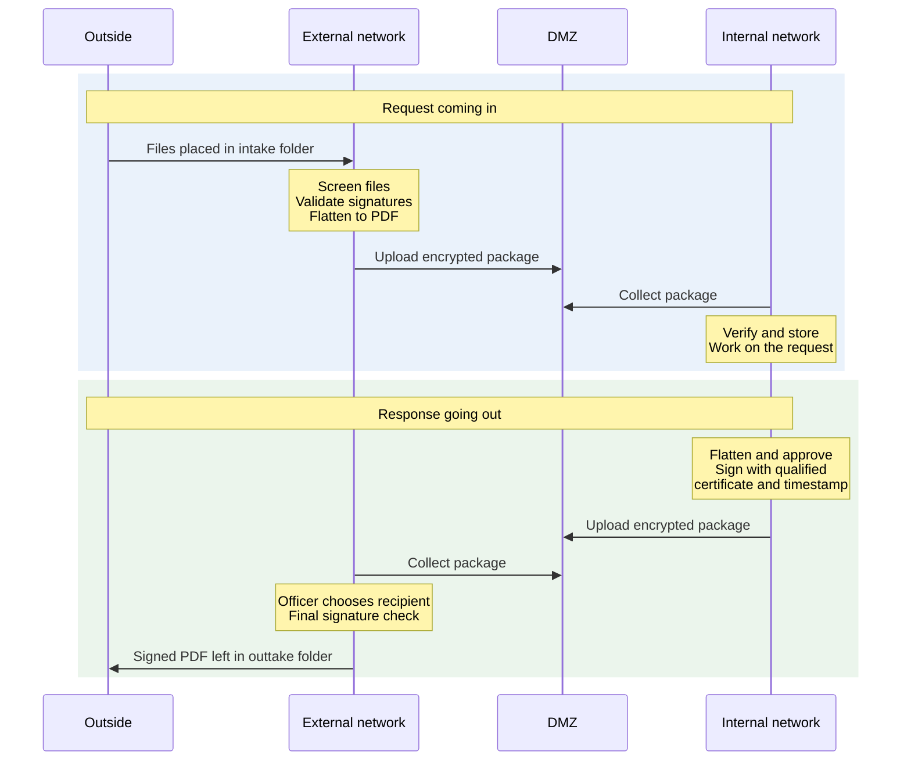
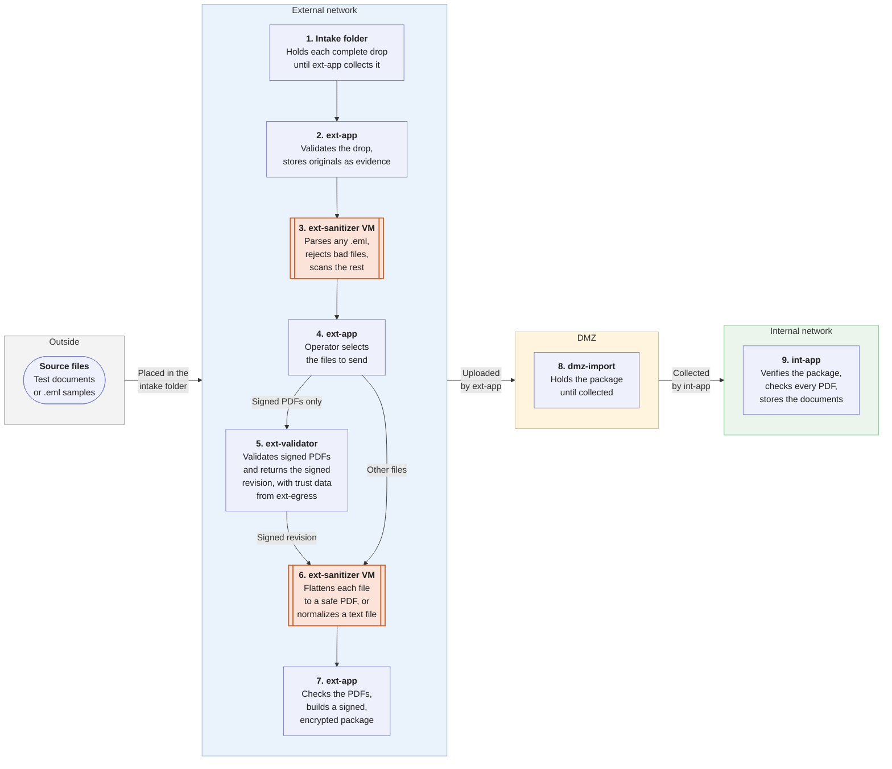
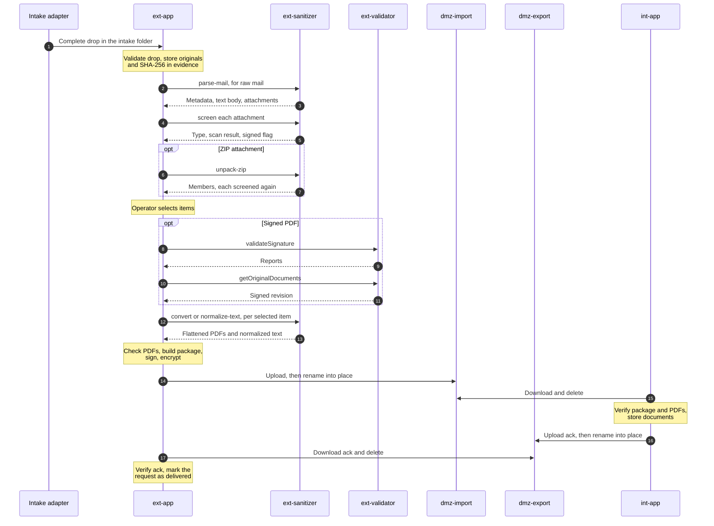
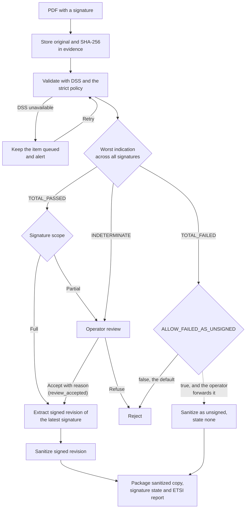
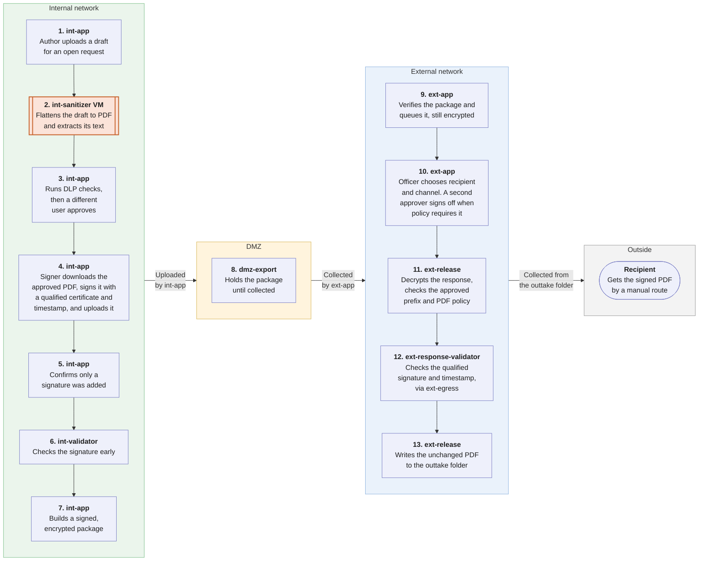
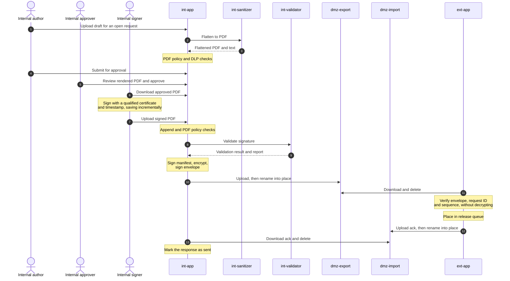
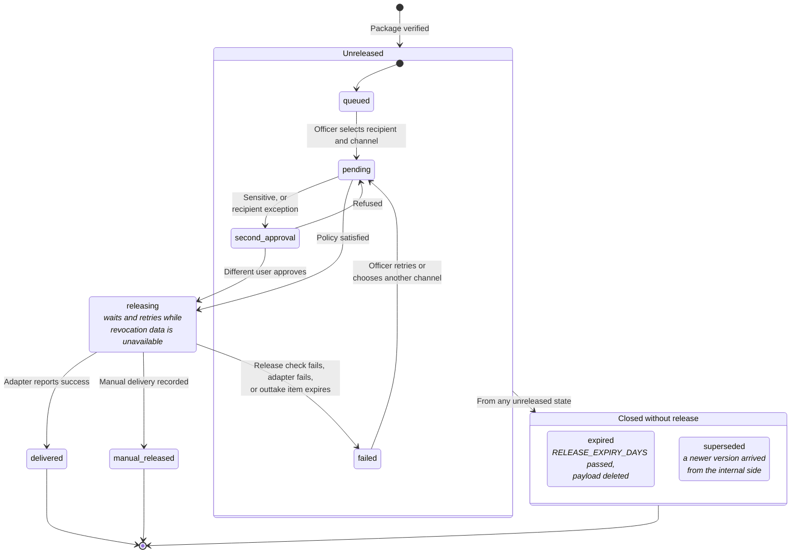
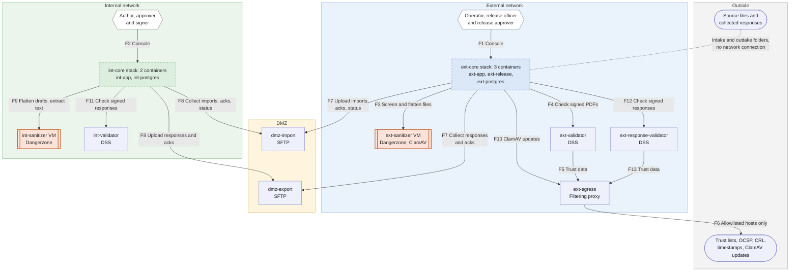

# Document Exchange Between the External and Internal Networks

**POC/MVP technical documentation for the self-hosted pipeline**

|  |  |
| --- | --- |
| Status | Draft for POC implementation |
| Date | 2026-11-04 |
| Working name | DXG (Document Exchange Gateway) |
| Audience | Developers, infrastructure engineers, security reviewers |

Sections 1 to 4 explain what DXG must do, how it works and what each part is. Sections 5 to 12 hold the detailed design. The appendices hold settings, interfaces and deployment details, and link to the code and configuration files kept next to this document in `checks/`, `scripts/`, `sql/`, `schemas/`, `examples/`, `poc/` and `deploy/`.

Two other documents belong with this one:

- The [proposal](document-exchange-proposal.md) is a short overview for decision makers.
- The [passthrough design](document-exchange-signed-pdf-passthrough.md) describes one optional feature that is disabled by default.

## 1. Overview

### 1.1 Purpose

DXG moves documents from mail requests received on the internet-connected external network to the internal network (intranet). It then returns a response created on the internal network to the external network, where an authorized user decides how and where to send it.

The design has six rules. The [proposal](document-exchange-proposal.md) lists the same six, with the same numbers.

1. **Nothing from the internet reaches the internal network unchanged.** Documents are flattened to PDF. Only signed manifests, reports and normalized text accompany them.
2. **Nothing connects into the internal network.** The internal network never connects to the internet or directly to the external network. The two networks exchange signed, encrypted packages through a DMZ, and the internal network opens all connections on its side.
3. **Untrusted files are opened only in disposable isolation.** A VM with no keys and no outbound network opens them. It is restored from a clean snapshot daily.
4. **Packages cannot be read or forged in transit.** The sender signs each package and encrypts it for the receiver. Each direction has its own DMZ host, account and keys.
5. **People decide, the system enforces.** An operator selects what enters. The internal side approves the content of a response, and a user on the external side chooses the recipient and channel.
6. **Every step is traceable.** Both sides record every decision against the request ID in a hash-chained audit log.

Section 2.2 turns these rules into security requirements. Section 3.6 defines one optional exception to rule 1 for incoming signed PDFs. It is disabled by default and needs a written risk acceptance.

### 1.2 Scope

| In scope | Out of scope for the MVP |
| --- | --- |
| Intake and outtake folders, with a mail adapter added for the MVP | Other adapters, such as rsync or an HTTP API |
| File allowlist, type detection, ClamAV screening | Commercial CDR |
| Sanitization to flattened PDF with Dangerzone | Editable Office output on the internal network |
| TXT normalization and safe ZIP unpacking | RAR, 7z and other archive formats |
| PAdES validation with EU DSS | Validation of `.p7m`, `.p7s` and ASiC files |
| Evidence store for originals on the external network | Long-term archival preservation |
| Signed and encrypted packages in both directions | Hardware diode (kept as an upgrade path, section 11.2) |
| Digitally signed PDF responses, with approval, DLP rules and flattening before signing | Passthrough of incoming signed PDFs for further signing, designed but disabled (section 3.6) |
| Release console on the external network, with delivery through the outtake folder | Recipient encryption and secure download portal |
| Audit trail linked to a request ID | High availability |

### 1.3 Assumptions

- The internal network is not classified or formally accredited. If it is, the accrediting authority decides the architecture before implementation starts.
- PDF output is acceptable for documents that arrive as Word or Excel files.
- Volume is low to medium. This must be measured during the POC (section 10.6).
- The organization can run an internal CA, or issue the certificates in section 4.4.
- Signers use a qualified certificate, a trusted timestamp, and a tool that saves signatures incrementally.
- The signing tool can reach a timestamp service from the internal network (section 3.4).
- The POC uses test data only, on one Docker host.
- For the MVP, network teams can enforce the flow matrix in section 5.1 at a firewall that neither network administers.

### 1.4 Terms

**Networks and hosts**

| Term | Meaning |
| --- | --- |
| External network, external side | The internet-connected network that holds the mailbox, and the DXG components on it |
| Internal network, internal side | The intranet, with no internet access, and the DXG components on it |
| DMZ | A separate network zone between the two networks. It holds only packages |
| `ext-app`, `int-app` | The web application on each side. This document names the application when it describes work, such as building a package |
| `ext-core`, `int-core` | The stack, and in the MVP the VM, that runs the application with its database. `ext-core` also runs `ext-release`. This document names the stack when it describes a host, such as in the flow matrix |
| Container | A long-running Docker container, started from a pinned image |
| Stack | A group of containers that work together, such as `ext-core` |
| Sandbox | A short-lived container created for one document. Dangerzone starts these inside its VM |
| VM | A separate virtual machine, used for the sanitizers in the POC and for everything in the MVP. The MVP may use a physical server instead |
| POC, MVP | Proof of concept on test data, and the minimum viable product for real use |

**Documents and their path**

| Term | Meaning |
| --- | --- |
| Request | One received email and everything derived from it |
| Item | One attachment, or one file unpacked from a ZIP |
| Adapter | A small service that moves files between an outside source or target and a folder |
| Intake folder | Where every request enters the pipeline |
| Drop | One request as an adapter leaves it in the intake folder: a `request.json` file and the files it lists |
| Evidence store | Protected storage on the external network holding unchanged originals |
| Flatten | Render a document to pixels and rebuild it as a PDF, with an OCR text layer. Only the look of each page survives |
| Normalize | Clean a text file or email body: check the encoding and remove control characters (section 7.3) |
| Sanitize | Make an item safe for the internal network: flatten a document, or normalize a text file |
| Sanitized copy | The flattened PDF produced from an item |
| Package | The file that crosses the DMZ, in either direction |
| Envelope, manifest | The signed public metadata of a package, and the signed list of files inside its encrypted payload (section 8) |
| Ack | A package with no payload that confirms or rejects another package |
| Base PDF | The approved, flattened PDF that a signer signs |
| Release | The act of sending an approved response from the external network |
| Outtake folder | Where every released response leaves the pipeline |
| Passthrough | The optional transfer of an incoming signed PDF without flattening (section 3.6) |

Appendix E.6 lists the roles, such as operator, release officer, author, approver and signer.

**Abbreviations**

| Term | Meaning |
| --- | --- |
| CDR | Content disarm and reconstruction |
| DLP | Data loss prevention |
| DSS | The European Commission's Digital Signature Service, used to validate signatures (section 4.3) |
| PAdES | PDF Advanced Electronic Signatures |
| QES, `QESig` | Qualified electronic signature, the highest level of electronic signature under eIDAS |
| OCSP, CRL | Online certificate status checks and certificate revocation lists |
| TSA | Timestamp authority |
| OCR | Optical character recognition, which adds a text layer to a flattened PDF |
| SFTP | File transfer over SSH |

## 2. Requirements

Each requirement has an ID that stays the same when this document changes. The security requirements enforce the six rules in section 1.1.

### 2.1 Functional requirements

| ID | Requirement |
| --- | --- |
| FR-01 | Accept requests only through the intake folder, and store each original unchanged |
| FR-02 | Reject executable, script and other disallowed content without operator action |
| FR-03 | Let an operator choose which allowed items go to the internal network, using metadata only |
| FR-04 | Flatten selected documents to PDF, and normalize text files |
| FR-05 | Unpack ZIP files within limits, and treat each file as a separate item |
| FR-06 | Validate digitally signed PDFs before sanitization, and keep the original as evidence |
| FR-07 | Give the internal side a sanitized copy, a signature status and an ETSI validation report |
| FR-08 | Let a user on the internal network create a response linked to an open request, and have it digitally signed as a PDF |
| FR-09 | Require a different user on the internal network to approve each response |
| FR-10 | Deliver approved responses to a release queue on the external network without sending them automatically |
| FR-11 | Let an authorized user on the external network choose the recipient and channel for each response |
| FR-12 | Require a second approver on the external network for sensitive responses and for recipient exceptions that policy marks |
| FR-13 | Support a corrected response only as a new signed version created on the internal network |
| FR-14 | Record every decision against the request ID |
| FR-15 | Deliver released responses only through the outtake folder |
| FR-16 | Support new adapters without changing the pipeline |
| FR-17 | Provide passthrough of incoming signed PDFs, and their return, as optional features disabled by default |
| FR-18 | Deliver every response as a PDF signed with a qualified certificate and a trusted timestamp, byte for byte, with its signatures intact |

### 2.2 Security requirements

| ID | Requirement |
| --- | --- |
| SR-01 | No direct network path exists between the external and internal networks, and nothing in the DMZ or on the external network can open a connection into the internal network |
| SR-02 | Untrusted files are parsed only in isolated hosts with no general network access |
| SR-03 | Every package is signed by the sending side and verified by the receiving side |
| SR-04 | Document payloads are encrypted while in the DMZ |
| SR-05 | The internal side cannot set a recipient, subject, or mail header |
| SR-06 | The external side cannot alter a response without detection |
| SR-07 | Replayed or out-of-sequence packages are rejected and raise an alert |
| SR-08 | Import and export use different DMZ hosts, accounts, keys and storage |
| SR-09 | A valid signature never exempts a file from sanitization, unless the passthrough (section 3.6) has been activated |
| SR-10 | Administrative access is separate from data flows and is logged |
| SR-11 | Adapters reach only their own folders, and have no access to keys, the database or evidence |
| SR-12 | A decrypted response reaches the outtake folder only after an authorized release |
| SR-13 | A signed response must be the approved PDF with only signature data added |
| SR-14 | Decrypted responses never reach a validator that parses hostile files |

## 3. How it works

### 3.1 At a glance

DXG has two flows: a request comes in, and a response goes out.



The columns are network zones, not machines. Each arrow points from the side that opens the connection. Both networks connect out to the DMZ, and nothing connects in to the internal network. The DMZ holds only packages with encrypted document content, and it uses a separate host for each direction.

### 3.2 Request coming in

An adapter drops each request into the intake folder. Untrusted files are opened only on `ext-sanitizer`. An operator chooses what to send, each chosen file is flattened to PDF, and the internal side collects the package.

Follow the numbers. Each box names the container or VM that does the work, and orange boxes with double side borders are VMs. Arrows show the order of work, not network connections: `ext-app` and `int-app` make every call, and the DMZ never connects to either network.



In the POC, files enter only through the intake folder, and raw `.eml` samples test mail parsing without a mailbox. The MVP adds a mail adapter at step 1.

The same flow as calls between components, where each arrow points from the side that opens the connection:



Steps in detail, with the step numbers from the first diagram:

- **Steps 1 and 2, intake.** An adapter places a complete drop in the intake folder (section 5.2). The intake worker in `ext-app` validates it, stores the originals and their hashes in the evidence store, and removes the drop.
- **Step 3, parse and screen.** For raw mail, `ext-sanitizer` parses the MIME structure. `ext-app` receives JSON metadata and raw parts and does no MIME parsing of its own. Each attachment then passes the checks in section 7. Rejected items keep their evidence record and reason.
- **Step 4, select.** The operator sees sender, subject, normalized body, file name, detected type, size and scan result. The console does not render attachments.
- **Step 5, validate.** Signed PDFs follow section 3.3.
- **Step 6, flatten.** `ext-sanitizer` flattens each selected document and normalizes each selected text file.
- **Step 7, check and package.** The PDF policy (appendix F) checks each flattened PDF in a restricted container on `ext-core`. `ext-app` then builds the package from section 8.
- **Step 8, transfer.** `ext-app` uploads the package to `dmz-import`.
- **Step 9, receive.** `int-app` collects the package, verifies it in the order in section 8.4, stores the documents and sends an `ack`.

If the internal side reports a rejection, or no `ack` arrives within `ACK_TIMEOUT_MINUTES`, the request is flagged for an operator to resend.

### 3.3 Signed PDFs

This is the default behavior. The signature is validated and reported, but the file reaching the internal network is flattened and cannot be signed further. Section 3.6 describes the optional alternative.



Rules:

- Sanitizing breaks a signature, so validation always happens first.
- The original stays in the evidence store on the external network. By default, it does not reach the internal network.
- `INDETERMINATE` often means an unknown trust anchor, missing revocation data, or a temporary outage. An operator decides, and the package records `review_accepted` rather than `passed`.
- `TOTAL_FAILED` is a rejection. `ALLOW_FAILED_AS_UNSIGNED` can allow an operator to forward the document as unsigned, and defaults to `false`.
- A PDF that hides its signature from screening is treated as unsigned and is still sanitized. This is a loss of evidence, not a security failure.

DSS returns the revision **before** the chosen signature was added. The sanitized copy therefore shows the document as signed, but the visible stamp of the latest signature is absent. The consoles on both networks show the signer details from the report instead.

**Decision table for DSS results**

| Indication | Signature scope | Action | State sent to the internal side |
| --- | --- | --- | --- |
| `TOTAL_PASSED` | Full | Continue | `passed` |
| `TOTAL_PASSED` | Partial | Operator review | `review_accepted` if accepted |
| `INDETERMINATE` | Any | Operator review | `review_accepted` if accepted |
| `TOTAL_FAILED` | Any | Reject | None |
| Multiple signatures | Any | Use the worst result | As above |
| DSS unavailable | Any | Keep item queued and alert | None |

### 3.4 Response going out

Every response leaves as a PDF signed with a qualified certificate and a trusted timestamp. Signing comes last, because flattening a file after signing would destroy the signature. Nothing may rewrite the file after it is signed.

The flow diagram reads like the incoming one: arrows show the order of work, not network connections.



In the POC, the signed PDF stays in the outtake folder until it is collected. The MVP adds a mail adapter after step 13.

The same flow as calls between components:



Rules:

- Drafts are flattened on the internal network. This removes metadata, comments, tracked changes, hidden sheets and embedded objects.
- The author and approver must be different accounts. The signer may also be the approver.
- A response may only be linked to a request that is open on the internal network.
- The internal side can mark a response `sensitive`. It cannot supply a recipient, subject, body or header.
- `ext-app` can verify the envelope without decrypting the payload, so the response stays encrypted until release.

Checks after signing:

1. `signature_append_check.py` confirms that the file is the approved PDF with data appended only, that a new signature exists, that page content is unchanged, and that the addition is within `SIGNATURE_MAX_APPEND_BYTES`.
2. `pdf_policy.py signed` confirms that no active content was added. Exit `2` is accepted, because a signer may lock the final document.
3. `int-validator` runs DSS with the strict policy. `TOTAL_FAILED` blocks the response. `INDETERMINATE` is allowed here only for revocation data that the internal network cannot reach, because the external side makes the final check.

**Response signature rule.** A response can be released only when DSS on `ext-response-validator` reports all of the following:

| Requirement | DSS value |
| --- | --- |
| Valid signature | `TOTAL_PASSED` |
| Qualified signature | Level is in `RESPONSE_SIGNATURE_LEVELS`, which defaults to `QESig` |
| Timestamped signature | Format is `PAdES-BASELINE-T`, `-LT` or `-LTA` |
| Trusted timestamp | Timestamp is valid. With `REQUIRE_QUALIFIED_TIMESTAMP`, its level is `QTSA` |
| Signed after approval | Timestamp is later than `approved_at` |
| Whole document covered | Signature scope is full |

There is no manual override. If revocation data is temporarily unavailable, the release waits and retries. If the rule fails, the internal side creates a new signed version. A level such as `AdESig-QC` shows a qualified certificate, but not a qualified signature, so it fails the rule.

A failed check returns the response to the signer. Rewriting a PDF on save fails the append check, so the signing tool must save incrementally. A document timestamp added after signing is allowed, because it is also an appended update. It does not count as a signature.

In the MVP, the signer downloads the approved PDF, signs it with an existing tool, and uploads the result. An integrated signing service can replace this later without changing the checks. Qualified signing certificates are separate from the package keys in section 4.4.

**Timestamp access.** The internal network has no internet route, so confirm how the signing tool reaches a timestamp service before phase 3.

| Option | How it works | Trade-off |
| --- | --- | --- |
| Existing service reachable internally | The tool already reaches a trusted timestamp service | No design change. The service must meet the signature rule |
| Timestamp proxy in the DMZ | A dedicated DMZ host forwards RFC 3161 requests from signing workstations to one timestamp service | Adds a narrow outbound path that carries hashes. It needs a security review, because it is an exception to rule 2 in section 1.1 |
| Document timestamp on the external side | The external side adds the timestamp before release | Not recommended. It proves the release time rather than the signing time, and the file would no longer be byte for byte what the internal side approved |

### 3.5 Release



When an officer starts a release, `ext-release` decrypts the response and runs the checks in appendix D.4. The response must meet the signature rule in section 3.4, and a failed check blocks the release.

Release rules:

- The console suggests the original sender, but the officer can choose another recipient.
- A recipient different from the original sender needs a written reason. Domains listed in `SECOND_APPROVAL_DOMAINS`, or any domain when the list is `*`, also need a second approver.
- Sensitive responses always need a second approver.
- Sensitive responses use the manual channel until recipient encryption exists (section 11.2). `SENSITIVE_ALLOW_EMAIL` defaults to `false`.
- The file is delivered byte for byte. The officer cannot edit it on the external network. A correction is a new version from the internal side, and it supersedes any unreleased version.
- A release closes the request on the external side, and the `released` status closes it on the internal side. A correction after release needs a new request.
- The release service writes the file and `delivery.json` to the outtake folder for the chosen channel.
- In the MVP, the mail adapter uses a fixed template, and `In-Reply-To` comes from the stored original message.
- The adapter compares the file hash with `delivery.json` immediately before delivery.

Delivery status stays on the external network. Only an enumerated status (`released`, `expired`, `bounced`) goes to the internal side, as a `status` package with no free text.

### 3.6 Signed PDF passthrough (reserved)

An optional feature can pass an eligible incoming signed PDF to the internal network unchanged, so that it can receive more signatures and leave again. It is disabled by default, and the POC and MVP do not depend on it. Its design, risks, tests and activation steps are in the [passthrough design](document-exchange-signed-pdf-passthrough.md).

The MVP does not build this feature, but it does include:

- The settings `SIGNED_PDF_PASSTHROUGH_ENABLED` and `SIGNED_PDF_RETURN_ENABLED`, read as `false`
- Rejection of `originals/` and `countersigned` responses, with `ack_reason` set to `feature_disabled`
- The database columns in appendix B for `passthrough`, `signable`, `original_path`, `original_sha256` and `kind`

Tests T-45 and T-46 prove that the disabled state holds.

## 4. Components

### 4.1 Architecture

This diagram shows every component and allowed connection in the POC.

- **Each solid rectangle is one Docker container.**
- **Each dashed rectangle is a stack of related containers.**
- **Each orange box with double side borders is a VM.** The two sanitizers run Dangerzone in VMs.
- **Rounded boxes are outside DXG**, such as services that DXG uses but does not manage.
- **Hexagons are people** using a console.
- **Each arrow** points from the side that opens the connection. Its label starts with the flow ID from section 5.1 and says what the connection is for.
- **The dotted line** is the hand-off through the intake and outtake folders, which has no network connection.



Section 4.2 describes each host, and section 5.1 gives the ports. Timestamp access for signers is not shown, because it depends on the decision in section 3.4.

### 4.2 What each component does

The POC runs the two sanitizers in VMs and everything else in Docker containers on one host (appendix E.8). The MVP keeps the same components and connections, but gives each component or stack its own VM, with clean snapshots and a firewall on each host. Internal and DMZ workloads run on hardware that does not also host external workloads, because a shared hypervisor is a path between the networks.

**External network**

**`ext-app`** (in `ext-core`). External web app: operator and release console, intake worker, workflow and packaging. These share one container because they share code and trust level.
- Software: Laravel, Vue, OpenSSL. Holds: `ext-package-sign`, the DSS client key, SFTP and agent keys, database credentials, the evidence store. Connections: F1 in; F3, F4, F7, F10 out.

**`ext-release`** (in `ext-core`). The release service: decrypts an approved response at release, runs the final checks (appendix D.4) and writes the file to the outtake folder.
- Holds: `ext-release-enc`, the release decryption key, as its only holder. Connections: F12 out. Reads the evidence store, writes only the outtake folder.

**`ext-postgres`, `int-postgres`**. Database and job queue for each side, with the hash-chained audit log (appendix B). The job queue is Laravel's database queue, so DXG needs no separate queue server. Reachable only inside its stack.

**`ext-sanitizer`** (VM). The only place untrusted files are opened: parses mail, detects type (Magika), scans (ClamAV), checks macros (oletools), unpacks ZIP files and flattens documents to PDF (Dangerzone).
- Software: a Python agent behind an SSH forced command (appendix D.1); Dangerzone starts one sandbox per document. Holds: no keys or credentials. Connections: F3 in, nothing out. Restored from a clean snapshot daily, because it is the host most likely to be compromised.

**`ext-validator`**. EU DSS for incoming signed PDFs: validates signatures and extracts the signed revision.
- Connections: F4 in; F5 out, to `ext-egress` only. It parses hostile PDFs and needs the internet, so the proxy allowlist stops URLs in a hostile certificate from probing internal systems.

**`ext-response-validator`**. A second EU DSS that checks signed responses at release. It never receives files from the internet.
- Connections: F12 in; F13 out, to `ext-egress` only. Kept apart so that decrypted responses never reach a host that parses hostile PDFs (SR-14).

**`ext-egress`**. Squid proxy that allows only trust lists, OCSP, CRL, timestamp hosts and ClamAV updates (appendix E.4). The only outbound path for trust data. Holds no keys. Connections: F5, F10, F13 in; F6 out.

**`ext-mail-adapter`** (MVP). Fetches mail over IMAP (M1) and sends released responses over SMTP (M2). No keys, no database; shares only the intake and outtake folders (section 5.2).

**DMZ**

**`dmz-import`, `dmz-export`**. One SFTP-only server per direction (SR-08), built from OpenSSH and nftables (appendix E.5). They accept F7 and F8 and open no connections. They hold only signed, encrypted packages, so a compromised DMZ host can delete or delay packages but cannot read or forge them.

**Internal network**

**`int-app`** (in `int-core`). Internal web app: collects and verifies packages, stores documents, and runs drafting, approval, the signing upload, DLP and response packaging.
- Software: Laravel, Vue, OpenSSL. Holds: `int-import-enc`, `int-package-sign`, SFTP and agent keys, database credentials. Connections: F2 in; F8, F9, F11 out. No route to the external network or the internet.

**`int-sanitizer`** (VM). Dangerzone behind the same kind of agent: flattens response drafts and extracts their text for DLP. Connections: F9 in, nothing out. Separate from `ext-sanitizer`, because one VM serving both networks would be a path between them.

**`int-validator`**. EU DSS with no network and a reviewed trust-list snapshot (appendix E.3). Checks signed responses before they leave. Connections: F11 in.

### 4.3 Software used

Confirm licenses again when pinning versions.

| Software | What it does in DXG | Version reviewed | License |
| --- | --- | --- | --- |
| Dangerzone | From the Freedom of the Press Foundation. Renders a document to pixels inside a gVisor sandbox and rebuilds a clean PDF, with an optional OCR text layer | 0.11.1 | AGPL-3.0 |
| Magika | Google's machine-learning file-type detector. It reads the content, not the extension | 1.0.1 | Apache-2.0 |
| ClamAV | Open-source antivirus that catches known malware early | Current stable | GPL-2.0 |
| oletools (`olevba`) | Finds macros in Office files | Current stable | BSD-2-Clause |
| EU DSS | The European Commission's Digital Signature Service, in Java. Validates PAdES signatures against the EU trusted lists | 6.5.1 | LGPL-2.1 |
| Squid | Forward proxy, used here as an allowlist | Distribution version | GPL-2.0 |
| OpenSSH | SFTP-only server on the DMZ hosts, and the transport for agent commands | Distribution version | BSD-style |
| nftables | Host firewall on each MVP host | Distribution version | GPL-2.0 |
| OpenSSL | CMS signing and encryption of packages | 3.5 LTS or later | Apache-2.0 |
| pikepdf, qpdf | Inspect PDF structure for the PDF checks (appendix F) | 10.18.0, 12.4.2 | MPL-2.0, Apache-2.0 |
| Laravel, Vue | Web app and console UI on both sides | Current stable | MIT |
| PostgreSQL | Database and job queue | 16 or later | PostgreSQL License |
| Docker, KVM | POC hosting: containers, and VMs for the sanitizers | Not pinned | Apache-2.0 (Docker Engine), GPL-2.0 (KVM) |
| Lidi | ANSSI software for hardware data diodes, used only for the optional diode path (section 11.2) | Current stable | LGPL-3.0 |

### 4.4 Keys and certificates

| Key | Holder | Purpose |
| --- | --- | --- |
| `ext-package-sign` | `ext-app` | Sign imports, acks and status packages |
| `int-import-enc` | `int-app` | Decrypt import payloads |
| `int-package-sign` | `int-app` | Sign response packages and acks |
| `ext-release-enc` | `ext-release` | Decrypt responses at release |
| `ext-dss-client` | `ext-app` | Authenticate to DSS |
| `sftp-ext-*`, `sftp-int-*` | `ext-app`, `int-app` | Separate SSH keys per host and direction |
| `agent-ext`, `agent-int` | `ext-app`, `int-app` | Run agent commands |

Rules:

- Use separate signing and encryption keys. Use P-256 or stronger, and a validity of one year or less.
- Pin the exact peer signing certificate on each side, in addition to chain validation. Roll certificates through a planned overlap period.
- Store private keys on the host only with file permissions in the POC. The MVP target for `ext-release-enc` and `int-package-sign` is a hardware token or HSM through PKCS#11.
- A root CA for this system should be offline. It may be a dedicated private CA used only for DXG.

Qualified certificates used to sign response PDFs are outside DXG. They are held on the signer's qualified device or service, and they are not package keys.

**Key compromise response:**

| Compromised key | Immediate action |
| --- | --- |
| `ext-package-sign` | Stop import processing on the internal side, remove the pin, investigate the external network, and review recent imports |
| `int-package-sign` | Block new responses on the external side, and hold unreleased items |
| `ext-release-enc` | Expire the queue, rotate the key, and ask the internal side to reissue required responses |
| `int-import-enc` | Treat all captured import payloads as exposed, and rotate the key |

## 5. Network

### 5.1 Flow matrix

The matrix names hosts, so it says `ext-core` for both `ext-app` and `ext-release`. Everything not listed is denied. In the POC, Docker networks enforce these rules (appendix E.8). In the MVP, they are enforced at the zone firewall and again on each host.

| ID | Source | Destination | Port | Purpose |
| --- | --- | --- | --- | --- |
| F1 | Operator browser | `ext-core` | 8080 | Console only: select files, review results, release responses |
| F2 | Internal user browser | `int-core` | 8081 | Console only: work on requests, approve and sign responses |
| F3 | `ext-core` | `ext-sanitizer` | 22 | Run agent commands |
| F4 | `ext-core` | `ext-validator` | 8443 | DSS REST calls |
| F5 | `ext-validator` | `ext-egress` | 3128 | Trust lists, OCSP, CRL, TSA |
| F6 | `ext-egress` | Allowlisted hosts | 80, 443 | Same traffic, after filtering |
| F7 | `ext-core` | `dmz-import`, `dmz-export` | 22 | Push packages, pull packages, collect DMZ logs |
| F8 | `int-core` | `dmz-import`, `dmz-export` | 22 | Pull packages, push packages |
| F9 | `int-core` | `int-sanitizer` | 22 | Run agent commands |
| F10 | `ext-core` | `ext-egress` | 3128 | ClamAV definition updates |
| F11 | `int-core` | `int-validator` | 8443 | DSS REST calls |
| F12 | `ext-core` | `ext-response-validator` | 8443 | DSS REST calls at release |
| F13 | `ext-response-validator` | `ext-egress` | 3128 | Trust lists, OCSP, CRL, TSA |

`ext-sanitizer`, `int-sanitizer`, `int-validator` and both DMZ hosts have no outbound rules. `int-core` has no route to the external network or the internet.

In the POC, the two console ports are published only on the Docker host's loopback address.

The MVP adds these flows for the mail adapter:

| ID | Source | Destination | Port | Purpose |
| --- | --- | --- | --- | --- |
| M1 | `ext-mail-adapter` | Mail server | 993 | Fetch mail |
| M2 | `ext-mail-adapter` | Mail relay | 587 | Send released responses |

### 5.2 Intake and outtake folders

The pipeline starts at a folder and ends at a folder. It does not know where a request came from or how a response leaves, so a new adapter does not change the pipeline.

The two folders sit on `ext-core` and are not network shares. They replace only the outer edges of the system. Sanitization, the DMZ transfer, approvals and human release are unchanged.

```text
/srv/dxg/intake/
  .incoming/<request-id>/         Adapter is still writing
  ready/<request-id>/             Complete drop, waiting for the pipeline
  processing/<request-id>/        Claimed by the intake worker
  rejected/<request-id>/          Failed validation, kept for analysis

/srv/dxg/outtake/                 Mounted as tmpfs in the MVP
  .incoming/<release-id>/         Release service is still writing
  ready/<channel>/<release-id>/   Waiting for that channel's adapter
  results/<release-id>.json       Delivery result written by the adapter
```

Possible intake adapters are the `dxg-drop` script (POC), mail over IMAP (MVP), manual upload by an operator, an rsync or SFTP drop, an HTTP API, a web upload portal, a watched network share, and a network scanner or printer.

Possible outtake adapters are collecting the file from the folder (POC), mail over SMTP (MVP), manual download by an authorized user, an rsync or SFTP push, an HTTP API or webhook call, a web download portal, and a network share.

**Intake drop.** In the POC, `dxg-drop` plays the adapter role. An adapter writes `request.json` and `files/` to `.incoming/<request-id>/`, then renames the directory into `ready/`. The mail adapter drops the raw message unchanged, so hostile mail is still parsed only on `ext-sanitizer`.

```json
{
  "schema": "dxg-intake/1",
  "request_id": "0195f7a2-6f7e-7c1a-9a44-1b1f4c2e7d10",
  "source": { "adapter": "mail", "reference": "1718000000:4521" },
  "received_at": "2026-11-04T09:12:44Z",
  "files": [
    {
      "file": "files/000001.bin",
      "kind": "raw_mail",
      "display_name": "message.eml",
      "sha256": "3333333333333333333333333333333333333333333333333333333333333333",
      "bytes": 48213
    }
  ]
}
```

`kind` is `raw_mail` or `attachment`. Adapters that do not supply a raw message may add `sender` and `subject`. For mail, `source.reference` holds `UIDVALIDITY:UID`, and the mail adapter moves a message to a processed folder only after its drop reaches `ready/`.

The intake worker renames a drop into `processing/` and then checks it, in this order:

1. The directory name is a UUID that matches `request_id`.
2. The drop contains only regular files, with no links or extra entries.
3. `request.json` is within its size limit and matches the schema.
4. Listed files match the directory contents, sizes and SHA-256 hashes.
5. Total size is within `MAX_DROP_BYTES`.
6. `source.adapter` and `source.reference` have not been seen before.

A failed drop moves to `rejected/` and raises an alert. A valid drop is copied to the evidence store and removed from the intake folder. Values in `request.json` remain untrusted text.

**Outtake item.** The release service writes the file and `delivery.json` after a release is authorized, then renames the directory into the channel's `ready/` folder.

```json
{
  "schema": "dxg-delivery/1",
  "release_id": "0195f7b4-1a22-7d10-8c11-4e2f7a9b6d33",
  "request_id": "0195f7a2-6f7e-7c1a-9a44-1b1f4c2e7d10",
  "channel": "email",
  "recipient": "person@example.org",
  "subject": "Response to your request",
  "reply_to_message_id": "<original@example.org>",
  "file": "signed.pdf",
  "sha256": "4444444444444444444444444444444444444444444444444444444444444444",
  "bytes": 202144,
  "expires_at": "2026-11-04T12:00:00Z"
}
```

The adapter checks `expires_at` and the file hash, delivers the file, writes a result, and deletes the item.

```json
{
  "schema": "dxg-delivery-result/1",
  "release_id": "0195f7b4-1a22-7d10-8c11-4e2f7a9b6d33",
  "result": "delivered",
  "reference": "250 2.0.0 queued",
  "completed_at": "2026-11-04T11:20:04Z"
}
```

`result` is `delivered` or `failed`. Rules for all adapters:

- Adapters run as separate service accounts, and each outtake adapter reads only its own channel.
- Adapters have no access to package keys, the database or the evidence store.
- Only the release service writes to the outtake folder, and only after an authorized release.
- `delivery.json` never comes from the internal network.
- In the MVP, outtake is a tmpfs mount, because it holds decrypted responses. Items older than `OUTTAKE_MAX_MINUTES` are deleted and the release moves to `failed`.
- A watched network share is an adapter that copies files in. It is never the intake folder itself.

## 6. Threat model and limitations

Section 6.1 lists what can go wrong and what limits the damage. Section 6.2 lists what the design does not do at all.

### 6.1 Threat model

| Threat | Main control | Remaining risk |
| --- | --- | --- |
| Malicious attachment | Flattening in a sandbox, allowlist, PDF policy check on both sides | Exploit in the renderer that also escapes the sandbox and VM |
| Disguised file type | Content-based detection, and agreement with the file extension | Rare polyglot files, which are flattened anyway |
| ZIP bomb or path traversal | Unpacking limits, generated file names, disposable host | Resource exhaustion on the isolated host only |
| Compromised `ext-sanitizer` | No keys or credentials, output treated as untrusted, restricted PDF check on the external side, full verification on the internal side | A forged but well-formed PDF with false visible content |
| Compromised `ext-core` | Encrypted responses, the internal side verifies every import and re-checks every PDF | Attacker can read the mailbox, evidence and queued imports, and can sign packages until the key is revoked |
| Compromised DMZ host | Encryption, signatures, sequence numbers | Denial of service, and exposure of envelope metadata |
| Forged validation report | Package signature, signing key held only by `ext-app` | The internal side trusts the external validator result, so `ext-core` compromise affects it |
| Malware on the internal network leaking data | Response needs an open request, approval, DLP, size limits, flattening before signing, append check, no recipient control | Data hidden in page images cannot be reliably detected |
| Compromised internal system sets a recipient | Schema has no recipient field, and the external side chooses the recipient | None for address selection |
| Compromised external workstation | Server-side send, MFA, second approver | Workstation can mislead its own user, and manual downloads expose plaintext |
| Altered response after approval | Append and page content checks on the internal side, prefix and signature checks at release | A signature appearance can carry a small amount of hidden data, within the size limit |
| Compromised or faulty adapter | Separate accounts, strict drop validation, no access to keys or evidence | Adapter can submit unwanted requests, and can read its own outtake channel |
| Replay or reordering | Unique package IDs, per-direction sequence numbers | Delay is possible |
| SSH client attack from DMZ | Minimal SFTP client, restricted user on `int-core`, patching | Residual risk until a hardware diode replaces the path |
| Signed PDF manipulation | Strict DSS policy, signed revision used for sanitization | Hidden content in a signed revision is rendered as it appears in that revision |

### 6.2 Known limitations

- **Docker POC.** All containers share one kernel, including those from both networks, so the POC must not handle real documents.
- **Software boundary.** A firewall and DMZ are not equivalent to a hardware diode. This design is not suitable for accredited or classified use without review.
- **Response appearance.** Flattening before signing makes responses image-based, with an OCR text layer. Recipients get a signed PDF, but not a text-native one.
- **Fidelity.** Output is rasterized, so files can grow and lose formulas, links and text selection quality. OCR quality depends on the source and language.
- **Spreadsheets.** Formulas and live data do not reach the internal network.
- **Trust in the external side.** The internal side cannot revalidate the original signature. It trusts a report signed by `ext-app`.
- **DLP.** Rule-based text scanning catches obvious leaks only. Malware could hide data inside a page image.
- **Availability.** Every component is a single instance.
- **Support.** No vendor support exists. Open-source licenses, including Dangerzone's AGPLv3, need legal review for your use.

## 7. File handling policy

The default limits for this section are in appendix A.

### 7.1 Allowed input

| Detected type | Extensions | Processing | Output on the internal network |
| --- | --- | --- | --- |
| PDF | `.pdf` | Dangerzone | Flattened PDF |
| Word | `.doc`, `.docx` | Macro check, Dangerzone | Flattened PDF |
| Excel | `.xls`, `.xlsx` | Macro check, Dangerzone | Flattened PDF |
| OpenDocument | `.odt`, `.ods` | Dangerzone | Flattened PDF |
| Image | `.jpg`, `.jpeg`, `.png`, `.tif`, `.tiff` | Dangerzone | Flattened PDF |
| Plain text | `.txt` | Normalization (section 7.3) | UTF-8 text |
| ZIP | `.zip` | Unpack (section 7.4), process each file | Per file |

### 7.2 Rejected by default

- Executables, libraries, installers and scripts
- Macro-enabled Office files, and legacy Office files where `olevba` finds macros
- HTML, SVG, XML, LNK, ISO and other disk images
- CSV, because of formula injection, until a value-only import exists
- RAR, 7z and other archives
- Password-protected or malformed files, including anything Dangerzone cannot flatten
- Any file whose detected type and extension do not agree

Screening stops at the first failure and records the reason:

1. Size limit
2. Type detection with Magika, with a minimum score
3. Extension agreement
4. Macro check for Office formats
5. ClamAV scan
6. Signature detection for PDF
7. ZIP unpacking

ClamAV catches known malware early, and it is not the main protection. A clean result never bypasses sanitization.

### 7.3 Text normalization

Applies to `.txt` files and email bodies.

1. Decode as UTF-8. If that fails, try `TEXT_FALLBACK_ENCODINGS`, then reject.
2. Reject files containing NUL bytes.
3. Remove control characters other than tab and newline, and remove Unicode bidirectional override characters.
4. Normalize line endings and apply NFC.
5. Enforce `MAX_TEXT_BYTES`.

For HTML-only messages, the agent extracts text and discards all markup. Links stay as plain text and are not clickable. Sender, subject and display names follow the same rules, with their own length limits, and the internal console always renders them as escaped text.

### 7.4 ZIP handling

- Reject encrypted entries, symbolic links and unsupported compression methods.
- Enforce entry count, total size, per-file size, compression ratio and nesting limits **before** extraction, and again while reading each stream.
- Never use the name inside the ZIP as a path. Write each member under a generated ID and keep the name as display text only.
- Each member becomes a new item and restarts screening from step 1.

## 8. Transfer packages

### 8.1 Layout

Each package is an uncompressed tar file named `<package_id>.tar`. It may contain only these regular files:

```text
envelope.json        Public metadata
envelope.json.p7s    Detached CMS signature over envelope.json
payload.cms          Optional. Encrypted CMS containing a signed inner tar
```

The inner tar contains fixed names only.

```text
Import:   manifest.json, body.txt, documents/NNNNNN.pdf, documents/NNNNNN.txt,
          reports/NNNNNN.etsi.xml
Response: manifest.json, signed.pdf, reports/signature.etsi.xml
```

The passthrough (section 3.6) adds `originals/NNNNNN.pdf` and the `countersigned` response kind. Receivers reject both while that feature is disabled.

`ack` and `status` packages have no payload.

### 8.2 Envelope and manifests

The envelope has no recipient, subject or free-text field. `additionalProperties: false` makes that a checked rule. IDs and times are checked with `pattern`, because validators do not enforce `format` by default. Appendix C.1 gives its JSON schema. `seq` increases by one per direction and is independent for each direction.

Each payload carries a manifest. Appendix C.2 and C.3 show the import and response manifests.

### 8.3 Signing and encryption

Payloads are signed first and then encrypted. The envelope is signed separately, and it carries the hash of the encrypted payload. This lets the receiver authenticate the package without decrypting it.

The scripts that create, verify and open a package are in appendix C.4. The real implementation must also check that the inner signer is the same pinned certificate as the envelope signer.

### 8.4 Verification order

The receiver stops at the first failure, keeps the package in a rejected folder, and sends a `rejected` ack where possible.

1. Check file size against `MAX_PACKAGE_BYTES`.
2. Read the tar with a strict reader: regular files and expected names only.
3. Verify the envelope signature and pinned signer.
4. Validate the envelope against its JSON schema.
5. Check that `package_id` is new and `seq` is the next expected value.
6. Compare `payload_sha256` and `payload_bytes`.
7. Check the request state. A response needs an open request and a higher `response_version`.
8. Decrypt and verify the inner signature. On the external side this happens at release, not at receipt.
9. Read the inner tar with the same strict reader. Allowed names depend on enabled features.
10. Validate the manifest, and compare every file hash.
11. Run the PDF policy check in a restricted container, using `output` mode for sanitized imports and `signed` mode for responses.

A `seq` gap puts the channel in a blocked state and alerts an operator, who decides whether to accept the gap after checking for lost packages.

## 9. Operations

### 9.1 Logging and alerts

Send application, host, firewall and proxy logs to a log store on each side. Internal logs stay on the internal network.

| Alert | Trigger |
| --- | --- |
| Sequence gap | Received `seq` is not the expected value |
| Verification failure | Any package signature, hash or schema failure |
| PDF policy failure | Any failure, especially on the internal network |
| Response signature failure | Append check or DSS failure on either side |
| Signing queue age | Approved response not signed within the agreed time |
| Queue age | Item or response older than its limit |
| Missing ack | `ACK_TIMEOUT_MINUTES` exceeded |
| Stale ClamAV data | Definitions older than 48 hours |
| Stale trust list | DSS cache older than the configured limit |
| Proxy denial spike | Unusual volume of denied DSS requests |
| Sanitizer anomaly | Timeouts, crash loops, unexpected tar entries |
| Rejected drop | Any drop moved to `rejected/` |
| Outtake age | Item older than `OUTTAKE_MAX_MINUTES` |
| Disk use | Above 80% on any data volume |

### 9.2 Maintenance

| Task | Frequency | Owner |
| --- | --- | --- |
| OS and package patches | Monthly, urgent fixes as needed | Infrastructure |
| Dangerzone template update | With every upstream release | Security or infrastructure |
| ClamAV definitions, moved by `ext-app` to `ext-sanitizer` | Daily | Automated |
| `ext-sanitizer` restored from a snapshot | Daily | Automated |
| Allowlist and policy review | Quarterly | Security |
| Backup restore test | Quarterly | Infrastructure |
| Certificate rollover | Before expiry | PKI owner |
| `int-validator` trust-list snapshot | Within `TRUST_SNAPSHOT_MAX_DAYS` | PKI owner |
| Access review | Quarterly | Service owner |

### 9.3 Backup

Back up both databases, the evidence store, configuration, and the audit hash exports. Encrypt backups, and keep backups from each network separate. Never back up decrypted payloads from `/dev/shm`.

### 9.4 Failure handling

| Failure | Behavior | Recovery |
| --- | --- | --- |
| Mail server unavailable | Adapter retries with backoff | Automatic |
| Folder adapter or mail adapter stopped | Drops or outtake items wait, and an alert is raised | Restart the adapter |
| `ext-core` restarts during delivery | Outtake contents are lost, and the release moves to `failed` | Officer retries the release |
| `ext-sanitizer` unavailable | Jobs stay queued | Restore host, and jobs resume |
| Flattening fails | Item rejected, with original kept in evidence | Ask the sender for another format |
| DSS unavailable | Signed items stay queued | Restore DSS |
| DMZ host unavailable | Packages stay on the sender | Rebuild DMZ host, and transfers resume |
| Package rejected | Package kept for analysis, and channel alert raised | Fix the cause, then resend with a new `package_id` and `seq` |
| Sequence gap | Channel blocked | Operator checks both sides and accepts the gap, or resends |
| Release send failure | Release moves to `failed` | Officer retries or chooses another channel |
| Signed upload rejected | Response returns to the signer with the reason | Sign the approved PDF again with an incremental save |
| Revocation data unavailable at release | Release waits and retries | Automatic. Alert if it continues |
| Signature rule fails at release | Release blocked | Create a new signed version |
| Response expires | Payload deleted on the external network, and `status` sent to the internal side | The internal side creates a new version if needed |

## 10. Testing

### 10.1 Test corpus

Keep hostile samples in a controlled store on the external network only.

| ID | Sample | Expected result |
| --- | --- | --- |
| T-01 | EICAR test file | Rejected at screening |
| T-02 | Executable renamed `.pdf` | Rejected by type detection |
| T-03 | `.docm` and legacy Office file with macro | Rejected by macro check |
| T-04 | PDF with JavaScript and `OpenAction` | Output has no active content |
| T-05 | HTML, SVG and LNK files | Rejected |
| T-06 | Password-protected ZIP, Word file and PDF | Rejected |
| T-07 | ZIP bomb and deep nesting | Rejected at a limit, with no host impact |
| T-08 | ZIP with `../` paths and symlinks | Rejected, with nothing written outside the job area |
| T-09 | Malformed Office and PDF files | Flattening fails safely |
| T-10 | Long or Unicode-tricked file names | Display name normalized, and file stored under a generated name |
| T-11 | HTML-only `.eml` sample with tracking images | Text extracted, with no remote fetch |
| T-12 | Incomplete drop left in `.incoming` | Ignored by the pipeline |
| T-13 | Drop with a malformed `request.json` | Moved to `rejected/`, and alert raised |
| T-14 | Drop with a symlink, extra file or missing file | Moved to `rejected/` |
| T-15 | Drop with a wrong size or hash | Moved to `rejected/` |
| T-16 | Same `source.reference` submitted twice | Second drop rejected |
| T-17 | MVP: same document through `dxg-drop` and the mail adapter | Same screening result |

### 10.2 Signature tests

| ID | Scenario | Expected result |
| --- | --- | --- |
| T-20 | Valid qualified PAdES signature | `passed`, with evidence and report stored |
| T-21 | Expired or revoked signer | `TOTAL_FAILED` or `INDETERMINATE`, as reported by DSS, and routed by section 3.3 |
| T-22 | Self-signed signature | Not trusted, and routed to review |
| T-23 | PDF changed after signing | Rejected, and the strict policy is shown to change the outcome from the default policy |
| T-24 | Incremental update and signature wrapping samples | Rejected or sent to review |
| T-25 | Shadow attack samples | Rejected or sent to review |
| T-26 | Multiple signatures | Worst result used, and the latest signature's revision extracted |
| T-27 | Signed PDF with embedded attachment | Attachment does not reach the internal network |
| T-46 | Signed PDF while the passthrough is disabled | Only the flattened copy and report reach the internal network |

### 10.3 Package and transfer tests

| ID | Scenario | Expected result |
| --- | --- | --- |
| T-30 | Payload changed in the DMZ | Rejected by hash check |
| T-31 | Envelope changed in the DMZ | Rejected by signature check |
| T-32 | Package signed by a valid but unpinned certificate | Rejected |
| T-33 | Replayed package | Rejected as a duplicate |
| T-34 | Package skipped | Channel blocked, and alert raised |
| T-35 | Tar with extra names, links or traversal | Rejected by strict reader |
| T-36 | Envelope carrying a `recipient` field | Rejected by schema |
| T-45 | Package containing `originals/` or a `countersigned` response while the passthrough is disabled | Rejected with `feature_disabled` |

### 10.4 Workflow and release tests

| ID | Scenario | Expected result |
| --- | --- | --- |
| T-37 | Response for a closed request | Rejected |
| T-38 | Author approves own response | Refused by the application and the database |
| T-39 | A user tries to change a response on the external network | No function exists, and any file change fails hash checks |
| T-40 | Same user creates and approves a release | Refused |
| T-41 | Sensitive response without a second approver | Cannot be released |
| T-42 | Expired response | Cannot be released, and payload deleted |
| T-43 | File changed in the outtake folder before delivery | Adapter refuses, and release moves to `failed` |
| T-44 | File placed in outtake without a release, or adapter reads another channel | Refused by permissions |

### 10.5 Response signing tests

| ID | Scenario | Expected result |
| --- | --- | --- |
| T-60 | Flattened PDF with a visible or invisible qualified signature and a trusted timestamp | Passes all checks and is delivered byte for byte |
| T-61 | Signed file rewritten by a tool that does not save incrementally | Rejected as not append-only |
| T-62 | Upload with no signature | Rejected |
| T-63 | Signed file with changed page content | Rejected |
| T-64 | Signature from an untrusted certificate | Blocked at release |
| T-65 | Certificate revoked between signing and release | Blocked at release |
| T-66 | Decrypted response sent to `ext-validator` | Not possible by configuration |
| T-67 | Delivered file compared with the approved upload | Identical, and the signature validates in a PDF reader |
| T-68 | Valid signature from a non-qualified certificate, or level `AdESig-QC` | Blocked at release |
| T-69 | Qualified signature with no timestamp, an invalid timestamp, or a timestamp before approval | Blocked at release |

### 10.6 Infrastructure and performance tests

| ID | Scenario | Expected result |
| --- | --- | --- |
| T-50 | Connection attempts from the external to the internal network, and from the DMZ to either network | Blocked and logged |
| T-51 | Outbound connection from `ext-sanitizer` | Blocked and logged |
| T-52 | DSS asked to fetch an unlisted host from a crafted certificate URL | Denied by proxy and logged |
| T-53 | Restored backup | Application starts, and audit chain validates |
| T-54 | Sanitizer restored during a job | Job retried, with no duplicate package |
| T-55 | Typical documents, measured per page and per file | Baseline recorded for time and output size |
| T-56 | Largest expected file and peak daily volume | Queue clears within the agreed time |

### 10.7 MVP acceptance criteria

- All tests in sections 10.1 to 10.6 pass, or an owner has accepted a documented exception.
- An independent penetration test covers the agent, package parsers, consoles and network paths, with no open critical or high findings.
- A failed transfer can be recovered by following written procedures only.
- A complete request can be reconstructed from audit records, from raw mail to release.
- Named owners exist for patching, keys, allowlists, incidents and retention.

## 11. Delivery plan

### 11.1 Phases

| Phase | Build | Exit criteria |
| --- | --- | --- |
| 1. Import POC | Intake folder, `dxg-drop`, agent, screening, Dangerzone, basic console, DMZ transfer, internal verification | T-01 to T-16, T-30 to T-36 and T-45 pass |
| 2. Signed PDFs | DSS, strict policy, evidence store, reports, review flow | T-20 to T-27 and T-46 pass |
| 3. Response path | Internal workflow, flattening, DLP rules, approvals, PDF signing upload, `int-validator`, package signing and encryption | T-37, T-38 and T-60 to T-69 pass |
| 4. Release console | Queue, policy rules, second approval, outtake folder | T-39 to T-44 pass |
| 5. Hardening | Move from Docker to VMs, add the mail adapter, monitoring, backups, access review, procedures, separate hardware | T-17 and T-50 to T-56 pass |
| 6. MVP sign-off | Independent penetration test and fixes | Section 10.7 met |
| Optional | Signed PDF passthrough, then return, only after an activation decision | Section 9 of the [passthrough design](document-exchange-signed-pdf-passthrough.md) met |

### 11.2 Backlog

| Item | Approach |
| --- | --- |
| Hardware diode | Implement the transport interface below this table with two physical diodes and Lidi. Acks then flow through the opposite diode |
| Editable spreadsheet data | Extract values in the sandbox, and write a new XLSX with cells stored as text |
| `.p7m`, `.p7s`, ASiC | Validate with DSS, extract content, and sanitize the extracted files |
| Recipient encryption | S/MIME for known recipients, or a secure download portal |
| More adapters | Add any option from section 5.2. Each one only reads or writes a folder |
| More formats | Enable 7z and RAR through libarchive with the ZIP rules, render CSV to PDF, and enable other Dangerzone formats |
| Hardware key protection | PKCS#11 tokens or HSM for release and signing keys |
| High availability | Replicated database and multiple workers after volume justifies it |

For the hardware diode, keep the transfer layer behind a small interface so that a diode can replace SFTP without changing the package format:

```text
Transport.put(package_path)
Transport.list() -> package names
Transport.get(name, destination_path)
Transport.delete(name)
```

A diode implementation has no `list` or `delete` across the link, so the receiver watches a local spool and the `ack` confirms delivery. Lidi sends without acknowledgement or retransmission at the link level, so package-level acks and resends remain necessary.

## 12. Open items

Nothing in this section is settled. Section 12.1 lists decisions that named owners must make, and section 12.2 lists issues that a design review found.

### 12.1 Decisions needed before the POC

| Decision | Owner |
| --- | --- |
| Classification and accreditation status of the internal network | Security owner |
| Whether a sanitized copy with a report meets record-keeping needs | Legal or records owner |
| Retention periods for evidence, audit logs and responses | Records owner |
| Which trust anchors and CAs must be supported | PKI owner |
| What counts as a sensitive response | Service owner |
| Which recipients and domains need a second approver | Service owner |
| How the signing tool reaches a trusted timestamp service from the internal network | PKI owner and network owner |
| Whether responses need `PAdES-BASELINE-LT` or `-LTA` for long-term validation | PKI owner and records owner |
| Whether and when to activate the passthrough in section 3.6 (not needed for the POC) | Security owner and service owner |
| Whether emails containing personal data may stay in the evidence store, and for how long | Data protection owner |

### 12.2 Known issues

A design review left these items open. Each needs a fix or a decision before or during the POC.

High:

1. **The append check covers only content streams** (appendix F.2). An update that replaces a page image or `/Resources` passes, and DSS does not see changes made in the signing update itself. This weakens SR-13.
2. **The internal side relies on a denylist PDF check** (appendix F.1). A compromised external host could send a PDF with a hostile font or image and no forbidden key. Options: allowlist the Dangerzone output shape, or flatten imports again on `int-sanitizer`.
3. **Timestamp access is unresolved** (section 3.4). The DMZ proxy is an exception to rule 2 in section 1.1, and the internal timestamp authority in section 6 of the [passthrough design](document-exchange-signed-pdf-passthrough.md) would not meet `REQUIRE_QUALIFIED_TIMESTAMP`. The "signed after approval" check also needs a reliable internal clock.
4. **The MVP mail adapter has no settled place.** Section 5.2 says the folders are not network shares and appendix E.8 makes the adapter a separate component, but appendix E.7 creates its user on `ext-core`.

Medium:

5. Both SFTP accounts can write the same `drop/` folder (appendix E.5), so neither DMZ host enforces its direction.
6. `open-payload.sh` decrypts into `/dev/shm`, which Docker limits to 64 MB by default, below `MAX_PACKAGE_BYTES`.
7. Nothing defines what happens when a package would exceed `MAX_PACKAGE_BYTES`, although a ZIP can unpack to `ZIP_MAX_TOTAL_BYTES` and flattening makes files larger.
8. ClamAV definitions reach `ext-sanitizer` daily (section 9.2), but the agent has no command for it (appendix D.1) and the snapshot restore removes them.
9. In the Compose file, `ext-release` has no database secret, no volume for encrypted responses and no socket shared with `ext-app`.
10. Mail handling skips S/MIME, attached messages, `winmail.dat`, `.pptx`, `.rtf`, `.heic` and inline images, shows no SPF, DKIM or DMARC result, and does not say whether the suggested recipient is From or Reply-To.
11. The `bounced` status has no source and no matching internal state.
12. Maintenance imports into the internal network (trust-list snapshots, Dangerzone templates, OS patches) have no design.

## Appendix A. Settings and default limits

These are starting values for the POC. The last column says where each setting is used.

| Setting | Default | Used in |
| --- | --- | --- |
| `MAX_DROP_BYTES` | 100 MiB | Section 5.2 |
| `MAX_ITEM_BYTES` | 50 MiB | Section 7.2 |
| `MAX_TEXT_BYTES` | 5 MiB | Section 7.3 |
| `MAX_PDF_PAGES` | 500 | Appendix F.1 |
| `MAX_PACKAGE_BYTES` | 500 MiB | Section 8.4 |
| `MAX_RESPONSE_PAGES` | 100 | Section 3.4 |
| `MAX_RESPONSE_BYTES` | 25 MiB | Section 3.4 |
| `SIGNATURE_MAX_APPEND_BYTES` | 2 MiB | Section 3.4 |
| `RESPONSE_SIGNATURE_LEVELS` | `QESig` | Section 3.4 |
| `REQUIRE_QUALIFIED_TIMESTAMP` | `true` | Section 3.4 |
| `TRUST_SNAPSHOT_MAX_DAYS` | 7 | Appendix E.3 |
| `ZIP_MAX_ENTRIES` | 200 | Section 7.4 |
| `ZIP_MAX_TOTAL_BYTES` | 500 MiB | Section 7.4 |
| `ZIP_MAX_RATIO` | 100 | Section 7.4 |
| `ZIP_MAX_DEPTH` | 2 | Section 7.4 |
| `MAGIKA_MIN_SCORE` | 0.90 | Section 7.2 |
| `TEXT_FALLBACK_ENCODINGS` | Not yet defined | Section 7.3 |
| `OCR_LANG` | Set per deployment, for example `eng` or `ron` | Appendix D.1 |
| `ALLOW_FAILED_AS_UNSIGNED` | `false` | Section 3.3 |
| `ACK_TIMEOUT_MINUTES` | 30 | Section 3.2 |
| `RELEASE_EXPIRY_DAYS` | 7 | Section 3.5 |
| `SECOND_APPROVAL_DOMAINS` | Set by the service owner (section 12.1) | Section 3.5 |
| `SENSITIVE_ALLOW_EMAIL` | `false` | Section 3.5 |
| `OUTTAKE_MAX_MINUTES` | 60 | Section 5.2 |
| `EVIDENCE_RETENTION_DAYS` | Set by the records owner | Section 12.1 |
| `SIGNED_PDF_PASSTHROUGH_ENABLED` | `false` | [Passthrough design](document-exchange-signed-pdf-passthrough.md) |
| `SIGNED_PDF_RETURN_ENABLED` | `false` | [Passthrough design](document-exchange-signed-pdf-passthrough.md) |
| `SIGNED_PDF_TRUST_ANCHORS` | Chosen at activation | [Passthrough design](document-exchange-signed-pdf-passthrough.md) |

## Appendix B. Data model

The external and internal networks have separate databases. They share only IDs carried in packages.

### B.1 External side

Tables for the external database: [`sql/external.sql`](sql/external.sql).

### B.2 Internal side

Tables for the internal database: [`sql/internal.sql`](sql/internal.sql).

`event_hash` is the SHA-256 of `previous_hash` plus the canonical JSON of the event. The application database role has `INSERT` and `SELECT` only on `audit_events`. Export the latest hash daily to a location that the application cannot write to.

## Appendix C. Package schema, manifests and scripts

### C.1 Envelope schema

JSON Schema for the envelope: [`schemas/envelope.schema.json`](schemas/envelope.schema.json).

### C.2 Import manifest example

Example: [`examples/import-manifest.json`](examples/import-manifest.json).

`signature.state` is one of `none`, `passed` or `review_accepted`. `int-app` keeps the ETSI report as an opaque file and displays values from the signed manifest, so the internal side does not need a rich XML viewer.

### C.3 Response manifest example

Example: [`examples/response-manifest.json`](examples/response-manifest.json).

The signature fields are for display only, because `ext-response-validator` makes its own check at release. `base_sha256` and `base_bytes` describe the approved PDF. The external side has no copy of that PDF, so it hashes the first `base_bytes` of `signed.pdf` and compares the result.

### C.4 Package scripts

- Create a package: [`scripts/build-package.sh`](scripts/build-package.sh)
- Verify the envelope, without decrypting: [`scripts/verify-envelope.sh`](scripts/verify-envelope.sh)
- Decrypt and verify the inner signature: [`scripts/open-payload.sh`](scripts/open-payload.sh)

## Appendix D. Interfaces

### D.1 Sanitizer agent

`ext-app` and `int-app` run the agent over SSH with a dedicated key. `authorized_keys` forces one command and disables everything else.

```text
restrict,command="/usr/local/bin/dxg-agent" ssh-ed25519 AAAA... ext-app
```

The requested operation arrives through `SSH_ORIGINAL_COMMAND`, and the agent accepts only these exact forms. Input arrives on stdin and output leaves on stdout.

| Command | Input | Output |
| --- | --- | --- |
| `parse-mail` | Raw message | Tar: `result.json`, `parts/NNNNNN.bin` |
| `screen` | One file | JSON: type, score, scan result, macro result, signed flag |
| `unpack-zip` | One ZIP file | Tar: `result.json`, `parts/NNNNNN.bin` |
| `normalize-text` | One text file | UTF-8 text, or a JSON error |
| `convert` | One file | Flattened PDF, exit status `0` on success |
| `extract-text` (`int-sanitizer` only) | One PDF | UTF-8 text |

Limits for every command are set in the systemd unit or wrapper: `RuntimeMaxSec`, `MemoryMax`, and a maximum stdin size.

Tar output from an agent is treated as hostile. `ext-app` reads it with its own loop, accepts regular files only, and requires names to match `^(result\.json|parts/[0-9]{6}\.bin)$`.

`convert` runs the following, with a timeout from configuration:

```bash
dangerzone-cli - -o - --ocr-lang "$OCR_LANG" < input > output.pdf
```

Dangerzone exits `1` when it cannot flatten a file. Treat that as a rejected item, and never fall back to the original file.

### D.2 DSS REST calls

| Operation | Method and path |
| --- | --- |
| Validate a signature | `POST /services/rest/validation/validateSignature` |
| Extract signed content | `POST /services/rest/validation/getOriginalDocuments` |

[`scripts/dss-validation-request.sh`](scripts/dss-validation-request.sh) builds the request body for validation.

The response object contains `diagnosticData`, `simpleReport`, `detailedReport` and `validationReportDataHandler`. The last field carries the ETSI TS 119 102-2 report.

Fields used from the simple report are `SignaturesCount`, `ValidSignaturesCount` and, per signature, `Indication`, `SubIndication`, `SignedBy`, `SigningTime`, `SignatureLevel` and `SignatureScope`.

For extraction, send the same `signedDocument` plus `signatureId`. **Always set `signatureId`.** If it is omitted, DSS uses the first signature in its list. Choose the signature whose byte range ends last, using the diagnostic data.

The default DSS policy only warns about several PDF modification checks, so a tampered file could still reach `TOTAL_PASSED`. Build the strict policy from the `constraint.xml` shipped with your exact DSS version:

```bash
sed -E 's#<(UndefinedChanges|PdfAnnotationOverlap|PdfVisualDifference|DocMDP|FieldMDP|SigFieldLock|ByteRangeCollision) Level="WARN"#<\1 Level="FAIL"#' \
  constraint.xml > dxg-policy.xml
```

Record the SHA-256 of `dxg-policy.xml` with every validation.

### D.3 Console API

Both consoles use the same conventions: session authentication, role checks on every route, CSRF protection and audit events on every change.

**External side**

| Method and path | Role | Purpose |
| --- | --- | --- |
| `GET /api/requests` | Operator, auditor | List requests |
| `GET /api/requests/{id}` | Operator, auditor | Request detail with item metadata |
| `POST /api/requests/{id}/selection` | Operator | Select items and queue processing |
| `POST /api/requests/{id}/reject` | Operator | Reject with a reason |
| `POST /api/items/{id}/signature-review` | Operator | Accept or refuse a signature result |
| `POST /api/requests/{id}/resend` | Operator | Resend after a rejection or timeout |
| `GET /api/responses` | Release officer, auditor | List the release queue |
| `POST /api/responses/{id}/release` | Release officer | Choose channel and recipient |
| `POST /api/releases/{id}/approve` | Release approver | Second approval |
| `POST /api/releases/{id}/refuse` | Release approver | Refuse with a reason |
| `POST /api/releases/{id}/manual-complete` | Release officer | Record how the file left the outtake folder |

**Internal side**

| Method and path | Role | Purpose |
| --- | --- | --- |
| `GET /api/requests` | User, auditor | List requests |
| `GET /api/documents/{id}` | User, auditor | Open a sanitized document |
| `POST /api/requests/{id}/responses` | User | Upload a draft response |
| `POST /api/responses/{id}/submit` | User | Submit for approval |
| `POST /api/responses/{id}/approve` | Approver | Approve the flattened PDF for signing |
| `POST /api/responses/{id}/refuse` | Approver | Refuse with a reason |
| `GET /api/responses/{id}/base` | Signer | Download the approved PDF |
| `POST /api/responses/{id}/signed` | Signer | Upload the signed PDF, run the checks and send |
| `POST /api/requests/{id}/close` | User | Close a request |

### D.4 Release service

`ext-release` is a small process on `ext-core`, running as its own user, and it is the only process that can read the release decryption key. It listens on a Unix socket and takes one argument, a release ID.

For each call, it:

1. Loads the release from the database and rechecks approvals, expiry and role rules.
2. Decrypts the payload to `/dev/shm` and verifies the inner signature.
3. Validates the manifest, and compares the file hash.
4. Hashes the first `base_bytes` of the file, and compares the result with `base_sha256`.
5. Runs `pdf_policy.py signed`, accepting exit `0` or `2`.
6. Validates the file on `ext-response-validator`, with current revocation data, and applies the signature rule in section 3.4.
7. Writes the file and `delivery.json` to the channel's outtake folder.
8. Writes the audit event, and deletes its own plaintext copy.

The adapter's result in `outtake/results/` completes the release.

## Appendix E. Deployment

### E.1 Base platform and sizing

| Item | Choice |
| --- | --- |
| OS | Debian 13 or Ubuntu 24.04 LTS, both listed as supported by Dangerzone |
| Deployment | POC: Docker Compose on one host, plus two sanitizer VMs. MVP: one VM per row in section 4.2. No Kubernetes |
| Application | Laravel and Vue, in containers built from pinned images |
| Database | PostgreSQL 16 or later, one instance per side |
| Queue | PostgreSQL, using Laravel's database queue |
| Agent | Python 3, with a virtual environment built from a hash-pinned lock file |
| Secrets | Files readable by one service user, not committed and not in images |

For the POC, start with 8 vCPU, 16 GiB RAM and 200 GiB disk for the Docker containers, and add the two sanitizer VMs from the table below. Suggested MVP sizing is below. Replace it with the flattening load measured during the POC.

| Host | vCPU | RAM | Disk |
| --- | --- | --- | --- |
| `ext-core` | 4 | 8 GiB | 200 GiB |
| `ext-sanitizer` | 8 | 16 GiB | 100 GiB |
| `ext-validator` | 2 | 4 GiB | 40 GiB |
| `ext-response-validator` | 2 | 4 GiB | 40 GiB |
| `ext-egress` | 1 | 1 GiB | 20 GiB |
| `dmz-import`, `dmz-export` | 1 each | 1 GiB each | 100 GiB each |
| `int-core` | 4 | 8 GiB | 200 GiB |
| `int-sanitizer` | 4 | 8 GiB | 60 GiB |
| `int-validator` | 2 | 4 GiB | 40 GiB |

### E.2 Dangerzone

- Dangerzone runs in a VM in both the POC and the MVP.
- Use `dangerzone-full`, which bundles the sandbox, on both sanitizer hosts. Neither host has internet access.
- Use version 0.11.1 or later. Advisory 2026-10-22 fixed two flaws in offline sandbox archive handling.
- Update by building a new VM template in a maintenance network and replacing the host. Do not load sandbox archives that you did not prepare yourself.
- Flatten a test document after every update, and compare the output against the PDF policy in appendix F.
- Confirm in phase 1 that unattended runs work with no network, including any update check at startup.

### E.3 DSS

- For the POC, the `dss-demo-webapp` from the matching `dss-demonstrations` release exposes the required REST endpoints.
- For the MVP, build a small service exposing only the two REST operations, instead of deploying a demonstration application.
- Disable signing endpoints, server-side keystores, and anything else this project does not use.
- Require mutual TLS from `ext-core`.
- Load EU trusted lists from the official list of trusted lists. Add national or private trust anchors only through a reviewed change.
- Alert if the trust-list cache goes stale.
- Run three separate instances: `ext-validator`, `ext-response-validator` and `int-validator`.
- `int-validator` has no network route, so load a reviewed trust-list snapshot and any internal CA as trust anchors.
- Qualified certificates and timestamps validate through the EU trusted lists, so `ext-response-validator` needs no private trust anchor for them.
- Refresh the `int-validator` snapshot within `TRUST_SNAPSHOT_MAX_DAYS`, using the controlled maintenance process.

### E.4 Egress proxy

Start with these destinations, and refine them during the POC:

- `ec.europa.eu` for the EU list of trusted lists
- `eur-lex.europa.eu` for the Official Journal reference
- Hosts publishing the national trusted lists you rely on
- OCSP, CRL and timestamp hosts of the CAs you expect to see
- OCSP and CRL hosts of the provider that issues your signers' qualified certificates
- `database.clamav.net` or your internal mirror, for `ext-core` only

Log and deny everything else. A denied revocation host produces an `INDETERMINATE` result, which goes to operator review, and the allowlist is updated through a reviewed change.

### E.5 DMZ hosts

These settings are for the MVP VMs:

- Host firewall, shown for `dmz-import` with example addresses: [`deploy/dmz/dmz-import.nft`](deploy/dmz/dmz-import.nft)
- SFTP settings for `sshd_config`: [`deploy/dmz/sshd-dxg.conf`](deploy/dmz/sshd-dxg.conf)
- Directory setup: [`deploy/dmz/setup-xfer-dirs.sh`](deploy/dmz/setup-xfer-dirs.sh)

Transfer rules:

- The sender uploads to `drop/.tmp-<package_id>` and renames it to `drop/<package_id>.tar`.
- The receiver ignores `.tmp-*`, downloads, verifies the size, stores the file, and then deletes the remote copy.
- A cleanup job on `ext-core` alerts on any package older than `ACK_TIMEOUT_MINUTES`.
- Administer DMZ hosts only from the hypervisor console, or through a separate management network that has no route to the external or internal networks.

`ext-core` collects DMZ logs over SFTP, so DMZ hosts need no outbound rule.

### E.6 Access control

| Role | Side | Can do |
| --- | --- | --- |
| Operator | External | Select items, review signature results, resend |
| Release officer | External | Choose recipient and channel, complete a manual release |
| Release approver | External | Give second approval |
| User | Internal | Read documents, draft and submit responses |
| Approver | Internal | Approve or refuse a response |
| Signer | Internal | Sign an approved response |
| Auditor | Both | Read requests and audit logs |
| Administrator | Both | Manage configuration, without any release or approval right |

Use MFA on every account on the external network. Use the existing directory on the internal network if it can be reached. Otherwise, use local accounts with MFA. One person must not hold both an officer and approver role.

### E.7 Intake and outtake folders

The example setup for the MVP `ext-core` VM is in [`deploy/ext-core/setup-folders.sh`](deploy/ext-core/setup-folders.sh). In the POC, the same two folders are host folders mounted into the containers.

Mount the outtake folder on tmpfs before creating its subfolders, and create them at boot. Example `fstab` entry:

```text
tmpfs /srv/dxg/outtake tmpfs rw,nosuid,nodev,noexec,size=2g,mode=0755 0 0
```

Implementation rules for these permissions:

- Adapters run with `umask 0007`. Otherwise, the pipeline cannot move a drop into `processing/`.
- The release service sets an item's group to the channel group before the final rename. Otherwise, the adapter cannot read the file.
- Keep all outtake subfolders on one mount, so that the final rename is atomic.
- For the POC, adapters share the intake folders. Use one `.incoming` folder per adapter if you need stricter separation.

### E.8 POC deployment with Docker

The POC runs 11 containers on one Docker host with Docker Compose. The two sanitizers run in separate VMs. The `dxg/*` images are built by this project. Section 4.2 explains which containers are grouped and which must stay separate.

**Compose file:** [`poc/docker-compose.yml`](poc/docker-compose.yml). Its paths, such as `./folders` and `./secrets`, are relative to `poc/`, and `.gitignore` keeps both out of the repository.

**How the networks work:**

- Each private network carries one allowed connection from section 5.1, or one stack's internal traffic.
- `internal: true` gives a network no route out of Docker. Only `outside` has one, and only `ext-egress` joins it. It holds no keys.
- No external container shares a network with an internal one. They can reach only the DMZ containers.

**Connecting the sanitizer VMs:**

- `ext-sanitize` and `int-sanitize` use named Linux bridges, `br-ext-san` and `br-int-san`.
- Run each VM under KVM on the Docker host, and attach its network card to that bridge with a static address in the subnet.
- The VMs keep their SSH forced-command interface from appendix D.1, and they have no other network.
- If the VMs run on another hypervisor, use a dedicated VLAN for each one instead.

**POC rules:**

- **Use test data only.** Dangerzone is isolated in a VM, but `ext-validator` and `int-app` still share one kernel on the Docker host. A DSS exploit from a hostile PDF could cross between the networks.
- **Docker networks do not enforce direction.** Containers on the same Docker network can reach each other's listening ports, whatever `ports:` publishes. Each DMZ container shares a network with `ext-app` and with `int-app`, so it could connect to either console. In the POC, each web server must therefore listen only on its address on its own stack network, `ext-core` or `int-core`, and not on all interfaces. The Compose file does not express this yet. Confirm it in phase 1 by trying to connect from each DMZ container to both consoles. The MVP firewall enforces direction properly.
- **Run PDF checks as a restricted subprocess** in `ext-app` and `int-app`, so that these containers need no access to the Docker socket. The MVP uses a separate restricted container.
- **Restore the sanitizer VMs daily** from a clean snapshot.
- **Use only the folders for files.** `dxg-drop` writes to `./folders/intake`, and released PDFs appear in `./folders/outtake/ready/`. The consoles handle decisions, not file transfer.
- **Restrict `./folders/outtake`,** because it holds decrypted test responses.

The MVP moves each container or stack to its own VM, and adds `ext-mail-adapter` as a separate component (section 4.2). Package formats and flows stay the same.

## Appendix F. PDF check scripts

Run these in a container with no network, a read-only filesystem and memory limits, because a compromised sanitizer could produce a hostile PDF. They check structure only, and do not judge visible content.

### F.1 PDF policy

Run `pdf_policy.py output` on the external side before packaging, and on the internal side before storing a document. Use `signed` mode for signed responses, and for the passthrough (section 3.6) if it is activated.

Script: [`checks/pdf_policy.py`](checks/pdf_policy.py).

The script runs the `qpdf` command and then pikepdf, which contains its own copy of qpdf. Install the `qpdf` command in the same version as that copy, 12.4.2 for pikepdf 10.18.0, so that one file is not judged by two different parsers. Distribution packages are older.

### F.2 Signature append check

Run on every signed response, with the approved PDF as the base. The passthrough (section 3.6) uses it with the signed original as the base.

Script: [`checks/signature_append_check.py`](checks/signature_append_check.py).

## Appendix G. Validation status of this document

| Item | Status |
| --- | --- |
| Package create, verify and open scripts | Executed with OpenSSL 3.0.13, including tamper and wrong-signer cases. The SHA-256 key derivation option was added later, and the sign, encrypt, decrypt and verify steps were executed again with OpenSSL 3.5.7 |
| Envelope schema | Tested against valid and invalid envelopes, including a `recipient` field. The ID and time patterns were added later and tested on their own, **not with a schema validator** |
| Manifest, drop and delivery examples | Parsed as JSON only |
| Docker Compose file | Checked with `docker compose config`, and its network graph was checked for isolation. **Not started**, because no Docker daemon or registry was available |
| Sanitizer VMs attached to Docker bridges | **Not tested** |
| Folder setup script | Executed as root, and tested with intake, outtake and channel-separation scenarios, without the tmpfs mount |
| Diagrams | Embedded as Mermaid blocks in this file. All blocks rendered without errors with mermaid-cli 11.4.2 |
| SQL for both networks | Applied to PostgreSQL 16 |
| `pdf_policy.py` | Executed against clean PDFs, real signed PDFs, and PDFs with JavaScript, links, attachments, launch actions and signature locks |
| `signature_append_check.py` | Executed with visible, invisible, certified, second and timestamped signatures, and with altered, rewritten, unsigned, timestamp-only and oversized files |
| nftables ruleset | Checked with `nft -c` |
| Strict DSS policy command | Executed against `constraint.xml` from DSS 6.5.1 |
| Dangerzone CLI options and exit codes | Read from the 0.11.1 source and documentation, **not executed** |
| DSS REST paths, fields and signed-revision behavior | Read from DSS 6.5.1 source, **not executed**, because the build dependencies could not be downloaded in the test environment |
| `sshd_config`, Squid guidance, tmpfs mount and host sizing | **Not tested** |
| Adapters and the intake worker | Specified only, **not built** |
| Signed PDFs from other signing software | **Not tested**. Test signatures came from one library only |
| Response signature rule with real qualified certificates and timestamps | **Not tested**. Tests used private test certificates, and DSS was not executed |
| `pdf_policy.py output` against real Dangerzone output | **Not tested** |

Confirm these during phase 1 and phase 2. In particular, add a contract test that captures a real DSS JSON response for your exact version before writing the result parser.

## References

- [Dangerzone repository](https://github.com/freedomofpress/dangerzone)
- [EU DSS repository](https://github.com/esig/dss)
- [DSS demonstrations repository](https://github.com/esig/dss-demonstrations)
- [Digital Signature Service, European Commission](https://ec.europa.eu/digital-building-blocks/sites/display/DIGITAL/Digital%20Signature%20Service%20-%20%20DSS)
- [ETSI TS 119 102-2: Signature Validation Report](https://www.etsi.org/deliver/etsi_ts/119100_119199/11910202/01.03.01_60/ts_11910202v010301p.pdf)
- [Magika](https://opensource.googleblog.com/2024/02/magika-ai-powered-fast-and-efficient-file-type-identification.html)
- [ANSSI Lidi](https://github.com/ANSSI-FR/lidi)
- [NCSC: Design Pattern for Safely Exporting Data](https://www.ncsc.gov.uk/guidance/design-pattern-safely-exporting-data)
- [Mladenov et al.: 1 Trillion Dollar Refund, attacks on PDF signatures](https://cse.buffalo.edu/~wenyaoxu/courses/fall2020/CSE741_Fall2020_Ref/PDF_Signature.pdf)
