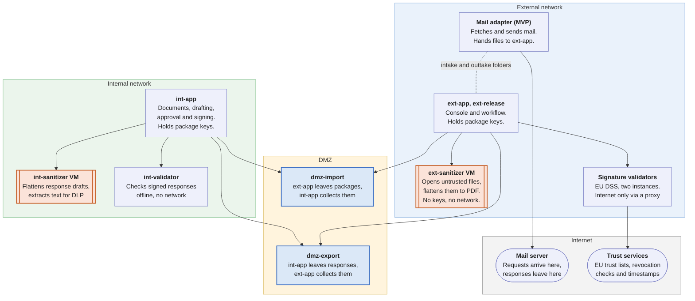

# Proposal: Document Exchange Gateway (DXG)

Teodor Ion · 4 November 2026

## What we ask

We ask the security team for seven decisions, listed at the end of this proposal. The last one is approval to start a proof of concept on one isolated host, with test data only.

## The need

Requests arrive by email at a mailbox on the internet-connected network, called the external network here. They carry Word, Excel, PDF, text, image and ZIP attachments, and some PDFs are digitally signed. Staff on the internal network (the internal network) need some of these documents, and they answer each request with a signed response.

The solution must:

- Bring only the selected documents into the internal network, never an executable, script, macro or other active content.
- Keep the internal network off the internet: nothing connects into it, and it never connects out.
- Send each response as a PDF with a qualified electronic signature and a trusted timestamp, unchanged after approval.
- Let the internal network approve what a response says, and let the external network choose who receives it.
- Record every decision against the request, from the original email to the delivered response.

## How it works

The two networks never connect to each other. Both connect out to two small transfer servers in a DMZ, one per direction, and exchange signed, encrypted packages through them. In the diagram, each arrow points from the side that opens the connection.

The core servers are the two application servers: ext-app with ext-release on the external network, and int-app on the internal network. Each core server talks only to its own isolated helpers and to the DMZ. Nothing on the external side or in the DMZ can open a connection to the internal network.

**Incoming request, external network to internal network**

1. The email arrives, and the original is stored unchanged as evidence on the external network.
2. In an isolated virtual machine, each attachment's real type is detected, it is scanned for malware and checked for macros. Disallowed files are rejected automatically.
3. An operator sees only metadata: sender, subject, file names, types and scan results. The operator selects the files the internal network needs. Nobody opens an attachment on the external network.
4. A signed PDF has its signature validated first, and the validation report travels with it.
5. Each selected file is rebuilt as a flattened PDF: rendered to pixels in a sandbox, then turned back into a PDF with an OCR text layer. Text files are normalized instead.
6. The documents are packed, signed, encrypted and left on the import server. The internal network collects the package, verifies it, checks every PDF again and stores it.

**Outgoing response, internal network to external network**

1. A user on the internal network drafts a response to an open request. The draft is flattened, which removes metadata, comments and hidden content, then checked by data loss prevention (DLP) rules.
2. A different user approves it.
3. A signer signs the approved PDF with a qualified certificate and a timestamp. The system checks that only a signature was added.
4. The response is packed, signed, encrypted and left on the export server. The external network collects it and keeps it encrypted.
5. A release officer chooses the recipient and channel. Sensitive responses and unusual recipients need a second approver. A final signature check runs, and the file leaves byte for byte as signed.

The internal network can never choose a recipient, and the external network can never change a response.

## Security design

Six rules carry the design, and each is enforced by a control rather than by trust in a person or one product.

| # | Rule | How it is enforced |
| --- | --- | --- |
| 1 | Nothing from the internet reaches the internal network unchanged | Every document is rebuilt as a flattened PDF. Only flattened PDFs, normalized text and signed validation reports cross. |
| 2 | Nothing connects into the internal network | Both networks connect out to the DMZ servers. The DMZ servers accept file transfers only from the two core servers and cannot open connections themselves. |
| 3 | Untrusted files are opened only in disposable isolation | A dedicated virtual machine with no keys and no network opens them, and each document is flattened inside a further sandbox. The machine is reset from a clean snapshot daily. |
| 4 | Packages cannot be read or forged in transit | The sender signs each package and encrypts it for the receiver, with pinned certificates, sequence numbers and replay detection. Each direction has its own DMZ server, account and keys. |
| 5 | People decide, the system enforces | An operator selects what enters. A response needs an author, a different approver and a signer. The internal network cannot set a recipient, and the release officer cannot edit the file. |
| 6 | Every step is traceable | Both sides keep a hash-chained audit log linked to the request ID. Original emails stay in an evidence store on the external network. |

Antivirus and type checks only reject known-bad files early. Flattening is the main protection, and a clean scan never skips it.

## Components

Each part does one job, and the parts that open untrusted files hold no keys and have no network access.

| Component | Network | What it does | Runs |
| --- | --- | --- | --- |
| ext-app | External | Console for operators and release officers. Runs intake, workflow and packaging. Holds the key that signs packages. | Laravel and Vue web app, OpenSSL |
| ext-release | External | Decrypts an approved response at release and hands it to the outgoing channel. Only holder of the release decryption key. | Small service, OpenSSL |
| ext-sanitizer | External, isolated VM | The only place untrusted files are opened: parses email, detects file types, scans, checks macros, unpacks ZIPs and flattens documents to PDF. No keys, no outbound network, reset daily. | Python agent, Magika, ClamAV, oletools, Dangerzone |
| ext-validator | External, isolated | Validates signatures on incoming signed PDFs against the EU trusted lists. | EU DSS |
| ext-response-validator | External, isolated | Checks the qualified signature and timestamp of each response at release. Never sees files from the internet. | EU DSS |
| ext-egress | External | The validators' only way out. Allows trust lists, revocation checks, timestamps and antivirus updates, and denies everything else. | Squid proxy |
| ext-mail-adapter (MVP) | External | Fetches mail and sends released responses. No keys and no database access. | IMAP and SMTP client |
| dmz-import, dmz-export | DMZ | One transfer server per direction. Holds only signed, encrypted packages until the other side collects them. | OpenSSH in file-transfer-only mode, nftables firewall |
| int-app | Internal | Console for internal users. Collects and verifies packages, stores documents, runs drafting, approval, signing upload and DLP checks, and builds response packages. Holds the import decryption key and the response signing key. | Laravel and Vue web app, OpenSSL |
| int-sanitizer | Internal, isolated VM | Flattens response drafts and extracts their text for DLP checks. | Python agent, Dangerzone |
| int-validator | Internal, isolated | Checks signed responses early, offline, with a reviewed copy of the trust lists. | EU DSS |
| Databases | Each side | Requests, decisions, job queue and the audit log. One per network, never shared. | PostgreSQL |

The software, in one line each:

| Software | What it is |
| --- | --- |
| Dangerzone | Open-source tool from the Freedom of the Press Foundation. Renders a document to pixels inside a gVisor sandbox and rebuilds a clean PDF, with optional OCR. |
| Magika | Google's file-type detector. It reads the content, so a renamed executable is caught. |
| ClamAV | Open-source antivirus for known malware. |
| oletools | Finds macros in Office files. |
| EU DSS | The European Commission's Digital Signature Service. Validates PDF signatures against the EU trusted lists and writes a standard validation report. |
| Squid | A web proxy, used here as an allowlist. |
| OpenSSH, nftables | A file-transfer-only server and the Linux host firewall. |
| OpenSSL | Signs and encrypts packages in the CMS standard format. |
| Laravel, Vue, PostgreSQL | The web application framework, its user interface and its database. |

The proof of concept runs everything on one host in containers, with the two sanitizers in VMs, on test data only. The MVP moves each component to its own VM, and runs the internal network and DMZ parts on hardware separate from the external ones.

## Files

The internal network receives flattened PDFs and normalized text, never an original file.

| Arrives as | Handling | Reaches the internal network as |
| --- | --- | --- |
| PDF, Word (.doc, .docx), Excel (.xls, .xlsx), OpenDocument (.odt, .ods), images (.jpg, .png, .tif) | Macro check for Office files, then flattened | Flattened PDF with OCR text |
| Text (.txt) | Encoding checked, control characters removed | Normalized UTF-8 text |
| ZIP | Unpacked within size, count and depth limits, then each file handled as above | One item per file |
| Signed PDF | Signature validated first, original kept as evidence | Flattened copy plus the validation report |

Rejected automatically: executables, libraries, installers and scripts; macro-enabled Office files; HTML, SVG, XML, shortcuts and disk images; CSV; RAR, 7z and other archives; password-protected or damaged files; any file whose real type does not match its extension.

The cost is fidelity. Flattened PDFs keep a document's look but lose formulas, links and editable text. A signature does not survive flattening, so the internal network relies on the validation report instead.

## Remaining risks and known gaps

Five risks remain by design. A design review also found twelve open issues. The four most serious are listed here and must be closed before the proof of concept. The [technical design](document-exchange-mvp-technical-documentation.md) lists all twelve in section 12.2.

| Remaining risk | What limits it |
| --- | --- |
| An exploit in Dangerzone that escapes both the sandbox and the VM | The VM holds no keys and has no network, it is reset daily, and the internal network checks every PDF again. |
| A software boundary, not a hardware data diode | Not proposed for classified networks without review. A hardware diode can replace the DMZ transfer later without changing the package format. |
| The internal network trusts signature checks made on the external side | The validation report is signed into the package, and the original stays in the evidence store. |
| Data hidden in page images on the way out | DLP reads text only. Flattening, size limits, a second approver and no recipient control on the internal network reduce the channel. |
| A compromised external core server | It can read the mailbox and queued imports. Responses stay encrypted until release, the internal network verifies every package, and the signing key can be revoked. |

| Known gap | Proposed fix |
| --- | --- |
| The check that only a signature was added compares page drawing commands. A flattened page draws an image stored elsewhere, so that image could be swapped during signing. | Compare the rendered pages, or allow the signing step to add signature objects only. |
| The internal network checks incoming PDFs against a list of forbidden features. A hostile font or image could pass if the external side were compromised. | Accept only the exact structure Dangerzone produces, or flatten every import again on the internal network's own sanitizer. |
| Signers on the internal network need a trusted timestamp, but the internal network has no route out. | A security decision, listed below. |
| Where the MVP mail adapter runs is not settled, and it reaches the internet. | Run it on its own host that shares only the intake and outtake folders. |

## Plan

The work runs in six phases, and only test data is used until the MVP passes an independent penetration test.

| Phase | Delivers | Done when |
| --- | --- | --- |
| 1. Import proof of concept | Intake, screening, flattening, DMZ transfer, internal verification | Malware, disguised-file, ZIP-bomb and tampered-package tests pass |
| 2. Signed PDFs | Signature validation, evidence store, reports, operator review | Valid, revoked, altered and shadow-attack samples are handled correctly |
| 3. Response path | Drafting, flattening, DLP, approval, signing upload, response packages | Only correctly signed, unaltered responses are accepted |
| 4. Release console | Release queue, recipient rules, second approval, outtake | No response can be released without its required approvals |
| 5. Hardening | Separate VMs and hardware, mail adapter, monitoring, backups, procedures | Network isolation, restore and load tests pass |
| 6. MVP sign-off | Independent penetration test and fixes | No open critical or high findings |

The full test list, with an ID for each case, is in section 10 of the [technical design](document-exchange-mvp-technical-documentation.md).

## Decisions we need from the security team

We ask for seven decisions, the last being approval to start the proof of concept.

| Decision | Our proposal |
| --- | --- |
| Is a firewall-and-DMZ boundary acceptable for this internal network, or is a hardware data diode required? | Software boundary for the proof of concept and MVP, with the diode as the upgrade path if the internal network's classification requires it. |
| How do internal signers get a trusted timestamp without the internal network connecting out? | Use an existing internal timestamp service if one qualifies. Otherwise, a dedicated timestamp proxy in the DMZ that carries only hashes, as a reviewed exception. |
| Which signature trust anchors do we accept? | The EU trusted lists only. Other national or private CAs only through a reviewed change. |
| What counts as a sensitive response, and which recipients need a second approver? | Defined with the service owner before phase 4. |
| How long do we keep original emails, which hold personal data, plus audit logs and responses? | Set with the records and data protection owners before phase 2. |
| What must the independent penetration test cover? | The sanitizer agent, package parsers, both consoles and every network path. |
| May we start the proof of concept? | One isolated host, test data only, no connection to the real mailbox or the internal network. |

Passing a signed PDF through unchanged, so the internal network can countersign it, is designed in a [separate document](document-exchange-signed-pdf-passthrough.md) but switched off. We do not ask for it now. Turning it on later would need a written risk acceptance.
