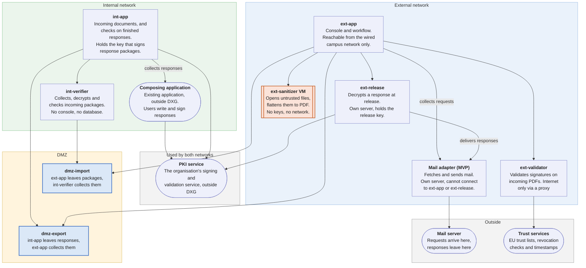

# Proposal: Document Exchange Gateway (DXG)

Teodor Ion · 4 November 2026

## What we ask

We ask the security team for seven decisions, listed at the end of this proposal. The last one is approval to start a proof of concept on one isolated host, with test data only.

## The need

Requests arrive by email at a mailbox on the internet-connected network, called the external network here. They carry Word, Excel, PDF, text, image and ZIP attachments, and some PDFs are digitally signed. Staff on the internal network (the intranet) need some of these documents, and they answer each request with a signed response. They write and sign that response in an existing internal application, through the organisation's PKI service.

The solution must:

- Bring only the selected documents into the internal network, never an executable, script, macro or other active content.
- Keep the internal network off the internet: nothing connects into it, and it never connects to the internet or to the external network. The one exception is the organisation's PKI service, which both networks use.
- Send each response as a PDF that carries the organisation's qualified seal, at least one qualified user signature and a qualified timestamp, unchanged after signing.
- Let the internal network decide what a response says, and let the external network choose who receives it.
- Record every decision against the request, from the original email to the delivered response.
- Accept other ways in and out later, such as an upload portal, without rebuilding the pipeline. Email is the first.

## How it works

The two networks never connect to each other. Both connect out to two small transfer servers in a DMZ, one per direction, and exchange signed, encrypted packages through them. In the diagram, each arrow points from the side that opens the connection.

The pipeline itself starts at an intake folder and ends at an outtake folder, and does not know about mail. Mail is the first adapter at each end. Another way in or out, such as an upload portal, is a new adapter with the same small interface.

The core servers are the two application servers: ext-app on the external network and int-app on the internal network. ext-release, which decrypts a response at release, runs on its own server. Each core server talks only to its own isolated helpers and to the DMZ. ext-app also reaches the release server and the mail adapter's server, and the release server reads the database beside ext-app. int-app also reaches the composing application's server and the PKI service. On the internal network, a separate verifier collects what arrives from the DMZ, so the server that holds the internal documents never parses a package itself. Nothing on the external side or in the DMZ can open a connection to the internal network.

**Incoming request, external network to internal network**

1. The email arrives, and the original is stored unchanged as evidence on the external network.
2. In an isolated virtual machine, each attachment's real type is detected, it is scanned for malware and checked for macros. Disallowed files are rejected automatically.
3. An operator sees only the message text and metadata: sender, subject, file names, types and scan results. The operator selects the files the internal network needs. Nobody opens an attachment on the external network.
4. A signed PDF has its signature validated first, and the validation report travels with it.
5. Each selected file is rebuilt as a flattened PDF: rendered to pixels in a sandbox, then turned back into a PDF with an OCR text layer. Text files are normalized instead.
6. The documents are packed, signed, encrypted and left on the import server. On the internal network, the verifier collects the package, verifies and decrypts it and checks every PDF again. Only then does the core server store the documents.

**Outgoing response, internal network to external network**

1. Users write the response in the existing composing application. The PKI service applies the organisation's qualified seal and a timestamp, and then one or more users sign. In the organisation's process, a signature is the approval.
2. DXG collects the finished PDF from the composing application, for an open request.
3. DXG asks the PKI service to check the seal, the signatures and the timestamps, checks that the PDF has no active content, and runs data loss prevention (DLP) rules on its text.
4. The response is packed, signed, encrypted and left on the export server. The external network collects it and keeps it encrypted.
5. A release officer chooses the recipient and channel. A sensitive response always needs a second approver, and so does a recipient in a domain that the service owner lists. Any recipient other than the suggested one needs a written reason. The PKI service checks the signatures once more, and the file leaves byte for byte as signed.

The internal network can never choose a recipient, and the external network can never change a response.

## Security design

Six rules carry the design, and each is enforced by a control rather than by trust in a person or one product.

| # | Rule | How it is enforced |
| --- | --- | --- |
| 1 | Nothing from the internet reaches the internal network unchanged | Every document is rebuilt as a flattened PDF. Only flattened PDFs, normalized text and signed validation reports cross. |
| 2 | Nothing connects into the internal network | Both networks connect out to the DMZ servers. The DMZ servers accept file transfers only from the two core servers and the internal verifier, and cannot open connections themselves. The one exception is the PKI service, which both networks reach. |
| 3 | Untrusted files are opened only in disposable isolation | A dedicated virtual machine with no keys and no outbound network opens them, and each document is flattened inside a further sandbox. The machine is reset from a clean snapshot daily. |
| 4 | Packages cannot be read or forged in transit | The sender signs each package and encrypts it for the receiver, with pinned certificates, sequence numbers and replay detection. Each direction has its own DMZ server, account and keys. |
| 5 | People decide, the system enforces | An operator selects what enters. A response needs the organisation's seal and at least one user signature, which is the approval. The internal network cannot set a recipient, and the release officer cannot edit the file. |
| 6 | Every step is traceable | Both sides keep a hash-chained audit log linked to the request ID. Original emails stay in an evidence store on the external network. |

Antivirus and type checks only reject known-bad files early. Flattening is the main protection, and a clean scan never skips it.

## Components

Each part does one job. The sanitizer, which opens untrusted files, holds no keys and has no outbound network. The validator for incoming PDFs reaches the internet only through an allowlist proxy.

| Component | Network | What it does | Runs |
| --- | --- | --- | --- |
| ext-app | External | Console for operators and release officers, reachable only from the wired campus network. Runs intake, workflow and packaging. Holds the key that signs packages. | Laravel and Vue web app, OpenSSL |
| ext-release | External, own server | Decrypts an approved response at release and hands it to the outgoing channel. Only holder of the release decryption key and of the outtake folder. Decrypted responses stay off the ext-app server, except a response for manual delivery while an officer downloads it through the console. | Small service, OpenSSL |
| ext-sanitizer | External, isolated VM | The only place where untrusted files are opened and rebuilt: parses email, detects file types, scans, checks macros, unpacks ZIPs and flattens documents to PDF. No keys, no outbound network, reset daily. | Python agent, Magika, ClamAV, oletools, Dangerzone |
| ext-validator | External, isolated | Validates signatures on incoming signed PDFs against the EU trusted lists. A separate instance of the PKI service software, with signing switched off, so that no file from the internet reaches the shared service. | eSign-API |
| ext-egress | External | The only way out to the internet for ext-validator and for antivirus updates. Allows trust lists, revocation checks, timestamps and antivirus updates, and denies everything else. | Squid proxy |
| ext-mail-adapter (MVP) | External, own server | Fetches mail and sends released responses. No keys and no database access. ext-app collects requests from it and ext-release delivers responses to it, so it never connects to them. | IMAP and SMTP client |
| dmz-import, dmz-export | DMZ | One transfer server per direction. Holds only signed, encrypted packages until the other side collects them. | OpenSSH in file-transfer-only mode, nftables firewall |
| int-verifier | Internal, isolated | The only internal part that connects to dmz-import. Collects packages, verifies and decrypts them, and checks every PDF before int-app sees it. Holds the import decryption key. No console, no database, and no key that signs response packages. | Small agent, OpenSSL, PDF checks |
| int-app | Internal | Console for internal readers. Stores verified documents, collects finished responses from the composing application, checks them and builds response packages. Holds the key that signs response packages. | Laravel and Vue web app, OpenSSL |
| PKI service | Used by both networks, outside DXG | The organisation's existing signing and validation service. Seals and signs responses for the composing application, and validates them for int-app and ext-release. | eSign-API |
| Composing application | Internal, outside DXG | The existing application in which users write and sign a response. DXG collects the finished PDF from it. | Existing |
| Databases | Each side | Requests, decisions, job queue and the audit log. One per network, never shared. | PostgreSQL |

The software, in one line each:

| Software | What it is |
| --- | --- |
| Dangerzone | Open-source tool from the Freedom of the Press Foundation. Renders a document to pixels inside a gVisor sandbox and rebuilds a clean PDF, with optional OCR. |
| Magika | Google's file-type detector. It reads the content, so a renamed executable is caught. |
| ClamAV | Open-source antivirus for known malware. |
| oletools | Finds macros in Office files. |
| eSign-API | The organisation's signing and validation service, built on the European Commission's Digital Signature Service. Validates PDF signatures against the EU trusted lists and writes a validation report. |
| Squid | A web proxy, used here as an allowlist. |
| OpenSSH, nftables | A file-transfer-only server and the Linux host firewall. |
| OpenSSL | Signs and encrypts packages in the CMS standard format. |
| Laravel, Vue, PostgreSQL | The web application framework, its user interface and its database. |

The proof of concept runs everything on one host in containers, with the sanitizer in a VM, on test data only. The MVP moves each component to its own VM, and runs the internal network and DMZ parts on hardware separate from the external ones.

## Files

The internal network receives flattened PDFs and normalized text, never an original file.

| Arrives as | Handling | Reaches the internal network as |
| --- | --- | --- |
| PDF, Word (.doc, .docx), Excel (.xls, .xlsx), OpenDocument (.odt, .ods), images (.jpg, .png, .tif). Presentations (.pptx, .odp) and rich text (.rtf) if phase 1 confirms they flatten reliably | Macro check for Office files, then flattened | Flattened PDF with OCR text |
| Text (.txt) | Encoding checked, control characters removed | Normalized UTF-8 text |
| ZIP | Unpacked within size, count and depth limits, then each file handled as above | One item per file |
| Signed PDF | Signature validated first, original kept as evidence | Flattened copy plus the validation report |

Rejected automatically: executables, libraries, installers and scripts; macro-enabled Office files; HTML, SVG, XML, shortcuts and disk images; CSV; RAR, 7z and other archives; encrypted mail; password-protected or damaged files; any file whose real type does not match its extension.

The cost is fidelity. Flattened PDFs keep a document's look but lose formulas, links and editable text. A signature does not survive flattening, so the internal network relies on the validation report instead.

## Remaining risks and known gaps

Six risks remain by design. A design review also found a number of open issues, and one serious gap is listed here. The [technical design](document-exchange-mvp-technical-documentation.md) lists all open issues in section 12.2.

| Remaining risk | What limits it |
| --- | --- |
| An exploit in Dangerzone that escapes both the sandbox and the VM | The VM holds no keys and has no outbound network, it is reset daily, and the internal network checks every PDF again. |
| A software boundary, not a hardware data diode | Not proposed for classified networks without review. A hardware diode can replace the DMZ transfer later without changing the package format. |
| The internal network trusts signature checks made on the external side | The validation report is signed into the package, and the original stays in the evidence store. |
| Data hidden in a response on the way out | DXG does not rebuild responses as images, as it does incoming files. The PKI service removes forms, actions and scripts before the seal, DLP reads the text, and size limits, the signatures and no recipient control on the internal network reduce the channel. |
| One PKI service is reachable from both networks, and it reaches a cloud signature provider | DXG sends it only finished responses, never a file from the internet. Incoming files are validated on a separate instance. The service itself is outside DXG's control. The security team has accepted this. |
| A compromised external core server | It can read every collected request and queued import. It can also record false approvals, and so release a waiting response to a recipient of its choice. It cannot change a response, and it cannot read the release key, which sits on a separate server. It can read a response only while an officer downloads it for manual delivery, which is how sensitive responses leave. The console is reachable only from the wired campus network, the internal network verifies every package, and the signing key can be revoked. |

| Known gap | Proposed fix |
| --- | --- |
| The internal network checks incoming PDFs against a list of forbidden features. A hostile font or image could pass if the external side were compromised. | The verifier will accept only the exact structure Dangerzone produces. This check is written in phase 1, from real Dangerzone output. |

## Plan

The work runs in six phases, and only test data is used until the MVP passes an independent penetration test.

| Phase | Delivers | Done when |
| --- | --- | --- |
| 1. Import proof of concept | Intake, screening, flattening, DMZ transfer, internal verifier | Malware, disguised-file, ZIP-bomb and tampered-package tests pass |
| 2. Signed PDFs | Signature validation, evidence store, reports, operator review | Valid, revoked, altered and shadow-attack samples are handled correctly |
| 3. Response path | Hand-over from the composing application, signature checks through the PKI service, DLP, response packages | Only correctly sealed and signed, unaltered responses are accepted |
| 4. Release console | Release queue, recipient rules, second approval, outtake | No response can be released without its required approvals |
| 5. Hardening | Separate VMs and hardware, mail adapter, monitoring, backups, procedures | Network isolation, restore and load tests pass |
| 6. MVP sign-off | Independent penetration test and fixes | No open critical or high findings |

The full test list, with an ID for each case, is in section 10 of the [technical design](document-exchange-mvp-technical-documentation.md).

## Decisions we need from the security team

We ask for seven decisions, the last being approval to start the proof of concept.

| Decision | Our proposal |
| --- | --- |
| Is a firewall-and-DMZ boundary acceptable for this internal network, or is a hardware data diode required? | Software boundary for the proof of concept and MVP, with the diode as the upgrade path if the internal network's classification requires it. |
| Which signature trust anchors do we accept? | The EU trusted lists only. Other national or private CAs only through a reviewed change. |
| What counts as a sensitive response, and which recipients need a second approver? | Defined with the service owner before phase 4. |
| How long do we keep original emails, which hold personal data, plus audit logs and responses? | Set with the records and data protection owners before phase 2. |
| What must the independent penetration test cover? | The sanitizer agent, package parsers, both consoles and every network path. |
| Do you accept that the release service trusts the approvals recorded by the external console? A compromised external core server could then release a waiting response to a recipient of its choice. | Accept for the MVP. The console is reachable only from the wired campus network, the release key sits on a separate server, and a response cannot be changed. A second confirmation on the release service would close the gap, at the price of a second login for officers and approvers. |
| May we start the proof of concept? | One isolated host, test data only, no connection to the real mailbox or the internal network. |

Passing a signed PDF through unchanged, so the internal network can countersign it, is designed in a [separate document](document-exchange-signed-pdf-passthrough.md) but switched off. We do not ask for it now. Turning it on later would need a written risk acceptance.
