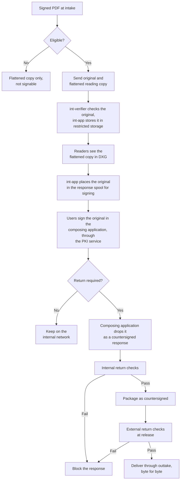

# Optional Signed PDF Passthrough and Return

**Companion to the DXG technical design**

|  |  |
| --- | --- |
| Status | Designed, disabled by default, not part of the POC or MVP |
| Date | 2026-11-04 |
| Audience | Security owner and service owner deciding on activation, and the developers who would build it |

This document belongs to the [technical design](document-exchange-mvp-technical-documentation.md) and uses its terms, settings, requirement IDs and test IDs. Section and appendix numbers that name the technical design refer to that document. All other section numbers refer to this one.

**This feature is disabled by default.** The POC and MVP do not depend on it. Section 3.6 of the [technical design](document-exchange-mvp-technical-documentation.md) lists the few items the MVP must reserve, so that activating the feature later needs no change to the package format.

This version follows the signing flow in which responses are signed in the composing application through the PKI service (section 3.4 of the [technical design](document-exchange-mvp-technical-documentation.md)). Section 2 lists what must be settled before activation.

## 1. Purpose

By default, an incoming signed PDF reaches the internal network as a flattened copy, which removes its signature. The two settings below allow an eligible original to stay byte-identical, receive more signatures on the internal network, and leave again with all of its signatures intact. Ordinary responses do not need this feature. They follow section 3.4 of the [technical design](document-exchange-mvp-technical-documentation.md).

| Setting | Default | Effect |
| --- | --- | --- |
| `SIGNED_PDF_PASSTHROUGH_ENABLED` | `false` | Eligible originals go to the internal network with a flattened reading copy |
| `SIGNED_PDF_RETURN_ENABLED` | `false` | That original, with added signatures, can leave as a `countersigned` response. Requires passthrough |

Each network reads its own settings, and a side with a setting off rejects that traffic. Both sides must be on for the feature to work. Settings change only through a reviewed configuration change, are recorded in the audit log, and have no switch in the consoles.

A new signature on a PDF is appended to the existing file, so this cannot work on a flattened copy. Any flattening also invalidates the earlier signatures.

## 2. Risk and open points

This is a deliberate exception to rule 1 in section 1.1 of the [technical design](document-exchange-mvp-technical-documentation.md), and to SR-09 and SR-18. It must not be activated without a written risk acceptance from the security owner.

Risks:

- A valid signature does not prove that a file is safe.
- The structural checks can find active content, but they cannot prove that fonts or images are free of exploits. An unchanged file can still attack the program that opens it.
- **The shared PKI service receives a file from the internet.** The composing application sends the original to the PKI service to have it signed, and `int-app` and `ext-release` send the countersigned file to it for validation. Without this feature, DXG never sends that service a file from the internet (SR-18).
- **The composing application handles a file from the internet.** It must pass the original to the PKI service without opening or rendering it.
- A returned PDF contains appended data that DLP cannot inspect, so it is a possible leak path.

Open points, to settle before activation:

1. **The server seal cannot be applied as it is today.** The PKI service flattens a document before it seals it, and that would destroy the signatures already on the original. Either the eSign-API gains a seal that appends without flattening (section 12.3 of the [technical design](document-exchange-mvp-technical-documentation.md)), or a countersigned response carries user signatures only.
2. **The append check is too narrow.** `signature_append_check.py` compares only page drawing commands, so a swapped page image passes. The return checks below add the comparison call of the eSign-API, which must be tested against such a file.

## 3. Eligibility at intake

A PDF is eligible only when every condition is true.

| Condition | Check |
| --- | --- |
| Passthrough is enabled on both sides | Configuration |
| Validation result is `TOTAL_PASSED` | `ext-validator` and the strict policy |
| The result was not an operator override | `review_accepted` is never eligible |
| Signer chains to an approved anchor | `SIGNED_PDF_TRUST_ANCHORS`, including any private CA |
| No active content, attachments, or fields other than signature fields | `pdf_policy.py signed` exits `0` |
| The document allows further signatures | `pdf_policy.py signed` exits `0`, not `2` |
| ClamAV finds nothing | Screening |
| Size is within `MAX_ITEM_BYTES` | Screening |

A file that fails any condition follows the default path. It reaches the internal network as a flattened copy with `signable: false`, and the reason is recorded.

## 4. Flow



## 5. Handling on the internal network

- `int-verifier` checks the original with `pdf_policy.py signed`. It cannot use the allowlist for flattened PDFs, because an original does not have the structure Dangerzone produces.
- `int-app` keeps the original in restricted storage. The DXG console has no download route for it.
- Readers see the flattened copy in the DXG console. It shows the whole file as it looks, with its visible signature stamps, and the console shows the signer details from the validation report.
- When a user asks to sign, `int-app` checks the hash of the original and places it in a `signable/` folder of the response spool (section 5.3 of the [technical design](document-exchange-mvp-technical-documentation.md)), with the request ID and the hash.
- The composing application passes the file to the PKI service without opening it. Each user signature is appended. The PKI service must never rewrite the file.

## 6. Return checks

The composing application drops the countersigned file as a response with `kind: countersigned` and the hash of the original.

Internal side, in `int-app`:

1. `signature_append_check.py`, with the original from restricted storage as its base, confirms the hash, that the file only appends to it, the size limit and at least one new signature.
2. `pdf_policy.py signed` confirms that no active content was added. Exit `2` is accepted here, because the final signer may lock the document.
3. The PKI service compares the original and the returned file (`compare-and-validate-signature`), with the strict policy. Every signature of the original must still be there and still `TOTAL_PASSED`, and the report must list no validation error.
4. The signature rule in section 3.4 of the [technical design](document-exchange-mvp-technical-documentation.md) applies to the added signatures: at least one at level `QESIG`, with a valid timestamp. The rows about the server seal depend on open point 1 in section 2.

External side, at release:

5. `ext-release` repeats `signature_append_check.py`, using the original from the evidence store. `ext-app` hands the original over with the release call, because `ext-release` runs on its own host. This does not depend on anything the internal network sends.
6. `ext-release` repeats step 3 and step 4 with the PKI service, with current revocation data.
7. The file is delivered byte for byte. Any correction is a new version from the composing application.

These checks limit the leak path, but they cannot prove the appended data is clean. `SIGNATURE_MAX_APPEND_BYTES` keeps it small. DLP is not run, because the text of the file is the sender's own.

## 7. Additional components and format

| Item | Purpose |
| --- | --- |
| Restricted original storage on `int-core` | Readable only by `int-app`, for the hand-over and for the return checks |
| `int-verifier` | Must accept `originals/` when the feature is on, and check them with `pdf_policy.py signed` |
| `signable/` folder in the response spool | Where `int-app` leaves an original for the composing application |
| Composing application | Must accept an original for signing, and must not open or render it |
| eSign-API | Must be able to add user signatures, and a seal if one is required, without rewriting the file |

The import manifest gains these fields for each eligible document:

```json
{
  "signable": true,
  "original": {
    "file": "originals/000001.pdf",
    "sha256": "5555555555555555555555555555555555555555555555555555555555555555",
    "bytes": 182044
  }
}
```

A `countersigned` response uses the manifest in appendix C.3 of the [technical design](document-exchange-mvp-technical-documentation.md), with two more fields that describe the original:

```json
{
  "schema": "dxg-response/1",
  "request_id": "0195f7a2-6f7e-7c1a-9a44-1b1f4c2e7d10",
  "version": 1,
  "kind": "countersigned",
  "file": "signed.pdf",
  "sha256": "6666666666666666666666666666666666666666666666666666666666666666",
  "bytes": 190412,
  "base_sha256": "5555555555555555555555555555555555555555555555555555555555555555",
  "base_bytes": 182044
}
```

## 8. Tests for activation

| ID | Scenario | Expected result |
| --- | --- | --- |
| T-70 | Eligible PDF with a valid signature | Original arrives byte-identical, with a flattened copy |
| T-71 | Signed PDF with JavaScript, attachment, link or non-signature field | Flattened copy only |
| T-72 | Certified PDF that allows no changes, or a signature field lock | Flattened copy only, marked not signable |
| T-73 | `review_accepted` or unapproved signer | Flattened copy only |
| T-74 | Setting on for one side only | Package rejected with `feature_disabled` |
| T-75 | User attempts to download the original from the DXG console | Refused and logged |
| T-76 | Original changed in storage | Hand-over for signing refused by hash check |
| T-77 | User signature added through the PKI service | Earlier signatures remain valid in the validation report and in a PDF reader |
| T-78 | Returned file with altered earlier bytes | Blocked as not append-only |
| T-79 | Returned file with a changed page image or page content under a new signature | Blocked by the comparison call |
| T-80 | Returned file with appended data and no new signature | Blocked |
| T-81 | Appended data over the size limit | Blocked |
| T-82 | Returned file that adds JavaScript or an attachment | Blocked |
| T-83 | Internal checks bypassed on a forged package | Blocked by the external check against the evidence store |
| T-84 | File bytes compared after delivery | Identical to the file the composing application dropped, and signatures validate |

## 9. Activation and deactivation

Before activation:

1. The security owner signs the risk acceptance, which names the exceptions to SR-09 and SR-18.
2. The two open points in section 2 are settled, and any change to the eSign-API is delivered.
3. The owner of the composing application confirms that it accepts an original for signing without opening it.
4. The records owner confirms how signed originals are retained on both networks.
5. Trust anchors and limits are chosen, and restricted storage is deployed.
6. T-70 to T-84 pass on real documents, because strict checks may reject some legitimate files.
7. Enable passthrough first. Enable return only after passthrough has run correctly.

To deactivate, set both settings to `false`. New signed PDFs then follow the default path. Originals already on the internal network stay in restricted storage until the records owner decides what to do with them.
