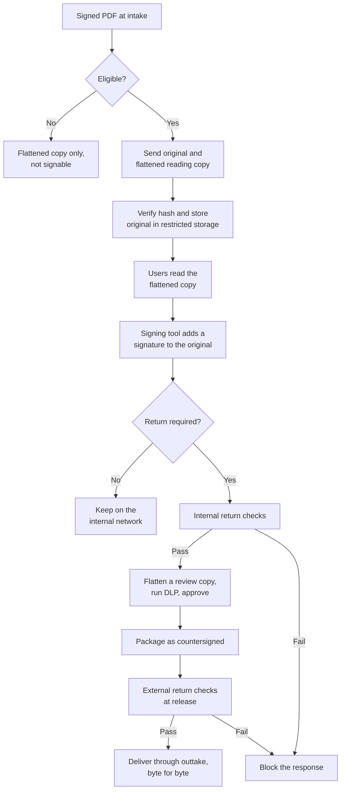

# Optional Signed PDF Passthrough and Return

**Companion to the DXG technical design**

|  |  |
| --- | --- |
| Status | Designed, disabled by default, not part of the POC or MVP |
| Date | 2026-11-04 |
| Audience | Security owner and service owner deciding on activation, and the developers who would build it |

This document belongs to the [technical design](document-exchange-mvp-technical-documentation.md) and uses its terms, settings, requirement IDs and test IDs. Section and appendix numbers that name the technical design refer to that document. All other section numbers refer to this one.

**This feature is disabled by default.** The POC and MVP do not depend on it. Section 3.6 of the [technical design](document-exchange-mvp-technical-documentation.md) lists the few items the MVP must reserve, so that activating the feature later needs no change to the package format.

## 1. Purpose

By default, an incoming signed PDF reaches the internal network as a flattened copy, which removes its signature. The two settings below allow an eligible original to stay byte-identical, receive more signatures on the internal network, and leave again with all of its signatures intact. New responses created on the internal network do not need this feature. They follow section 3.4 of the [technical design](document-exchange-mvp-technical-documentation.md).

| Setting | Default | Effect |
| --- | --- | --- |
| `SIGNED_PDF_PASSTHROUGH_ENABLED` | `false` | Eligible originals go to the internal network with a flattened reading copy |
| `SIGNED_PDF_RETURN_ENABLED` | `false` | That original, with added signatures, can leave as a `countersigned` response. Requires passthrough |

Each network reads its own settings, and a side with a setting off rejects that traffic. Both sides must be on for the feature to work. Settings change only through a reviewed configuration change, are recorded in the audit log, and have no switch in the consoles.

A new signature on a PDF is appended to the existing file, so this cannot work on a flattened copy. Any flattening also invalidates the earlier signatures, whichever sanitization product is used.

## 2. Risk

This is a deliberate exception to rule 1 in section 1.1 of the [technical design](document-exchange-mvp-technical-documentation.md) and to SR-09. It must not be activated without a written risk acceptance from the security owner.

- A valid signature does not prove that a file is safe.
- The structural checks can find active content, but they cannot prove that fonts or images are free of exploits. An unchanged file can still attack the program that opens it.
- A returned PDF contains appended data that DLP cannot fully inspect, so it is a possible leak path.

## 3. Eligibility at intake

A PDF is eligible only when every condition is true.

| Condition | Check |
| --- | --- |
| Passthrough is enabled on both sides | Configuration |
| Validation result is `TOTAL_PASSED`, with full scope | DSS and the strict policy |
| The result was not an operator override | `review_accepted` is never eligible |
| Signer chains to an approved anchor | `SIGNED_PDF_TRUST_ANCHORS`, including any private CA |
| No active content, attachments, or fields other than signature fields | `pdf_policy.py signed` exits `0` |
| The document allows further signatures | `pdf_policy.py signed` exits `0`, not `2` |
| ClamAV finds nothing | Screening |
| Size is within `MAX_ITEM_BYTES` | Screening |

A file that fails any condition follows the default path. It reaches the internal network as a flattened copy with `signable: false`, and the reason is recorded.

## 4. Flow



## 5. Handling on the internal network

- The original goes to restricted storage. It has no download route, and only the signing tool can open it.
- Users read the flattened copy. It shows the signed revision, so the latest signature's visible stamp is absent, and the console shows the signer details from the report.
- The file hash is checked before each signing action.
- The signing tool appends a signature, and must never save the file in a way that rewrites it.

Choose the signing tool when activating the feature. It must be patched, isolated and have JavaScript disabled. Options include:

- An internal signing service using smart cards, tokens or an HSM
- A locked-down desktop PDF application on a dedicated workstation

## 6. Return checks

Internal side, before approval:

1. `signature_append_check.py`, with the original as its base, confirms the hash, that the file only appends to it, the size limit, at least one new signature, and unchanged page content.
2. `pdf_policy.py signed` confirms that no active content was added. Exit `2` is accepted here, because the final signer may lock the document.
3. DSS on `int-validator` runs with the strict policy, using internal trust anchors and a reviewed trust-list snapshot. `UndefinedChanges` and the other strict checks must pass.
4. `int-sanitizer` flattens a copy of the returned file. DLP and the approver use this copy, and never open the signed file directly.
5. A different user approves the response, with `kind: countersigned`.

External side, at release:

6. `ext-release` repeats `signature_append_check.py`, using the original from the evidence store. This does not depend on anything the internal network sends.
7. `ext-response-validator` validates the file with current revocation data, and the internally added signature must meet the rule in section 3.4 of the [technical design](document-exchange-mvp-technical-documentation.md).
8. The file is delivered byte for byte. Any correction is a new version from the internal side.

The internal network has no route to a public timestamp service. If long-term validation is required, use an internal timestamp authority. Anything added on the external side would need these checks to run again, and is not part of this design.

These checks limit the leak path, but they cannot prove the appended data is clean. `SIGNATURE_MAX_APPEND_BYTES` keeps it small.

## 7. Additional components and format

| Item | Purpose |
| --- | --- |
| Restricted original storage on `int-core` | Readable only by the signing tool and the check service |
| Signing tool | Section 5. It must open the original, which the MVP signing flow does not allow |

The import manifest gains these fields for each eligible document:

```json
{
  "signable": true,
  "original": {
    "file": "originals/000001.pdf",
    "sha256": "5555555555555555555555555555555555555555555555555555555555555555",
    "bytes": 182044
  }
}
```

A `countersigned` response uses the manifest in appendix C.3 of the [technical design](document-exchange-mvp-technical-documentation.md), with the original as its base:

```json
{
  "schema": "dxg-response/1",
  "request_id": "0195f7a2-6f7e-7c1a-9a44-1b1f4c2e7d10",
  "version": 1,
  "kind": "countersigned",
  "file": "signed.pdf",
  "sha256": "6666666666666666666666666666666666666666666666666666666666666666",
  "bytes": 190412,
  "base_sha256": "5555555555555555555555555555555555555555555555555555555555555555",
  "base_bytes": 182044
}
```

## 8. Tests for activation

| ID | Scenario | Expected result |
| --- | --- | --- |
| T-70 | Eligible PDF with a valid signature | Original arrives byte-identical, with a flattened copy |
| T-71 | Signed PDF with JavaScript, attachment, link or non-signature field | Flattened copy only |
| T-72 | Certified PDF that allows no changes, or a signature field lock | Flattened copy only, marked not signable |
| T-73 | `review_accepted` or unapproved signer | Flattened copy only |
| T-74 | Setting on for one side only | Package rejected with `feature_disabled` |
| T-75 | User attempts to download the original | Refused and logged |
| T-76 | Original changed in storage | Signing refused by hash check |
| T-77 | Second signature added | Earlier signatures remain valid in DSS and in a PDF reader |
| T-78 | Returned file with altered earlier bytes | Blocked as not append-only |
| T-79 | Returned file with changed page content under a new signature | Blocked as page content changed |
| T-80 | Returned file with appended data and no new signature | Blocked |
| T-81 | Appended data over the size limit | Blocked |
| T-82 | Returned file that adds JavaScript or an attachment | Blocked |
| T-83 | Internal checks bypassed on a forged package | Blocked by the external check against the evidence store |
| T-84 | File bytes compared after delivery | Identical to the approved file, and signatures validate |

## 9. Activation and deactivation

Before activation:

1. The security owner signs the risk acceptance.
2. The records owner confirms how signed originals are retained on both networks.
3. The signing tool, trust anchors and limits are chosen.
4. Restricted storage is deployed.
5. T-70 to T-84 pass on real documents, because strict checks may reject some legitimate files.
6. Enable passthrough first. Enable return only after passthrough has run correctly.

To deactivate, set both settings to `false`. New signed PDFs then follow the default path. Originals already on the internal network stay in restricted storage until the records owner decides what to do with them.
